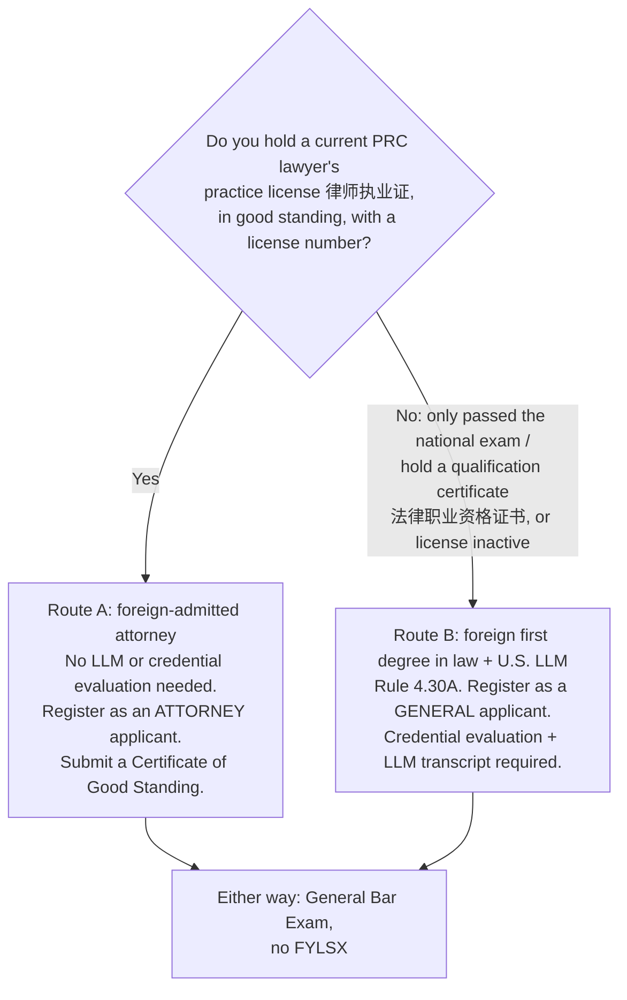

# Admissions checklist: July 2027 (foreign-educated applicant)

> **Read §1 first.** Two facts decide whether you can sit in July 2027, and only you or the State Bar can confirm them. Everything else is a dated to-do list.

## 1. Which eligibility route are you on?

California law requires an applicant whose legal education was in a non-common-law country to "demonstrate to the satisfaction of the State Bar that the person's education, experience, and qualifications qualify them to take the examination" (Bus. & Prof. Code § 6060) [S-046]. For you there are two possible routes:

### Route A: foreign-admitted attorney
- **The rule.** "If you are fully admitted to the practice of law (without any restrictions) in a country outside of the U.S., you may be eligible to take the California bar exam without additional legal education" [S-049].
  - The staff standard: an applicant is eligible "only if the applicant can practice without restrictions before the highest professional bar admission regulation or licensing authority" [S-050].
- **The certificate.** You prove admission with a **Certificate of Good Standing (CGS)** from the highest licensing authority [S-051]. It must:
  - be issued **within 6 months**;
  - show your license number, admission date, current good standing and disciplinary history;
  - carry a signature, stamp or seal;
  - come with a certified English translation **plus the original**.
- **Registration.** You register and pay as an **attorney applicant** [S-049].
- **The PRC question** [VERIFY V-012]:
  - No State Bar source names the PRC.
  - Under the "practice without restrictions" standard, **passing the National Unified Legal Professional Qualification Exam (法律职业资格考试) alone very likely does not count.** That exam gives a qualification certificate, not a practice license.
  - A secondary source says a PRC practice license requires the exam plus one year of supervised practice [S-075].
  - A license that is suspended or inactive may also fail the "without restrictions" test. This can happen, for example, when a PRC lawyer moves to a foreign firm's representative office or leaves practice.
  - **Action:** tell me which document you hold. If it is a practice license, ask the State Bar's Office of Admissions in writing whether it qualifies, and which PRC authority issues an acceptable CGS (municipal/provincial justice bureau or lawyers association).

### Route B: foreign first degree in law plus a U.S. LLM (rule 4.30(A))
- **The rule.** Foreign-educated applicants qualify as general applicants if they "have a first degree in law, acceptable to the Committee, from a law school in the foreign state or country and have completed a year of legal education at an American Bar Association Approved Law School or a California accredited law school in areas of law prescribed by the Committee" [S-047].
- **The Committee's Guidelines (2024 revision)** [S-052] [S-053] [VERIFY V-013]:

| Requirement | LLM degree awarded | 20 LLM units, no degree |
|---|---|---|
| Minimum units | 20 semester (or equivalent) units | 20 semester (or equivalent) units |
| Professional Responsibility course (ABA Model Rules + leading case law) | **Required** | **Required** |
| 12 units in 3 separate bar-tested subjects | "Suggested, but not required" | **Required** |
| Time limit | Within 36 consecutive months of starting qualifying study | Same |

  - An older State Bar web page still says the bar-subject units are mandatory for the degree route ("one course in four separate subjects") and gives a "three calendar years" limit.
- **You already satisfy both versions on coursework.** Your bar-tested courses are Corporations (Business Associations), Property, Torts, Evidence, and Trusts & Estates, which is five. Professional Responsibility is in your Fall cohort. Make sure **Professional Responsibility appears on the transcript**.
- **Online LLM** [VERIFY V-014]:
  - No State Bar text accepts or excludes online LLM units.
  - Cardozo says its online LLM is "designed to meet the educational requirements" for California, but adds that eligibility "is determined solely by ... the California Committee of Bar Examiners" [S-054] (secondary).
  - Another school describes online LLM eligibility as decided "case-by-case" by the State Bar [S-055] (secondary).
  - **Get a written eligibility determination from the State Bar now, not in June 2027.**
- **Credential evaluation.** A State Bar-approved credential evaluator (a NACES member) must prepare a course-by-course evaluation of your Fudan LLB **and** the State Bar's *Foreign Law Study Evaluation Summary* form [S-048] [S-056] [VERIFY V-017].
  - The evaluation is "advisory"; the State Bar makes the final call [S-048].
  - Agency fees and turnaround times are not published by the State Bar. Allow time for Fudan to issue certified transcripts and for translation.
- **Timing: the biggest threat on this route.**
  - Once you finish, you must **mail an official sealed LLM transcript** to the Office of Admissions (845 S. Figueroa St., Los Angeles, CA 90017). Electronic transcripts are not accepted [S-048].
  - It must be **received by the final eligibility deadline, two weeks before the exam**. That was July 14, 2026 for the July 2026 exam [S-058] and Feb 9, 2027 for the February 2027 exam [S-004].
  - **For July 2027 that is about Tuesday, July 13, 2027** [VERIFY V-016].
  - If your degree is certified but not yet posted, the State Bar may clear you conditionally for **one** administration [S-057]. It is unconfirmed how this applies to LLM applicants [VERIFY V-015].

### FYLSX (the "baby bar"): does not apply to you
- **Route A:** you are an attorney applicant. The FYLSX is a general-applicant requirement [S-047].
- **Route B:** rule 4.30(A) carries no FYLSX condition. Only rule 4.30(B) does (foreign legal study **without** a first law degree) [S-047] [S-048].
- A Fudan LLB is a first degree in law, subject to the credential evaluation.

### You take the General Bar Exam, not the Attorneys' Exam
- "Attorneys admitted in foreign jurisdictions must take the General Bar Exam" [S-074].
- The Attorneys' Exam requires at least 4 years' active admission in a **U.S.** jurisdiction [S-074].

## 2. Threats to a July 2027 sitting (ranked)

| # | Threat | Why it matters | What to do now |
|---|---|---|---|
| 1 | **LLM finishes too late** (Route B) | The sealed transcript must *arrive* about July 13, 2027. If Cardozo's final quarter ends in summer 2027, you cannot sit in July 2027 on the degree route. The non-degree "20 units" option may still work, but only if PR plus 12 bar-subject units are complete and on a sealed transcript by then [VERIFY V-015]. | Tell me Cardozo's final-term end date and when it issues final transcripts. If it is later than about late June 2027, ask Cardozo and the State Bar about the non-degree option or about moving a course earlier. |
| 2 | **Online LLM not accepted** | No primary text addresses it [VERIFY V-014]. | Write to the Office of Admissions now (Applicant Portal general request) for an eligibility determination. |
| 3 | **"China bar" status** | Decides Route A vs. Route B, the fees and the documents [VERIFY V-012]. | Confirm which PRC certificate you hold; see §1. |
| 4 | **Credential evaluation lead time** (Route B) | Depends on Fudan transcripts, translation and agency processing. | Order it in **November 2026**. |
| 5 | **Only one fallback on this format** | If you cannot sit, or fail, in July 2027, the **only** retake on this format is **February 2028** (last Tuesday of Feb 2028 = Feb 29). From July 2028 the exam is NextGen [S-020]. | Treat July 2027 as the real attempt; see [format-change-tracker.md](format-change-tracker.md). |
| 6 | **Moral character delays admission, not the exam** | Processing takes at least 6 months after the file is complete [S-062]. | File by **January–February 2027** (see §3). |

## 3. Dated checklist (November 2026 → admission)

Status key: ☐ to do · ☑ done. **(est.)** = the July 2027 date is not yet published and is estimated from the Rules of the State Bar and the 2026 pattern [VERIFY V-016].

| When | Task | Detail | Source |
|---|---|---|---|
| ☐ **Nov 2026 (now)** | Decide the route | Answer the §1 PRC question. Tell me Cardozo's final-term dates. | — |
| ☐ Nov 2026 | **Register** with the State Bar (Applicant Portal), if not already registered | Registering is *not* applying for the exam. You must register before the moral character application. Fee: **$155** general / **$310** attorney applicant. Missing items must be supplied within 60 days or the file is abandoned. Law students must register within 90 days of starting law study [VERIFY V-019]. | [S-059] [S-028] [S-001] |
| ☐ Nov 2026 | Request a **written eligibility determination** | Online LLM, coursework, timing of the transcript. | [S-054] [S-055] |
| ☐ Nov 2026 | Route B: order the **credential evaluation** | NACES agency on the State Bar list; course-by-course evaluation plus the Foreign Law Study Evaluation Summary. | [S-048] [S-056] |
| ☐ Nov 2026 | Route A: line up the **CGS** | It must be dated within 6 months of submission, so plan a fresh one dated about **February–June 2027**. You need the original plus a certified translation. Whether the PRC is on the electronic-delivery list is unknown, so allow for international mail. | [S-051] |
| ☐ Fall 2026 | **Professional Responsibility** course on the LLM transcript | Required on Route B. Also doubles as MPRE preparation. | [S-052] |
| ☐ **by Thu Jan 21, 2027** | **Register for the March 2027 MPRE** | Test dates **Mar 23–24, 2027**. Fee $185. "Absolutely no new registrations will be accepted after the deadline." | [S-066] |
| ☐ Dec 2026 – **Feb 2027** | File the **moral character application** | Can be filed any time after registration. The State Bar suggests at least 8–10 months before your target admission date. Processing takes at least 180 days after the file is complete (6–8 months typically). A positive determination is valid 36 months. **Not required to sit**, but required for admission. Fee **$900** general / **$1,054** attorney. | [S-062] [S-063] [S-028] |
| ☐ with moral character | **Fingerprints** | You live in California, so use **Live Scan** with the State Bar's "Request for Live Scan Service" form and photo ID. The fee is set by the Live Scan operator [VERIFY V-020]. | [S-064] |
| ☐ late Jan 2027 (if needed) | **Testing accommodations** request | The State Bar encourages filing about 6 months ahead. The hard deadline is the final filing deadline (**June 1**). MPRE accommodations are separate, through NCBE. | [S-069] [S-068] |
| ☐ **Mar 23–24, 2027** | **Take the MPRE** | California pass mark **86**. NCBE shows no age limit on scores for California. It must be passed **before admission**, not before the bar exam. Fallback dates: Aug 18–19 (register by Jun 17) or Nov 4–5, 2027 (register by Sep 21). | [S-065] [S-066] [S-067] |
| ☐ ~**Mon Mar 1, 2027** (est.) | July 2027 exam **application opens** | 2026 pattern: opened March 1. | [S-061] |
| ☐ **by Thu Apr 1, 2027** (est.) | **File the exam application on time** | Rule: timely by April 1 for July, late (with fees) by June 1. Fee **$878** general / **$1,650** attorney, plus **$153** laptop fee. Choose **typing (laptop)** and a **San Diego-area test site** (July 2026 sites included DoubleTree San Diego Mission Valley and Chula Vista). | [S-042] [S-028] [S-029] |
| ☐ Apr 2 – Jun 1, 2027 (est.) | Late window (avoid) | $50 late fee through late April; $250 from the last business day of April. **Nothing is accepted after the final deadline.** | [S-060] [S-042] |
| ☐ **by ~late June 2027** | **Mail the sealed LLM transcript** (Route B) or the **CGS** (Route A) | It must be *received* by the final eligibility deadline, **about Tue July 13, 2027** (est.). Electronic transcripts are not accepted. | [S-048] [S-058] |
| ☐ ~late Jun 2027 (est.) | **Admittance ticket** | 2026: notices began June 30. A ticket is withheld if eligibility or accommodations are pending. | [S-003] |
| ☐ ~early Jul 2027 (est.) | Test-center change deadline | 2026: July 6. | [S-061] |
| ☐ **by ~Fri Jul 23, 2027** (est.) | **Examplify registration and mock exam** uploaded | Missing it means you must handwrite. 2026 deadline: July 24. | [S-008] [S-009] |
| ☐ **Tue–Wed Jul 27–28, 2027** | **Exam** | Day 1 written; Day 2 MBE. | [S-001] |
| ☐ Thu Jul 29, 2027, noon PT (est.) | **Upload answer files** | A late upload costs 10 written scaled points. | [S-009] |
| ☐ late Oct – early Nov 2027 (est.) | **Results** | July 2026 results came out Oct 30, 2026. | [S-012] |
| ☐ after passing | **Admission** | Certification needs (1) a positive moral character determination, (2) a passing MPRE on file, (3) compliance with any support orders, (4) administrative issues cleared. Then: Supreme Court order, then the **oath** (can be taken outside California), which must be **within 5 years** of the exam. First license fee $598 (Jan–May) / $299 (Jun–Nov). | [S-070] [S-071] [S-028] |
| ☐ after admission | **New Attorney Training** | 10 hours online (ethics, basic skills, competence, elimination of bias). The completion deadline is unconfirmed [VERIFY V-020]. | [S-072] |

## 4. Fees at a glance (2026 schedule; confirm the 2027 schedule)

| Item | General applicant (Route B) | Attorney applicant (Route A) | Source |
|---|---|---|---|
| Registration | $155 | $310 | [S-028] |
| Moral character application | $900 | $1,054 | [S-028] |
| Exam application | $878 | $1,650 | [S-028] |
| Laptop fee | $153 | $153 | [S-028] |
| Late filing fees | $50, then $250 | $50, then $250 | [S-060] |
| MPRE (NCBE) | $185 | $185 | [S-066] |
| First annual license fee | $598 / $299 by admission month | same | [S-070] |
| **Typical total before admission** | **≈ $2,271** + credential evaluation | **≈ $3,352** | computed |

The switch fee from handwriting to laptop is $60. A separate $100 "late laptop" figure appears in one version of the schedule [VERIFY V-018].

## 5. Other requirements checked
- **Pre-admission competency or pro bono training:** proposed in 2013–2014, later narrowed to a requirement that law schools *offer* practice-based courses. No requirement binding on applicants for 2027–2028 admission was found [S-073].
- **Score transfer:** not possible. California accepts no transferred UBE or MBE scores and has no admission on motion [S-043].
- **California-specific professional responsibility exam:** none found. The **MPRE** is the requirement [S-065].
