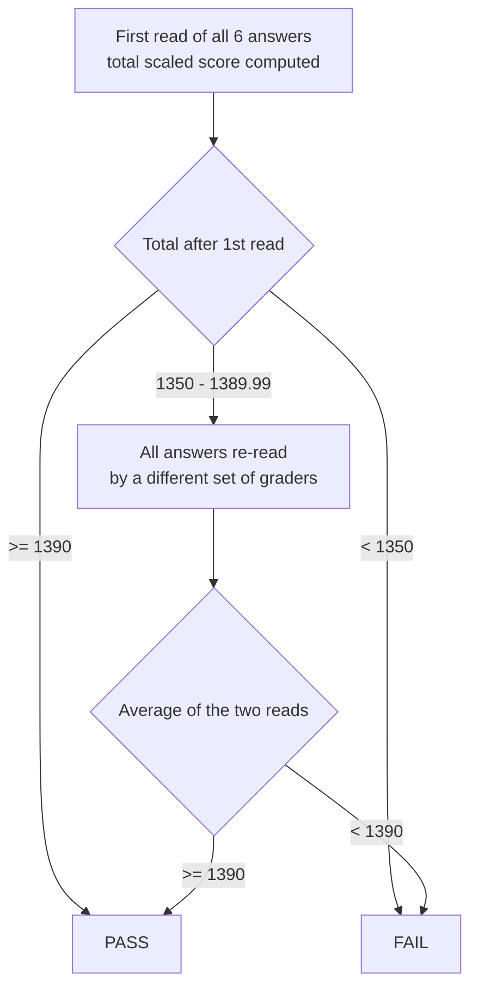

# July 2027 California Bar Exam: format and scoring

> **Verification note.** Every fact here was checked on 2026-11-04 against State Bar, Supreme Court, Legislature or NCBE pages, but through a search index rather than by opening the page (see `sources.md`). Re-run `/update-exam-intel` monthly. The State Bar says more July 2027 details "will be published at a later date" [S-001].

## 1. At a glance

| Item | July 2027 fact | Source |
|---|---|---|
| Exam | California **General Bar Examination** (GBX). You are not eligible for the Attorneys' Exam, which requires U.S. admission ([admissions-checklist.md](admissions-checklist.md)). | [S-001] |
| Dates | **Tuesday July 27 and Wednesday July 28, 2027** | [S-001] [S-002] |
| Standing rule | The GBX "will continue to be administered in-person on the last Tuesdays in February and July each year" until NextGen replaces it. | [S-005] |
| Delivery | **In person only.** Essays and the PT are typed on your own laptop in **ExamSoft Examplify**. Handwriting is an option you choose on the application. The MBE is on paper (Scantron, #2 pencil, no laptop). | [S-003] [S-004] [S-008] |
| Day 1 (Tue), written | **AM (3 h):** Essays 1–3. **PM (3.5 h):** Essays 4–5 plus the 90-minute Performance Test (PT). | [S-003] |
| Day 2 (Wed), MBE | **200 multiple-choice questions** in two 3-hour sessions of 100. No scheduled breaks inside a session. You can move between questions within a session but cannot return to a closed session. | [S-003] [S-004] [S-006] |
| MBE scoring | **175 scored + 25 unscored pretest** questions, which you cannot tell apart. 25 scored questions in each of the 7 subjects. | [S-006] [S-007] |
| Passing score | **1390 out of 2000** total scaled score (in effect since July 2020) | [S-011] [S-005] |
| Weighting | Total = 0.50 × MBE scaled + 0.50 × written scaled | [S-011] [S-010] |
| Written raw maximum | 700 = 5 essays × 100 + the PT × 2 × 100 (the PT counts as two essays) | [S-010] [S-011] |
| Results | July 2026 results came out Oct 30, 2026 through the Applicant Portal. Feb 2027 results are scheduled for Apr 30, 2027. The July 2027 date is not yet published; by pattern, expect late October or early November 2027. | [S-012] [S-035] [S-004] |
| Score transfer | California accepts **no** transferred UBE or MBE scores and has no admission on motion. | [S-043] |

### Seating and session rules (July 2026 bulletin; confirm for 2027)
- You must be seated by **8:20 a.m.** Afternoon re-entry is around 1:30 p.m. Anyone arriving **one hour or more after a session starts is refused admission** [S-003].
- Desktop computers and tablets with detachable keyboards (e.g., iPad, Surface Pro) are not allowed [S-008].
- You **must complete and upload the Examplify mock exam** by the deadline. Otherwise you are required to handwrite. The July 2026 deadline was July 24 [S-008] [S-009].
- Answer files must be uploaded by the deadline after the exam (July 2026: Thursday noon PT). A **late upload costs 10 scaled points** from your written scaled score [S-009].

### Timing inside the written sessions
- The State Bar describes the written section as "five one-hour essays and one 90-minute Performance Test" [S-003].
- Essays 1–3 share one 3-hour session, and Essays 4–5 and the PT share one 3.5-hour session. The July 2026 bulletin lets you answer a session's questions **in any order** and **allocate the time within the session as you see fit**; once a session ends you cannot go back to its questions [S-003]. **Still plan as if every essay gets exactly 60 minutes and the PT exactly 90.** Overrunning one essay is the most common way to lose a whole answer's worth of points.

## 2. How the written section is graded

| Step | Rule | Source |
|---|---|---|
| Raw grade | Graders score each essay and the PT **40–100 in 5-point steps**. To earn at least 40, an answer must identify the subject and attempt to apply law to facts; otherwise it gets **0**. | [S-010] |
| What is *not* graded | "The quality of handwriting or the accuracy of spelling and grammar are not considered." | [S-010] |
| Anonymity | Answers are identified only by code number. | [S-010] |
| Calibration | Grading groups (experienced graders plus apprentices) calibrate on sample answers before grading. Details are in [grader-expectations.md](grader-expectations.md). | [S-010] |
| Raw → scaled | Each administration uses its own linear formula to convert written raw scores to the MBE's scale. **Feb 2026:** written scaled = raw × 4.0700 − 399.0100. | [S-011] |
| Total | 0.5 × MBE scaled + 0.5 × written scaled | [S-011] |

### Phased grading (the "re-read")

- These thresholds come from the State Bar's grading page and the Feb 2026 bulletin [S-010] [S-011].
- **Rounding:** "Any score between 1389.0001 and 1389.9999 is rounded to 1390 and deemed a passing score" [S-011].
- The old third phase of grading was eliminated when the cut score dropped from 1440 to 1390 in July 2020 [S-036] [VERIFY V-003].
- **Appeals:** I found no State Bar process for appealing a grade on the merits. Do not count on one [VERIFY V-004].

### What the score math means for you

These figures use the **Feb 2026 formula** for illustration only. The formula changes every administration, and July cohorts usually score differently from February ones.

| Your MBE scaled | Written scaled needed | Written raw needed (of 700) | Average raw per graded unit (7 units) |
|---|---|---|---|
| 1450 | 1330 | ≈ 425 | ≈ 60.7 |
| 1430 | 1350 | ≈ 430 | ≈ 61.4 |
| 1390 | 1390 | ≈ 440 | ≈ 62.8 |
| 1350 | 1430 | ≈ 449 | ≈ 64.2 |

- With that formula, **one raw point ≈ 4.07 written-scaled points ≈ 2.04 total-scaled points.** So one essay moving from 60 to 65 adds about 10 total scaled points, and the PT moving from 60 to 65 adds about **20**, because it is doubled.
- **The PT is worth two essays.** It is also the part of the exam least dependent on memorized law, so it is your highest-return written skill. The study plan gives it dedicated weekly practice.
- A realistic passing profile is **mostly 60s and 65s on the written section with no answer below 55, plus an MBE comfortably above the pass line.** A single 40 or 45 (for example, from running out of time) is very hard to recover from.
- California reports the MBE on the same 2000-point scale as the written section. The July 2026 California mean scaled MBE was 1377 [S-012]. Reading this as NCBE's 200-point scaled score × 10 is my inference [VERIFY V-005].

## 3. The November 2024 "study" adjustment does not apply to you
- Applicants who answered at least 28 of 49 experimental questions in the Nov 2024 study received +40 MBE scaled (+20 total) [S-011].
- The Supreme Court limited it to "the first bar exam they take during 2025 or 2026" [S-038]. A July 2027 sitting falls outside that window. `/update-exam-intel` should flag any order extending it.

## 4. Pass rates (context for your plan)

| Administration | GBX overall | GBX first-time | Source |
|---|---|---|---|
| Feb 2024 | 33.9% | 44.8% | [S-017] |
| Jul 2024 | 53.8% | 68.2% | [S-016] |
| Jul 2025 | 54.8% | 69.7% (adjusted) | [S-015] [S-014] |
| Feb 2026 | 30.8% | 43.9% | [S-013] |
| Jul 2026 | 48.3% | 64.7% | [S-012] |

- Feb 2025 is left out. The State Bar published several figures at different stages of the scoring remedies, and they conflict.
- July 2026 was the State Bar's "lowest July pass rate over the last five years," with a California mean scaled MBE of 1377 [S-012].

**Foreign-educated applicants (the category you will be in):**

| Administration | Category | First-time pass rate | Source |
|---|---|---|---|
| Jul 2025 | Foreign-educated / JD-equivalent | **18.8%** (49 of 261). Repeat 6.2%; all takers 13.4%. | [S-014] |
| Jul 2026 | Foreign-educated, JD-equivalent + one year U.S. education | **12.9%** (preliminary). Repeat 10.2%. | [S-012] [VERIFY V-007] |

For comparison, first-time takers from California ABA-accredited schools passed at **84.4%** in July 2025 and **78.1%** in July 2026 [S-014] [S-012].

**What this means.** For your applicant category, the first-time base rate is roughly **1 in 5 to 1 in 8** (18.8% in July 2025, 12.9% in July 2026). Many applicants in that category sit with little US-doctrine background and limited prep time. You have an LL.M., a structured 38-week plan and an intensive phase of 36–38 h/week from May (alongside your job, with no study leave), so the base rate is not your forecast. It is a warning that this exam punishes under-preparation, especially in **writing speed in English** and **MBE volume**. The plan's checkpoints are set against the pass line, not against the average.

## 5. Context: why the format is stable for July 2027
- **February 2025:** the State Bar briefly replaced the MBE with its own questions (developed by Kaplan, with some AI-assisted items) and offered remote testing. After widespread technical failures, the Supreme Court ordered in-person testing and a return to the NCBE MBE starting July 2025 [S-023] [S-022] [S-033].
- **Statutory notice:** Bus. & Prof. Code § 6046.6 bars changes that substantially alter the preparation needed to pass "except after giving two years' notice" [S-019].
  - SB 253 (Ch. 405, Stats. 2025) added 18 months' notice to change the multiple-choice vendor, two years' notice for remote testing, and 120 days' notice for testing-software or medium changes [S-018] [VERIFY V-008].
  - Cal. Rules of Court, rule 9.6 (amended eff. Oct 1, 2025) requires Supreme Court approval and a cost-benefit analysis for substantial changes [S-021].
- **Result:** no change has been announced for July 2027 [S-001]. The NextGen switch starts **July 2028**, with notice given July 15, 2026 [S-020]. See [format-change-tracker.md](format-change-tracker.md).

## 6. Open items for this file
- July 2027 application deadlines, test sites, laptop-registration window and results date: **not yet published.** They are tracked in [admissions-checklist.md](admissions-checklist.md) and refreshed by `/update-exam-intel`.
- V-003, V-004, V-005, V-007 and V-008 in `VERIFY-QUEUE.md` (V-002 and V-006 were resolved in Phase 7).
