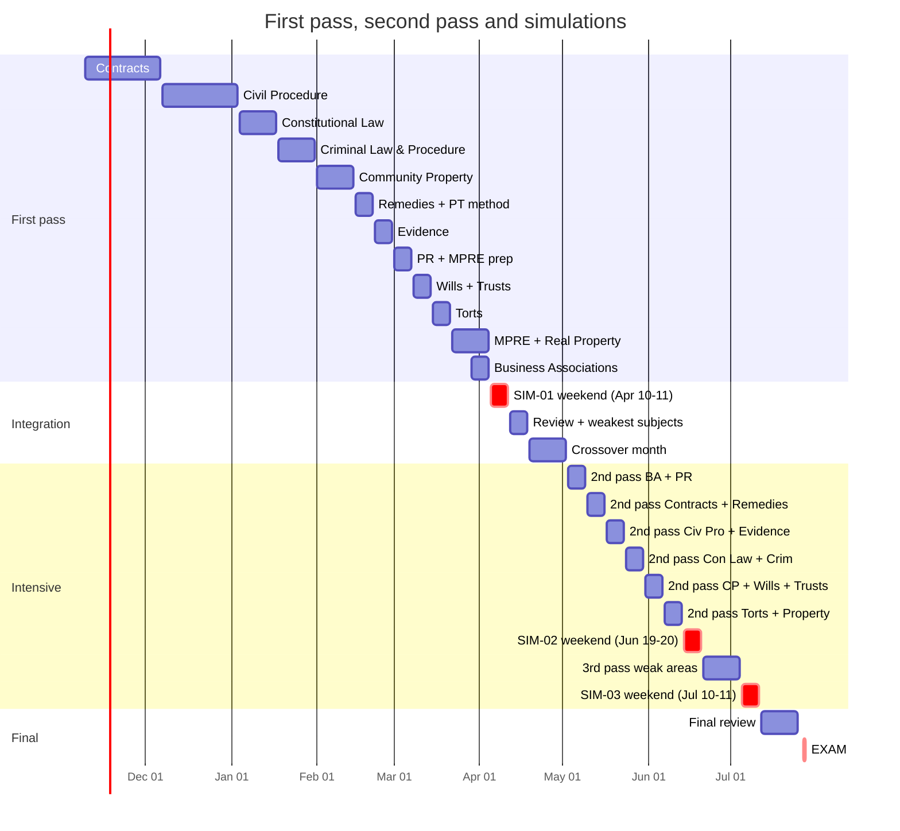

# Master study plan: Nov 9, 2026 → July 27, 2027

> **Revised 2026-11-04 with your inputs:**
> - Eligibility is settled: Route B, and Cardozo has confirmed it.
> - The LL.M. ends May or June 2027.
> - **There is no study leave.**
> - **From December you can study 3–4 h every weekday + about 20 h on weekends.**
> - You'll buy licensed practice questions as needed.
> - The repo is built in the agreed order.

**At a glance**

| | |
|---|---|
| Duration | **38 weeks**: 2026-W46 to 2027-W30 |
| Total study time | **≈ 1,200 hours**: Nov 10–12 h/week; **Dec–Jul 28–38 h/week** while working |
| Practice | **≈ 3,140 MBE questions · 109 timed essays · 74 issue-spotting drills · 17 PTs · 3 full simulations** (justified in [practice-targets.md](practice-targets.md)) |
| Shape | **First pass of all 13 subjects done by Mar 28** → April diagnostic and second pass → May–July second and third passes with heavy timed practice |
| Work | Full-time throughout; no leave; **PTO Mon–Thu Jul 26–29** for exam week |
| Key dates | MPRE Mar 23–24 · exam application timely by about Apr 1 · **SIM-01 Sat–Sun Apr 10–11** · SIM-02 Sat–Sun Jun 19–20 (week −6) · SIM-03 Sat–Sun Jul 10–11 (week −3) · **exam Jul 27–28** |

The week-by-week source of truth is [`schedule.yml`](schedule.yml), rendered into `weeks/<ISO week>.md` by `python scripts/build_weeks.py`. To change the plan, edit `schedule.yml` and re-render with `--from <week>`. `/weekly-review` does this.

## 1. Phases

| Phase | Dates | Weeks | Hours/week | Focus |
|---|---|---|---|---|
| **Foundation: first pass** | Nov 9 – Mar 28 | 20 | Nov 10–12 · **Dec–Mar 28–35** (finals week 15) | Learn every subject once, in order. **Gap subjects:** Contracts → Civil Procedure → Constitutional Law → Criminal Law & Procedure (Nov–Jan). **Then:** Community Property → Remedies → Evidence → PR → Wills & Trusts → Torts → Real Property (Feb–Mar). MPRE Mar 23–24. Daily MBE and flashcards. |
| **Integration** | Mar 29 – May 2 | 5 | 36 | Finish Real Property; Business Associations; **diagnostic SIM-01 (Apr 10–11)**; second pass on the weakest subjects; crossover month; weekly PTs. |
| **Intensive** | May 3 – Jul 11 | 10 | 36–38 (no leave) | Second pass of all subjects in pairs; third pass on weak areas. Timed essays on weeknights; PTs and long MBE sets on weekends. **SIM-02 (week −6)** and **SIM-03 (week −3)**. |
| **Final review** | Jul 12 – Jul 25 | 2 | 32–35 | SIM-03 review, high-yield sets, attack outlines, light timed practice, logistics. |
| Exam week | Jul 26 – 29 (PTO) | 1 | — | Light review Monday; exam Tue–Wed; upload Thursday. |

## 2. Why the plan is shaped this way

1. **Use the December capacity to finish the first pass early.** At 30–35 h/week from December, every subject gets a full first pass by **March 28**. That leaves April–July for what moves scores most: second and third passes, timed practice and simulations. Dec–Mar runs a little **below** your 35–40 h ceiling, leaving room for LL.M. coursework (Fall finals, then your final term).
2. **Gap subjects first, in your order.**
   - Contracts, about 4 weeks: the UCC overlay is about a quarter of Contracts MBE questions [S-040].
   - Civil Procedure, about 4 weeks across the holidays.
   - Constitutional Law, 2 weeks.
   - Criminal Law & Procedure, 2 weeks.
3. **California-only subjects follow** (Community Property, Remedies, then Wills & Trusts). Your Fall LL.M. subjects (Evidence, PR, T&E) get their **full bar-level pass** in late Feb–March, after the courses end.
4. **The MPRE sits in March (W09–W12)**, right after the PR pass. A passing MPRE is required before admission [S-065].
5. **The diagnostic moves up to April 10–11**, once every subject has had a first pass. That makes it a true diagnostic, with three months left to act on it.
6. **No study leave, so work is split by type:**
   - **weeknight evenings (3–4 h):** learning blocks or timed essays, plus MBE sets and drills;
   - **weekends (about 10 h a day):** long reading blocks, PTs, long timed MBE sets, and all three simulations, with real start times (seated by 8:20 a.m. [S-003]).
7. **Volume is higher than your example ranges** (≈ 3,140 MBE vs. 1,800–2,200; 109 essays vs. 60+) because the plan has about 450 more hours. The split between practice and learning stays balanced (≈ 41% practice).

## 3. Weekly rhythms

**November (10–12 h):** weekdays ~75 min (learn + MBE mini-set + Anki); Saturday and Sunday ~3 h each (learn block, essay or `/spot`, timed MBE set, `/weekly-review`).

**From December, learning weeks (28–35 h)**
| When | Blocks |
|---|---|
| Weeknight (3–4 h) | ≈ 90 min learn (primer → outline → rule statements) · 15–20 MBE questions timed + review · 15 min `/drill` + Anki. On 1–2 evenings a week, swap the learning block for a timed essay + self-grading. |
| Saturday (~9–10 h) | Morning: long learning block (outline + worked examples + flowcharts). Afternoon: timed MBE set (33 Qs) + full review; essay or `/spot`. |
| Sunday (~9–10 h) | Timed MBE set + review · consolidation (attack-outline draft for the week's subject) · PT when scheduled · `/weekly-review` |

**Integration and intensive (36–38 h)**
| When | Blocks |
|---|---|
| Weeknight (3.5 h) | 18:30 timed essay (60 min) → 19:30 self-grade + log (30 min) → 20:15 timed MBE set (15–20 Qs) + review → 21:15 `/drill` + Anki → 22:00 stop |
| Saturday (~10 h) | 08:20 second-pass reading → 11:30 review → 13:30 **PT (90 min)** → 15:15 PT self-grading → 16:30 long timed MBE set + review |
| Sunday (~10 h) | 08:20 long timed MBE set (33–50 Qs) → review → second-pass reading → `/spot` ×2 + `/drill` → `/weekly-review` + attack-outline memorization |

**Final review (32–35 h):** weeknights: short timed MBE set + must-know lists; weekends: high-yield reading, one essay or `/spot`, attack outlines. In W29, shift your sleep to exam timing.

## 4. Making 35–38 h/week work alongside a full-time job

You will carry about **75–80 hours a week of work plus study from December to July**, about 8 months. That is the main risk in this plan, so it has explicit guardrails:

- **Deload weeks are built in.** W51 (LL.M. finals, 15 h), the holiday weeks W52–W53 (28 h), W05 (Lunar New Year, 28 h) and W12 (MPRE, 30 h) are lighter. Do not "catch up" in them; use them to recover.
- **Cut order when work or the LL.M. spikes.** Drop items in this order: (1) one essay, (2) MBE questions above 60 that week, (3) weekend reading. **Never cut the PT or a simulation.** Log what you cut; `/weekly-review` reflows it.
- **Sustainability rules:**
  - 7+ hours of sleep;
  - stop at 22:00 on weeknights;
  - one lighter evening a week;
  - short exercise most days;
  - one fully free half-day each weekend.

  Warning signs and responses are in `09-exam-strategy/mindset-and-fatigue.md`. Two consecutive weeks more than 20% under target trigger an **escalate** review ([practice-targets.md](practice-targets.md) §4).
- **PTO:**
  - **Required:** Mon–Thu **Jul 26–29** (book in May).
  - **Valuable if available:** the MPRE days (Mar 23–24) if the test time conflicts; Fri Jun 18 and Fri Jul 9, to rest before the weekend simulations; Fri Jul 23.
  - **Ask for a lighter July workload** if your role allows.
- **Retakes:** you're willing to retake. The plan still aims to pass first time. **Feb 2028 is the only retake in this format**; from July 2028 the exam is the NextGen UBE [S-020].

## 5. LL.M. and MPRE alignment
- **Fall 2026** (T&E, Evidence, PR, Family Law): finals are assumed in **W51**, a 15 h week. Family Law is not a General Bar Exam subject.
- **Final LL.M. term** (ends May or June 2027) overlaps the whole of Jan–May.
  - Dec–Mar weeks are planned at 28–35 h, below your 35–40 h ceiling, to leave room for it.
  - Tell me the term's courses and I'll align them.
  - Ask Cardozo when the final transcript issues; it must **arrive** at the State Bar by about Jul 13 ([admissions-checklist.md](../00-exam-intel/admissions-checklist.md)).
- **MPRE (Mar 23–24):** register by **Jan 21**. Prep is 6 h in W09, 4 h in W10 and 6 h in W11, right after the PR pass. California requires a scaled 86 [S-065].

## 6. Practice questions
- **Repo bank:** at least 1,050 original MBE-style questions (Phase 5).
- **Licensed questions** (you'll buy as needed) supply the rest of the ≈ 3,140 and the best calibration to real MBE difficulty.
  - Start using licensed NCBE questions by **February** so CP2 (Mar 28) measures against real items.
  - Log them with `quiz.py log --source official`; never copy their text.

## 7. Risks and buffers

| Risk | Buffer / response |
|---|---|
| Fatigue from 75–80 h/week (work + study) for 8 months | Deload weeks; §4 sustainability rules; cut order; PTO around simulations if possible |
| Work crunch or travel | Add blackouts to `config/plan.yml`; `/weekly-review` reflows the schedule. Holiday weeks W52–W53 can absorb a slipped week. |
| LL.M. final term workload | Dec–Mar planned below capacity; cut order; tell me the courses |
| Transcript arrives late (V-015) | Ask Cardozo now; ask the State Bar about conditional clearance if needed [S-057] |
| Falling behind a checkpoint | Go / adjust / escalate rules in [practice-targets.md](practice-targets.md) §4 |
| Illness | W15–W17 (second pass) and W25–W26 (third pass) can each absorb one lost week |

## 8. Assumptions to confirm (tell me and I'll rebalance)
1. Fall LL.M. finals week (assumed **W51**) and the 2027 final-term courses.
2. Known work travel, holidays or family commitments (Lunar New Year is Sat Feb 6, 2027).
3. Which PTO days in §4 you can take.

## 9. Checkpoints (summary)

| ID | Date | MBE accuracy (last 200) | Written average | Admin gate |
|---|---|---|---|---|
| CP1 | Jan 31 | ≥ 50% | ≥ 55 | Registered as general applicant; credential evaluation ordered; MPRE registered |
| CP2 | Mar 28 (first pass done) | ≥ 58% | ≥ 60 | MPRE taken; moral character filed; application drafted |
| CP3 | May 2 | ≥ 62% | ≥ 62 | Application filed; SIM-01 reviewed; Cardozo transcript date known; exam-week PTO requested |
| CP4 | Jun 20 (SIM-02) | ≥ 66% | ≥ 64 | Transcript mailing confirmed for June |
| CP5 | Jul 11 (SIM-03) | ≥ 68% | ≥ 65 | Transcript received; Examplify mock exam done |

Rationale and the go / adjust / escalate rules are in [practice-targets.md](practice-targets.md).

## 10. Week-by-week overview (generated)
<!-- BEGIN WEEK-TABLE -->
| Week | Dates | Phase | Hours | Theme | MBE | Essays | PT | Cum. MBE / essays / PT |
|---|---|---|---|---|---|---|---|---|
| [2026-W46](weeks/2026-W46.md) | Nov 09 | foundation | 10 | Orientation + Contracts I: formation | 15 | 0 | 0 | 15 / 0 / 0 |
| [2026-W47](weeks/2026-W47.md) | Nov 16 | foundation | 11 | Contracts I: consideration and its substitutes; UCC battle of the forms | 20 | 0 | 0 | 35 / 0 / 0 |
| [2026-W48](weeks/2026-W48.md) | Nov 23 | foundation | 12 | Contracts II–III: defenses, statute of frauds, parol evidence, interpretation, warranties | 25 | 0 | 0 | 60 / 0 / 0 |
| [2026-W49](weeks/2026-W49.md) | Nov 30 | foundation | 30 | Contracts IV–VI: performance, breach, discharge, remedies, third parties (capacity ramps up) | 60 | 2 | 0 | 120 / 2 / 0 |
| [2026-W50](weeks/2026-W50.md) | Dec 07 | foundation | 32 | Civil Procedure I–II: jurisdiction, venue, Erie; first timed Contracts essay | 70 | 2 | 0 | 190 / 4 / 0 |
| [2026-W51](weeks/2026-W51.md) | Dec 14 | foundation | 15 | LL.M. finals week (assumed) — maintenance only | 30 | 0 | 0 | 220 / 4 / 0 |
| [2026-W52](weeks/2026-W52.md) | Dec 21 | foundation | 28 | Civil Procedure III–IV: pleadings, joinder, discovery, PI/TRO, jury (holiday week) | 60 | 1 | 0 | 280 / 5 / 0 |
| [2026-W53](weeks/2026-W53.md) | Dec 28 | foundation | 28 | Civil Procedure V–VII + California CCP distinctions (holiday week) | 60 | 2 | 0 | 340 / 7 / 0 |
| [2027-W01](weeks/2027-W01.md) | Jan 04 | foundation | 35 | Constitutional Law I–III: judicial review, separation of powers, federalism | 80 | 2 | 0 | 420 / 9 / 0 |
| [2027-W02](weeks/2027-W02.md) | Jan 11 | foundation | 35 | Constitutional Law IV: individual rights (due process, equal protection, takings, First Amendment) | 80 | 2 | 0 | 500 / 11 / 0 |
| [2027-W03](weeks/2027-W03.md) | Jan 18 | foundation | 35 | Criminal Law I–IV: homicide, other crimes, inchoate crimes, defenses | 80 | 2 | 0 | 580 / 13 / 0 |
| [2027-W04](weeks/2027-W04.md) | Jan 25 | foundation | 35 | Criminal Procedure: Fourth, Fifth and Sixth Amendments — CHECKPOINT 1 **CP1** | 80 | 2 | 0 | 660 / 15 / 0 |
| [2027-W05](weeks/2027-W05.md) | Feb 01 | foundation | 28 | Community Property I–II: characterization, presumptions, transmutation, tracing, apportionment | 70 | 2 | 0 | 730 / 17 / 0 |
| [2027-W06](weeks/2027-W06.md) | Feb 08 | foundation | 35 | Community Property III–VII: management, separation, division, death, debts, putative spouses | 80 | 2 | 0 | 810 / 19 / 0 |
| [2027-W07](weeks/2027-W07.md) | Feb 15 | foundation | 35 | Remedies + Performance Test method | 80 | 2 | 1 | 890 / 21 / 1 |
| [2027-W08](weeks/2027-W08.md) | Feb 22 | foundation | 35 | Evidence: full pass (FRE for the MBE + California Evidence Code distinctions) | 90 | 2 | 0 | 980 / 23 / 1 |
| [2027-W09](weeks/2027-W09.md) | Mar 01 | foundation | 35 | Professional Responsibility (California Rules + B&P vs ABA) + MPRE prep | 80 | 2 | 0 | 1060 / 25 / 1 |
| [2027-W10](weeks/2027-W10.md) | Mar 08 | foundation | 35 | Wills & Succession + Trusts (California Probate Code); MPRE prep | 80 | 2 | 1 | 1140 / 27 / 2 |
| [2027-W11](weeks/2027-W11.md) | Mar 15 | foundation | 35 | Torts: full pass (MBE + California rules); MPRE practice exam | 80 | 2 | 0 | 1220 / 29 / 2 |
| [2027-W12](weeks/2027-W12.md) | Mar 22 | foundation | 30 | MPRE (Tue–Wed Mar 23–24) + Real Property begins — CHECKPOINT 2 **CP2** | 60 | 1 | 0 | 1280 / 30 / 2 |
| [2027-W13](weeks/2027-W13.md) | Mar 29 | integration | 36 | Real Property (finish) + Business Associations: FIRST PASS COMPLETE; FILE THE EXAM APPLICATION | 100 | 3 | 1 | 1380 / 33 / 3 |
| [2027-W14](weeks/2027-W14.md) | Apr 05 | integration | 36 | DIAGNOSTIC SIMULATION #1 (Sat–Sun Apr 10–11) | 200 | 7 | 1 | 1580 / 40 / 4 |
| [2027-W15](weeks/2027-W15.md) | Apr 12 | integration | 36 | SIM-01 review + second pass on the two weakest subjects | 100 | 4 | 1 | 1680 / 44 / 5 |
| [2027-W16](weeks/2027-W16.md) | Apr 19 | integration | 36 | Crossover month: Contracts + Remedies, Wills/Trusts + Community Property, PR + anything | 100 | 4 | 1 | 1780 / 48 / 6 |
| [2027-W17](weeks/2027-W17.md) | Apr 26 | integration | 36 | Second pass: weakest subjects + Torts/Property essays — CHECKPOINT 3 **CP3** | 100 | 4 | 1 | 1880 / 52 / 7 |
| [2027-W18](weeks/2027-W18.md) | May 03 | intensive | 36 | Second pass: Business Associations + Professional Responsibility | 100 | 4 | 1 | 1980 / 56 / 8 |
| [2027-W19](weeks/2027-W19.md) | May 10 | intensive | 37 | Second pass: Contracts + Remedies | 90 | 4 | 1 | 2070 / 60 / 9 |
| [2027-W20](weeks/2027-W20.md) | May 17 | intensive | 38 | Second pass: Civil Procedure + Evidence | 100 | 5 | 1 | 2170 / 65 / 10 |
| [2027-W21](weeks/2027-W21.md) | May 24 | intensive | 38 | Second pass: Constitutional Law + Criminal Law & Procedure | 100 | 5 | 1 | 2270 / 70 / 11 |
| [2027-W22](weeks/2027-W22.md) | May 31 | intensive | 38 | Second pass: Community Property + Wills + Trusts (California trio) | 90 | 5 | 1 | 2360 / 75 / 12 |
| [2027-W23](weeks/2027-W23.md) | Jun 07 | intensive | 38 | Second pass: Torts + Real Property | 100 | 5 | 1 | 2460 / 80 / 13 |
| [2027-W24](weeks/2027-W24.md) | Jun 14 | intensive | 38 | SIMULATION #2 (Sat–Sun Jun 19–20, week −6) — CHECKPOINT 4 **CP4** | 200 | 8 | 1 | 2660 / 88 / 14 |
| [2027-W25](weeks/2027-W25.md) | Jun 21 | intensive | 38 | SIM-02 review + third pass on weakest subjects | 90 | 4 | 1 | 2750 / 92 / 15 |
| [2027-W26](weeks/2027-W26.md) | Jun 28 | intensive | 38 | Third pass continued + full memorization cycle | 90 | 5 | 1 | 2840 / 97 / 16 |
| [2027-W27](weeks/2027-W27.md) | Jul 05 | intensive | 38 | SIMULATION #3 (Sat–Sun Jul 10–11, week −3) — CHECKPOINT 5 **CP5** | 200 | 7 | 1 | 3040 / 104 / 17 |
| [2027-W28](weeks/2027-W28.md) | Jul 12 | final-review | 35 | SIM-03 review + final review 1: high-yield + attack outlines | 60 | 3 | 0 | 3100 / 107 / 17 |
| [2027-W29](weeks/2027-W29.md) | Jul 19 | final-review | 24 | Final review 2: final-2-weeks-review set; taper | 40 | 2 | 0 | 3140 / 109 / 17 |
| [2027-W30](weeks/2027-W30.md) | Jul 26 | exam | 4 | EXAM WEEK — Tue–Wed Jul 27–28 (PTO Mon–Thu) | 0 | 0 | 0 | 3140 / 109 / 17 |

**Totals:** 1194 hours · 3140 MBE questions · 109 essays (incl. simulations) · 17 PTs · 74 issue-spotting drills.
<!-- END WEEK-TABLE -->
