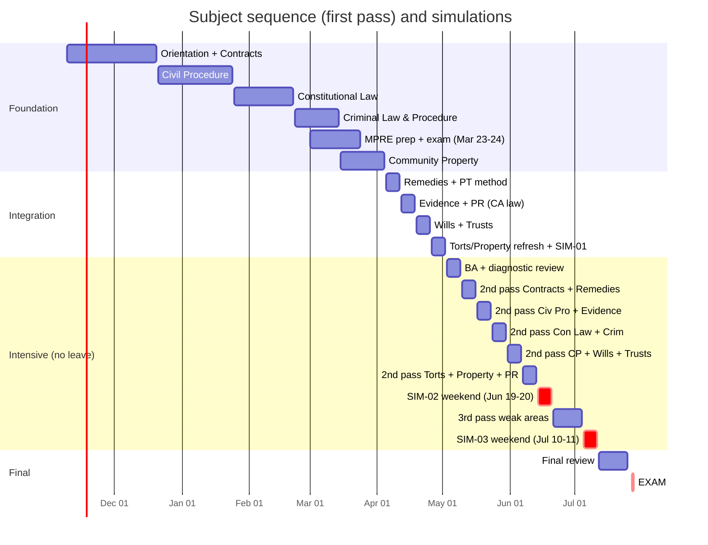

# Master study plan: Nov 9, 2026 → July 27, 2027

> **Revised 2026-11-04 with your inputs:**
> - Eligibility is settled: Route B, and Cardozo has confirmed it.
> - The LL.M. ends May or June 2027.
> - **There is no study leave.** You will study 3–4 h every weekday and about 20 h on weekends.
> - The repo is built in the agreed phase order.

**At a glance**

| | |
|---|---|
| Duration | **38 weeks**: 2026-W46 to 2027-W30 |
| Total study time | **≈ 754 hours** (sum of weekly targets) |
| Practice | **≈ 2,210 MBE questions · 75 timed essays · 52 issue-spotting drills · 12 PTs · 3 full simulations** (justified in [practice-targets.md](practice-targets.md)) |
| Work | Full-time throughout. **No leave.** The intensive phase is **35–38 h/week**: weeknight evenings plus long weekends. **PTO Mon–Thu Jul 26–29** for exam week. |
| Key dates | MPRE Mar 23–24 · exam application timely by about Apr 1 · SIM-01 Sat–Sun May 1–2 · SIM-02 Sat–Sun Jun 19–20 · SIM-03 Sat–Sun Jul 10–11 · **exam Jul 27–28** |

The week-by-week source of truth is [`schedule.yml`](schedule.yml), rendered into `weeks/<ISO week>.md` by `python scripts/build_weeks.py`. To change the plan, edit `schedule.yml` and re-render with `--from <week>`. `/weekly-review` does this.

## 1. Phases

| Phase | Dates | Weeks | Hours/week | Focus |
|---|---|---|---|---|
| **Foundation** | Nov 9 – Mar 28 | 20 | 10–12 (finals week ≈ 6) | Learn the gap subjects in order: **Contracts → Civil Procedure → Constitutional Law → Criminal Law & Procedure**, then begin **Community Property**. MPRE in March. MBE practice and flashcards from week 1. Fall LL.M. subjects kept warm with MBE sets. |
| **Integration** | Mar 29 – May 2 | 5 | 16–20 | Finish **Community Property**, learn **Remedies**, **PT method**, California-law passes of **Evidence, PR, Wills, Trusts**, Torts/Property essay refresh, **diagnostic SIM-01** (weekend). |
| **Intensive** | May 3 – Jul 11 | 10 | **35–38 while working**: 3–4 h each weekday + ~20 h weekends | Second pass of all 13 subjects in pairs. **Weeknights:** timed essays and MBE sets. **Weekends:** PTs, long MBE sets, reading, and the simulations: **SIM-02 (week −6)** and **SIM-03 (week −3)**. |
| **Final review** | Jul 12 – Jul 25 | 2 | 32–35 | SIM-03 review, high-yield sets, attack outlines, light timed practice, logistics. |
| Exam week | Jul 26 – 29 (PTO) | 1 | — | Light review Monday; exam Tue–Wed; upload Thursday. |

## 2. Why the plan is shaped this way

This follows your four-phase design. Changes and their reasons:

1. **Gap subjects first, in your order.**
   - Contracts gets 5 weeks: it is the largest gap, carries the UCC overlay (about a quarter of Contracts MBE questions [S-040]), and is Remedies' most frequent crossover partner.
   - Civil Procedure gets 4 weeks, Con Law about 4, Criminal Law & Procedure 3.
2. **The MPRE sits inside the foundation phase (W09–W12).** Your Fall PR course makes March the cheapest time to take it, and a passing MPRE is required before admission [S-065].
3. **Fall LL.M. subjects are reinforced, not re-taught.**
   - Evidence is in most foundation MBE sets while you take the course.
   - PR flashcards start in W49.
   - The **California-law** layer of Evidence, PR, Wills and Trusts comes in integration.
4. **Torts and Real Property** stay warm with MBE sets from W47; they are 50 of the 175 scored MBE questions [S-007]. A full second pass follows in W23.
5. **No study leave, so the intensive phase is split by type of work.**
   - **Weeknight evenings (3–4 h)** hold the short, timed units: one timed essay plus self-grading, one timed MBE set plus review, and rule drills. A tired brain can still do these well.
   - **Weekends (about 10 h a day)** hold everything that needs long, fresh blocks: PTs, long MBE sets, second-pass reading, and all three full simulations.
6. **Simulations run on weekends:**
   - SIM-01 May 1–2 (diagnostic);
   - **SIM-02 Jun 19–20 (week −6)**;
   - **SIM-03 Jul 10–11 (week −3)**.

   They use real start times (seated by 8:20 a.m. [S-003]). If you can spare two PTO days, SIM-03 can instead run Tue–Wed Jul 6–7 to rehearse real exam weekdays.
7. **The foundation phase stays at 10–12 h/week**, as in your original brief. You now say you can do 3–4 h per weekday plus 20 h per weekend. **If that capacity is available now**, the foundation can be compressed and the second pass started earlier; tell me and I'll re-plan it.

## 3. Weekly rhythms

**Foundation (about 11 h)**
| Day | Time | Blocks |
|---|---|---|
| Mon–Thu | ~75 min | 35 min learn (primer/outline + rule statements) · 30 min MBE mini-set with review · 10 min Anki |
| Fri | ~45 min | `/drill` on the week's rules |
| Sat | ~3 h | 2 h learn block · 1 h essay or `/spot` · Anki |
| Sun | ~3 h | Timed MBE set + full review · `/weekly-review` (30 min) · Anki |

**Integration (16–20 h):** weekdays about 2 h (learn + MBE); weekends about 5 h each (essays, PT, longer MBE sets).

**Intensive while working (35–38 h): weeknight evening, about 3.5 h**
| Time | Block |
|---|---|
| 18:30–19:30 | Timed essay (60 min, real conditions) |
| 19:30–20:00 | Self-grade against the model answer; log; error-log rows |
| 20:15–21:15 | Timed MBE set (15–20 Qs at 1.8 min) + review of every miss |
| 21:15–21:45 | `/drill` on the week's rules + Anki |
| 22:00 | Stop. Protect 7+ hours of sleep. |

On Fridays, swap the essay for a lighter block if the week was heavy.

**Intensive weekend day (about 10 h)**
| Time | Saturday | Sunday |
|---|---|---|
| 08:20–11:30 | Second-pass reading: outline + rule statements + `ca-distinctions.md` | Long timed MBE set (33–50 Qs) |
| 11:30–12:30 | Review | Review of every miss |
| 13:30–15:00 | **PT (90 min, timed)** | Second-pass reading |
| 15:15–16:15 | PT self-grading | `/spot` ×2 + `/drill` |
| 16:30–18:30 | Long timed MBE set + review | `/weekly-review` + attack-outline memorization |

Starting at 08:20 on weekends trains the exam-day start [S-003].

**Final review (32–35 h):**
- weeknights: short timed MBE set and must-know lists;
- weekends: high-yield reading, one essay or `/spot`, attack outlines;
- W29: shift your sleep toward exam timing.

## 4. Making 35–40 h/week work without leave

This is the hardest part of the plan: for 10 weeks you will carry roughly **80+ hours a week of work plus study**.

- **Use PTO surgically, since leave isn't available:**
  - **Required:** Mon–Thu **Jul 26–29** (exam week). Book it in May.
  - **Valuable if available:**
    - Fri Jun 18 (often a Juneteenth holiday) and Fri Jul 9, to rest before each weekend simulation;
    - Fri Jul 23, the Examplify mock deadline and last Friday;
    - two days for a weekday SIM-03 (§2.6).
  - **Ask for a lighter workload in July** if your role allows it, even without leave.
- **Cut order when work spikes.** Drop items in this order: (1) the 5th weekly essay, (2) MBE questions above 80 in that week, (3) weekend reading. **Never cut the PT or a simulation.** Log what you cut; `/weekly-review` reflows it.
- **Sustainability rules:**
  - 7+ hours of sleep;
  - one lighter evening a week;
  - short exercise most days;
  - stop at 22:00 on weeknights.

  Warning signs and responses are in `09-exam-strategy/mindset-and-fatigue.md`. Two consecutive weeks more than 20% under target trigger an **escalate** review ([practice-targets.md](practice-targets.md) §4).
- **Retakes.** You've said you're willing to sit more than once. The plan still aims to pass on the first attempt. **Feb 2028 is the only retake in this format**; from July 2028 the exam is the NextGen UBE [S-020].

## 5. LL.M. and MPRE alignment
- **Fall 2026** (T&E, Evidence, PR, Family Law): the plan assumes finals around **W51** (Dec 14–20) and cuts bar time to 6 h that week. **Family Law** is not a General Bar Exam subject.
- **Final LL.M. term** (ends May or June 2027) overlaps integration and the start of the intensive phase.
  - The hours here are **bar-study hours on top of LL.M. coursework**.
  - If coursework spikes in April–June, use the cut order in §4. Tell me the term's courses and I'll align them (e.g., if a course matches a bar subject).
  - Ask Cardozo when the final transcript issues; it must **arrive** at the State Bar by about Jul 13 ([admissions-checklist.md](../00-exam-intel/admissions-checklist.md)).
- **MPRE (Mar 23–24):** register by **Jan 21**. Prep is 2 h in W09, 3 h in W10 and 5 h in W11. California requires a scaled 86 [S-065]. The test is on a weekday, so plan PTO if needed.

## 6. Repo build status
You are building the whole repo now, in the agreed phase order, so each subject's files should exist before its study week. If a file is missing when you reach it, study from the primary texts (FRCP, FRE, Restatements, UCC Article 2, California codes) and flag it. Licensed NCBE practice questions remain the best calibration for real MBE difficulty throughout. Log them with `quiz.py log --source official`.

## 7. Risks and buffers

| Risk | Buffer / response |
|---|---|
| Fatigue from 80+ h/week (work + study) in May–July | §4 sustainability rules; lighter Friday evenings; cut order; PTO around simulations if possible |
| Work crunch or travel weeks | Buffer weeks W51–W53 and W05 in the foundation. In the intensive phase, use the cut order and add blackouts to `config/plan.yml`; `/weekly-review` reflows the schedule. |
| LL.M. final term overlaps integration and the early intensive phase | Cut order; tell me the courses so the plan can align |
| Transcript arrives late (V-015) | Ask Cardozo now; ask the State Bar about conditional clearance if the degree posts late [S-057] |
| Falling behind a checkpoint | Go / adjust / escalate rules in [practice-targets.md](practice-targets.md) §4 |
| Illness in May–July | W25–W26 are third-pass weeks that can absorb up to one lost week |

## 8. Assumptions to confirm (tell me and I'll rebalance)
1. **Does the 3–4 h/weekday + 20 h/weekend capacity apply now, or only from May?** The plan assumes from May; foundation and integration keep your original 10–20 h.
2. Fall LL.M. finals week (assumed **W51**) and the 2027 final-term courses and dates.
3. Known work travel, holidays or family commitments (Lunar New Year is Sat Feb 6, 2027).
4. Whether you will buy licensed NCBE MBE practice questions (strongly recommended).
5. Which PTO days in §4 you can actually take.

## 9. Checkpoints (summary)

| ID | Date | MBE accuracy (last 200) | Written average | Admin gate |
|---|---|---|---|---|
| CP1 | Jan 31 | ≥ 50% | ≥ 55 | Registered as general applicant; credential evaluation ordered; MPRE registered |
| CP2 | Mar 28 | ≥ 56% | ≥ 58 | MPRE taken; moral character filed; application drafted |
| CP3 | May 2 (SIM-01) | ≥ 60% | ≥ 60 | Application filed; Cardozo transcript date known; exam-week PTO requested |
| CP4 | Jun 20 (SIM-02) | ≥ 65% | ≥ 63 | Transcript mailing confirmed for June |
| CP5 | Jul 11 (SIM-03) | ≥ 68% | ≥ 65 | Transcript received; Examplify mock exam done |

Rationale and the go / adjust / escalate rules are in [practice-targets.md](practice-targets.md).

## 10. Week-by-week overview (generated)
<!-- BEGIN WEEK-TABLE -->
| Week | Dates | Phase | Hours | Theme | MBE | Essays | PT | Cum. MBE / essays / PT |
|---|---|---|---|---|---|---|---|---|
| [2026-W46](weeks/2026-W46.md) | Nov 09 | foundation | 10 | Orientation + Contracts I: formation | 15 | 0 | 0 | 15 / 0 / 0 |
| [2026-W47](weeks/2026-W47.md) | Nov 16 | foundation | 11 | Contracts I: consideration and its substitutes; UCC battle of the forms | 20 | 0 | 0 | 35 / 0 / 0 |
| [2026-W48](weeks/2026-W48.md) | Nov 23 | foundation | 12 | Contracts II–III: defenses, statute of frauds, parol evidence, interpretation, warranties | 25 | 0 | 0 | 60 / 0 / 0 |
| [2026-W49](weeks/2026-W49.md) | Nov 30 | foundation | 11 | Contracts IV: performance, breach, discharge | 25 | 0 | 0 | 85 / 0 / 0 |
| [2026-W50](weeks/2026-W50.md) | Dec 07 | foundation | 10 | Contracts V–VI: remedies and third-party rights; first essay | 25 | 1 | 0 | 110 / 1 / 0 |
| [2026-W51](weeks/2026-W51.md) | Dec 14 | foundation | 6 | LL.M. finals week (assumed) — maintenance only | 15 | 0 | 0 | 125 / 1 / 0 |
| [2026-W52](weeks/2026-W52.md) | Dec 21 | foundation | 12 | Holiday week: Contracts timed essay + Civil Procedure I begins | 30 | 1 | 0 | 155 / 2 / 0 |
| [2026-W53](weeks/2026-W53.md) | Dec 28 | foundation | 12 | Civil Procedure I: personal jurisdiction, service, venue, transfer | 30 | 0 | 0 | 185 / 2 / 0 |
| [2027-W01](weeks/2027-W01.md) | Jan 04 | foundation | 11 | Civil Procedure II–III (part 1): Erie, pleadings, Rule 11, joinder, class actions | 30 | 0 | 0 | 215 / 2 / 0 |
| [2027-W02](weeks/2027-W02.md) | Jan 11 | foundation | 11 | Civil Procedure III (part 2)–IV: discovery, summary judgment, PI/TRO, jury | 30 | 0 | 0 | 245 / 2 / 0 |
| [2027-W03](weeks/2027-W03.md) | Jan 18 | foundation | 12 | Civil Procedure V–VII + California CCP distinctions; Civ Pro essay | 30 | 1 | 0 | 275 / 3 / 0 |
| [2027-W04](weeks/2027-W04.md) | Jan 25 | foundation | 11 | Constitutional Law I–II: judicial review, justiciability, separation of powers — CHECKPOINT 1 **CP1** | 30 | 1 | 0 | 305 / 4 / 0 |
| [2027-W05](weeks/2027-W05.md) | Feb 01 | foundation | 9 | Constitutional Law III: federalism | 25 | 0 | 0 | 330 / 4 / 0 |
| [2027-W06](weeks/2027-W06.md) | Feb 08 | foundation | 11 | Constitutional Law IV (part 1): state action, due process, equal protection, takings | 30 | 0 | 0 | 360 / 4 / 0 |
| [2027-W07](weeks/2027-W07.md) | Feb 15 | foundation | 12 | Constitutional Law IV (part 2): First Amendment; Con Law essay | 30 | 1 | 0 | 390 / 5 / 0 |
| [2027-W08](weeks/2027-W08.md) | Feb 22 | foundation | 11 | Criminal Law I–IV: homicide, other crimes, inchoate crimes, general principles | 35 | 0 | 0 | 425 / 5 / 0 |
| [2027-W09](weeks/2027-W09.md) | Mar 01 | foundation | 11 | Criminal Procedure: Fourth Amendment; MPRE prep begins | 35 | 0 | 0 | 460 / 5 / 0 |
| [2027-W10](weeks/2027-W10.md) | Mar 08 | foundation | 12 | Criminal Procedure: Fifth and Sixth Amendments; Crim essay; MPRE prep | 35 | 1 | 0 | 495 / 6 / 0 |
| [2027-W11](weeks/2027-W11.md) | Mar 15 | foundation | 12 | MPRE intensive + Community Property begins | 30 | 0 | 0 | 525 / 6 / 0 |
| [2027-W12](weeks/2027-W12.md) | Mar 22 | foundation | 12 | MPRE (Tue–Wed Mar 23–24) + Community Property characterization — CHECKPOINT 2 **CP2** | 25 | 1 | 0 | 550 / 7 / 0 |
| [2027-W13](weeks/2027-W13.md) | Mar 29 | integration | 16 | Community Property (finish) + CP essay; FILE THE EXAM APPLICATION | 50 | 1 | 0 | 600 / 8 / 0 |
| [2027-W14](weeks/2027-W14.md) | Apr 05 | integration | 16 | Remedies + Performance Test method | 50 | 1 | 1 | 650 / 9 / 1 |
| [2027-W15](weeks/2027-W15.md) | Apr 12 | integration | 17 | Evidence (CA vs FRE) + Professional Responsibility (CA vs ABA) | 60 | 2 | 0 | 710 / 11 / 1 |
| [2027-W16](weeks/2027-W16.md) | Apr 19 | integration | 18 | Wills & Succession + Trusts (California Probate Code) | 60 | 2 | 1 | 770 / 13 / 2 |
| [2027-W17](weeks/2027-W17.md) | Apr 26 | integration | 20 | Torts + Real Property essay refresh; DIAGNOSTIC SIMULATION #1 (Sat–Sun May 1–2) — CHECKPOINT 3 **CP3** | 200 | 5 | 1 | 970 / 18 / 3 |
| [2027-W18](weeks/2027-W18.md) | May 03 | intensive | 36 | Diagnostic review + Business Associations | 80 | 4 | 0 | 1050 / 22 / 3 |
| [2027-W19](weeks/2027-W19.md) | May 10 | intensive | 37 | Second pass: Contracts + Remedies | 90 | 4 | 1 | 1140 / 26 / 4 |
| [2027-W20](weeks/2027-W20.md) | May 17 | intensive | 38 | Second pass: Civil Procedure + Evidence | 100 | 5 | 1 | 1240 / 31 / 5 |
| [2027-W21](weeks/2027-W21.md) | May 24 | intensive | 38 | Second pass: Constitutional Law + Criminal Law & Procedure | 100 | 5 | 1 | 1340 / 36 / 6 |
| [2027-W22](weeks/2027-W22.md) | May 31 | intensive | 38 | Second pass: Community Property + Wills + Trusts (California trio) | 90 | 5 | 1 | 1430 / 41 / 7 |
| [2027-W23](weeks/2027-W23.md) | Jun 07 | intensive | 38 | Second pass: Torts + Real Property + Professional Responsibility | 100 | 5 | 1 | 1530 / 46 / 8 |
| [2027-W24](weeks/2027-W24.md) | Jun 14 | intensive | 38 | SIMULATION #2 (Sat–Sun Jun 19–20, week −6) — CHECKPOINT 4 **CP4** | 200 | 8 | 1 | 1730 / 54 / 9 |
| [2027-W25](weeks/2027-W25.md) | Jun 21 | intensive | 38 | SIM-02 review + third pass on weakest subjects | 90 | 4 | 1 | 1820 / 58 / 10 |
| [2027-W26](weeks/2027-W26.md) | Jun 28 | intensive | 38 | Third pass continued + full memorization cycle | 90 | 5 | 1 | 1910 / 63 / 11 |
| [2027-W27](weeks/2027-W27.md) | Jul 05 | intensive | 38 | SIMULATION #3 (Sat–Sun Jul 10–11, week −3) — CHECKPOINT 5 **CP5** | 200 | 7 | 1 | 2110 / 70 / 12 |
| [2027-W28](weeks/2027-W28.md) | Jul 12 | final-review | 35 | SIM-03 review + final review 1: high-yield + attack outlines | 60 | 3 | 0 | 2170 / 73 / 12 |
| [2027-W29](weeks/2027-W29.md) | Jul 19 | final-review | 32 | Final review 2: final-2-weeks-review set; taper | 40 | 2 | 0 | 2210 / 75 / 12 |
| [2027-W30](weeks/2027-W30.md) | Jul 26 | exam | 4 | EXAM WEEK — Tue–Wed Jul 27–28 (PTO Mon–Thu) | 0 | 0 | 0 | 2210 / 75 / 12 |

**Totals:** 754 hours · 2210 MBE questions · 75 essays (incl. simulations) · 12 PTs · 52 issue-spotting drills.
<!-- END WEEK-TABLE -->
