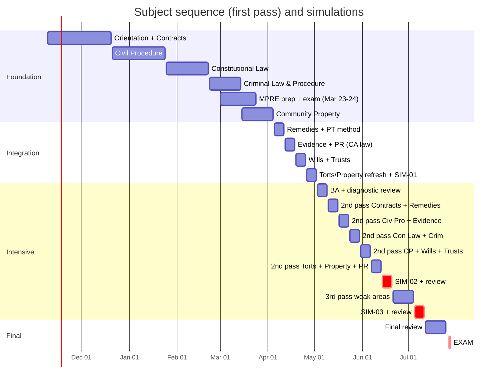

# Master study plan: Nov 9, 2026 → July 27, 2027

**At a glance**

| | |
|---|---|
| Duration | **38 weeks**: 2026-W46 to 2027-W30 |
| Total study time | **≈ 755 hours** (sum of weekly targets) |
| Practice | **≈ 2,170 MBE questions · 68 timed essays · 53 issue-spotting drills · 12 PTs · 3 full simulations** (justified in [practice-targets.md](practice-targets.md)) |
| Leave | Study leave is needed: **full-time from Mon May 17, 2027 at the latest**. Request it by Feb 15, 2027 (§4). |
| Key dates | MPRE Mar 23–24 · exam application timely by about Apr 1 · SIM-01 May 1–2 · SIM-02 Jun 15–16 · SIM-03 Jul 6–7 · **exam Jul 27–28** |

The week-by-week source of truth is [`schedule.yml`](schedule.yml), rendered into `weeks/<ISO week>.md` by `python scripts/build_weeks.py`. To change the plan, edit `schedule.yml` and re-render with `--from <week>`. `/weekly-review` does this.

## 1. Phases

| Phase | Dates | Weeks | Hours/week | Focus |
|---|---|---|---|---|
| **Foundation** | Nov 9 – Mar 28 | 20 | 10–12 (finals week ≈ 6) | Learn the gap subjects in order: **Contracts → Civil Procedure → Constitutional Law → Criminal Law & Procedure**, then begin **Community Property**. MPRE in March. MBE practice and flashcards from week 1. Fall LL.M. subjects kept warm with MBE sets. |
| **Integration** | Mar 29 – May 2 | 5 | 16–20 | Finish **Community Property**, learn **Remedies**, **PT method**, California-law passes of **Evidence, PR, Wills, Trusts** (all in your Fall LL.M.), Torts/Property essay refresh, **diagnostic SIM-01**. |
| **Intensive** | May 3 – Jul 11 | 10 | 25 while working (W18–W19), then **40–44 on leave** | Second pass of all 13 subjects in pairs, daily timed MBE, 3–5 timed essays/week, 1 PT/week, memorization cycles, **SIM-02 (week −6)** and **SIM-03 (week −3)**. |
| **Final review** | Jul 12 – Jul 25 | 2 | 30–35 | High-yield sets, attack outlines, light timed practice, logistics. |
| Exam week | Jul 26 – 28 | 1 | — | Light review Monday; exam Tue–Wed; upload Thursday. |

## 2. Why the plan is shaped this way

This follows your proposed four-phase design. Where I changed it, the reason is given.

1. **Gap subjects come first, in your order.** Contracts gets 5 weeks: it is the largest gap subject, carries the UCC overlay (about a quarter of Contracts MBE questions [S-040]), and is the most frequent crossover partner for Remedies. Civil Procedure gets 4 weeks; Con Law about 4; Crim 3.
2. **The MPRE sits inside the foundation phase (W09–W12).** Your Fall PR course makes March the cheapest time to take it, and a passing MPRE is required before admission [S-065]. The cost is that Community Property starts in W11 instead of W09.
3. **Fall LL.M. subjects are reinforced, not re-taught.** Evidence is in most foundation MBE sets while you take the course. PR flashcards start in W49 for the MPRE. Their **California-law** layer (CEC vs. FRE, CA Rules vs. ABA, Probate Code) comes in integration, once the courses are done.
4. **Torts and Real Property** (completed courses, but 50 of the 175 scored MBE questions [S-007]) stay warm through MBE sets from W47 onward. They get an essay refresh in W17 and a full second pass in W23.
5. **The intensive phase has a 2-week ramp (W18–W19 at 25 h)**, because 35–45 h/week is not realistic while working full-time. If you can start leave on May 3 (option A, §4), set those two weeks to 40 h.
6. **Simulations:** SIM-01 is diagnostic, at the end of integration (a weekend, so no PTO is needed). SIM-02 is at **week −6** and SIM-03 at **week −3**, as you specified. Both run on a Tuesday–Wednesday with real start times, to rehearse the actual exam days.
7. **Business Associations** gets its first essay-level pass in W18. You completed Corporations, and BA is essay-only, so it was the safest subject to defer.

## 3. Weekly rhythms

**Foundation (working, about 11 h)**
| Day | Time | Blocks |
|---|---|---|
| Mon–Thu | ~75 min | 35 min learn (primer/outline + rule statements) · 30 min MBE mini-set (5–8 Qs) with review · 10 min Anki |
| Fri | ~45 min | `/drill` on the week's rules |
| Sat | ~3 h | 2 h learn block · 1 h essay or `/spot` · Anki |
| Sun | ~3 h | Timed MBE set (15–20 Qs) + full review · `/weekly-review` (30 min) · Anki |

**Integration (working, 16–20 h):** weekdays about 2 h (learn + MBE); weekends about 5 h each (essays, PT, longer MBE sets).

**Intensive while working (W18–W19, 25 h):** weekdays about 2.5 h; Saturday 7 h; Sunday 6 h.

**Intensive on leave (40–44 h; Mon–Sat about 7 h, Sunday half day)**
| Time | Block |
|---|---|
| 08:00–09:15 | Timed MBE set (15–20 Qs at 1.8 min) + review of every miss |
| 09:30–10:30 | Timed essay (real conditions) |
| 10:30–11:15 | Self-grade against the model answer; log it; error-log entries |
| 12:15–14:45 | Second-pass reading: outline + rule statements + `ca-distinctions.md` |
| 15:00–15:45 | `/drill` and `/spot` |
| 16:00–16:30 | Anki |
| Saturday | PT (90 min) + review instead of the essay block |
| Sunday | Rest until afternoon; Anki + `/weekly-review` |

**Final review (30–35 h):** mornings high-yield reading; midday a short timed MBE set; afternoons one essay or `/spot`; evenings memorization lists. Sleep is shifted to exam timing in W29.

## 4. Study leave: when and how long

A 35–45 h/week intensive cannot coexist with a full-time job, so the plan **requires study leave**.

| Option | Leave starts | Weeks off before exam | Effect on the plan | Recommendation |
|---|---|---|---|---|
| **A** | Mon May 3 (W18) | ≈ 12.3 | W18–W19 rise from 25 h to 40 h (≈ +30 h) | Best, if your employer allows it |
| **B** | **Mon May 17 (W20)** | ≈ 10.3 | As scheduled: 2-week ramp at 25 h while working | **Baseline / minimum** |
| C | Tue Jun 1 | ≈ 8 | W20–W21 at 25 h instead of 40–42 (≈ −32 h, including Memorial Day week) | Not recommended for your applicant category (first-time pass rate 12.9% in Jul 2026, 18.8% in Jul 2025 [S-012] [S-014]) |

- **Action:** decide by **Feb 15, 2027** and request the leave from your employer. That date is also in `config/plan.yml` admissions.
- Separately, plan PTO for the MPRE (Tue–Wed Mar 23–24) if the testing time conflicts with work.

## 5. LL.M. and MPRE alignment
- **Fall 2026 (T&E, Evidence, PR, Family Law):** the plan assumes finals around **W51** (Dec 14–20) and cuts bar time to 6 h that week. **Family Law** is not a General Bar Exam subject, so it gets no bar time; it will matter only for a future California component (from July 2029 at the earliest [S-005]).
- **Final LL.M. term (2027): dates unknown.** If it runs through the integration phase (Mar 29 – May 2), the integration hours (16–20) are at risk. Tell me the term dates and I'll rebalance in `schedule.yml`. The transcript deadline (about July 13) is in [admissions-checklist.md](../00-exam-intel/admissions-checklist.md).
- **MPRE (Mar 23–24):** register by **Jan 21**. Prep is 2 h in W09, 3 h in W10 and 5 h in W11, built on your Fall PR course. California requires a scaled 86 [S-065].

## 6. Repo build must stay ahead of the schedule

This repo is your primary source, so each subject's files must exist before you study it:

| Subject | First study week | Needed by | Repo phase |
|---|---|---|---|
| Contracts | W46 | **now** | Phase 4, group 1 |
| Civil Procedure | W52 | Dec 21 | Phase 4, group 1 |
| Constitutional Law | W04 | Jan 25 | Phase 4, group 1 |
| Criminal Law & Procedure | W08 | Feb 22 | Phase 4, group 1 |
| Community Property | W11 | Mar 15 | Phase 4, group 2 |
| Remedies | W14 | Apr 5 | Phase 4, group 2 |
| Evidence, PR | W15 | Apr 12 | Phase 4, group 3 |
| Wills, Trusts | W16 | Apr 19 | Phase 4, group 3 |
| Torts, Real Property | W17 | Apr 26 | Phase 4, group 4 |
| Business Associations | W18 | May 3 | Phase 4, group 4 |
| MBE question bank | W46 (Evidence, Contracts) | ongoing | Phase 5 |

- **Gap:** Contracts starts this week, but its repo files come in Phase 4, after Phase 3 (past exams).
- **Until then:** read the primary texts (Restatement (Second) of Contracts, UCC Article 2), and use **licensed NCBE practice questions** for MBE sets, logged with `quiz.py log --source official`. Licensed NCBE questions remain the best calibration for real MBE difficulty throughout.

## 7. Risks and buffers

| Risk | Buffer / response |
|---|---|
| Work travel or crunch weeks | Buffer weeks W51–W53 and W05. Add blackout dates to `config/plan.yml`; `/weekly-review` reflows the schedule. |
| Falling behind a checkpoint | Go / adjust / escalate rules in [practice-targets.md](practice-targets.md) §4 |
| Eligibility problem (V-012, V-014, V-015) | Resolve by CP1 (Jan 31). If July 2027 is impossible, the same plan shifts about 7 months to **Feb 2028**, the last exam in the current format [S-027]. |
| Repo content lags the schedule (§6) | Use primary texts and licensed questions temporarily; escalate the build order with me. |
| Burnout | One half day off every week; Sundays light on leave; see `09-exam-strategy/mindset-and-fatigue.md` |
| Illness during intensive | W25–W26 are third-pass weeks that can absorb up to one lost week. |

## 8. Assumptions to confirm (tell me and I'll rebalance)
1. Leave start date: option A, B or C (§4).
2. Fall LL.M. finals week (assumed **W51**) and the **2027 final-term dates and courses**.
3. Realistic weekday and weekend hours. The plan assumes about 75 min on weekdays and 3 h per weekend day in the foundation phase.
4. Known work travel, holidays or family commitments, including Lunar New Year (Sat Feb 6, 2027) and Christmas.
5. Whether you will buy licensed NCBE MBE practice questions. This is strongly recommended; see §6.

## 9. Checkpoints (summary)

| ID | Date | MBE accuracy (last 200) | Written average | Admin gate |
|---|---|---|---|---|
| CP1 | Jan 31 | ≥ 50% | ≥ 55 | Eligibility determination requested; MPRE registered |
| CP2 | Mar 28 | ≥ 56% | ≥ 58 | MPRE taken; moral character filed; application drafted |
| CP3 | May 2 (SIM-01) | ≥ 60% | ≥ 60 | Application filed; leave confirmed |
| CP4 | Jun 20 (SIM-02) | ≥ 65% | ≥ 63 | Transcript or CGS mailing plan set |
| CP5 | Jul 11 (SIM-03) | ≥ 68% | ≥ 65 | Examplify mock exam done |

Rationale and the go / adjust / escalate rules are in [practice-targets.md](practice-targets.md).

## 10. Week-by-week overview (generated)
<!-- BEGIN WEEK-TABLE -->
| Week | Dates | Phase | Hours | Theme | MBE | Essays | PT | Cum. MBE / essays / PT |
|---|---|---|---|---|---|---|---|---|
| [2026-W46](weeks/2026-W46.md) | Nov 09 | foundation | 10 | Orientation + Contracts I: formation | 15 | 0 | 0 | 15 / 0 / 0 |
| [2026-W47](weeks/2026-W47.md) | Nov 16 | foundation | 11 | Contracts I: consideration and its substitutes; UCC battle of the forms | 20 | 0 | 0 | 35 / 0 / 0 |
| [2026-W48](weeks/2026-W48.md) | Nov 23 | foundation | 12 | Contracts II–III: defenses, statute of frauds, parol evidence, interpretation, warranties | 25 | 0 | 0 | 60 / 0 / 0 |
| [2026-W49](weeks/2026-W49.md) | Nov 30 | foundation | 11 | Contracts IV: performance, breach, discharge | 25 | 0 | 0 | 85 / 0 / 0 |
| [2026-W50](weeks/2026-W50.md) | Dec 07 | foundation | 10 | Contracts V–VI: remedies and third-party rights; first essay | 25 | 1 | 0 | 110 / 1 / 0 |
| [2026-W51](weeks/2026-W51.md) | Dec 14 | foundation | 6 | LL.M. finals week (assumed) — maintenance only | 15 | 0 | 0 | 125 / 1 / 0 |
| [2026-W52](weeks/2026-W52.md) | Dec 21 | foundation | 12 | Holiday week: Contracts timed essay + Civil Procedure I begins | 30 | 1 | 0 | 155 / 2 / 0 |
| [2026-W53](weeks/2026-W53.md) | Dec 28 | foundation | 12 | Civil Procedure I: personal jurisdiction, service, venue, transfer | 30 | 0 | 0 | 185 / 2 / 0 |
| [2027-W01](weeks/2027-W01.md) | Jan 04 | foundation | 11 | Civil Procedure II–III (part 1): Erie, pleadings, Rule 11, joinder, class actions | 30 | 0 | 0 | 215 / 2 / 0 |
| [2027-W02](weeks/2027-W02.md) | Jan 11 | foundation | 11 | Civil Procedure III (part 2)–IV: discovery, summary judgment, PI/TRO, jury | 30 | 0 | 0 | 245 / 2 / 0 |
| [2027-W03](weeks/2027-W03.md) | Jan 18 | foundation | 12 | Civil Procedure V–VII + California CCP distinctions; Civ Pro essay | 30 | 1 | 0 | 275 / 3 / 0 |
| [2027-W04](weeks/2027-W04.md) | Jan 25 | foundation | 11 | Constitutional Law I–II: judicial review, justiciability, separation of powers — CHECKPOINT 1 **CP1** | 30 | 1 | 0 | 305 / 4 / 0 |
| [2027-W05](weeks/2027-W05.md) | Feb 01 | foundation | 9 | Constitutional Law III: federalism | 25 | 0 | 0 | 330 / 4 / 0 |
| [2027-W06](weeks/2027-W06.md) | Feb 08 | foundation | 11 | Constitutional Law IV (part 1): state action, due process, equal protection, takings | 30 | 0 | 0 | 360 / 4 / 0 |
| [2027-W07](weeks/2027-W07.md) | Feb 15 | foundation | 12 | Constitutional Law IV (part 2): First Amendment; Con Law essay | 30 | 1 | 0 | 390 / 5 / 0 |
| [2027-W08](weeks/2027-W08.md) | Feb 22 | foundation | 11 | Criminal Law I–IV: homicide, other crimes, inchoate crimes, general principles | 35 | 0 | 0 | 425 / 5 / 0 |
| [2027-W09](weeks/2027-W09.md) | Mar 01 | foundation | 11 | Criminal Procedure: Fourth Amendment; MPRE prep begins | 35 | 0 | 0 | 460 / 5 / 0 |
| [2027-W10](weeks/2027-W10.md) | Mar 08 | foundation | 12 | Criminal Procedure: Fifth and Sixth Amendments; Crim essay; MPRE prep | 35 | 1 | 0 | 495 / 6 / 0 |
| [2027-W11](weeks/2027-W11.md) | Mar 15 | foundation | 12 | MPRE intensive + Community Property begins | 30 | 0 | 0 | 525 / 6 / 0 |
| [2027-W12](weeks/2027-W12.md) | Mar 22 | foundation | 12 | MPRE (Tue–Wed Mar 23–24) + Community Property characterization — CHECKPOINT 2 **CP2** | 25 | 1 | 0 | 550 / 7 / 0 |
| [2027-W13](weeks/2027-W13.md) | Mar 29 | integration | 16 | Community Property (finish) + CP essay; FILE THE EXAM APPLICATION | 50 | 1 | 0 | 600 / 8 / 0 |
| [2027-W14](weeks/2027-W14.md) | Apr 05 | integration | 16 | Remedies + Performance Test method | 50 | 1 | 1 | 650 / 9 / 1 |
| [2027-W15](weeks/2027-W15.md) | Apr 12 | integration | 17 | Evidence (CA vs FRE) + Professional Responsibility (CA vs ABA) | 60 | 2 | 0 | 710 / 11 / 1 |
| [2027-W16](weeks/2027-W16.md) | Apr 19 | integration | 18 | Wills & Succession + Trusts (California Probate Code) | 60 | 2 | 1 | 770 / 13 / 2 |
| [2027-W17](weeks/2027-W17.md) | Apr 26 | integration | 20 | Torts + Real Property essay refresh; DIAGNOSTIC SIMULATION #1 (Sat–Sun May 1–2) — CHECKPOINT 3 **CP3** | 200 | 5 | 1 | 970 / 18 / 3 |
| [2027-W18](weeks/2027-W18.md) | May 03 | intensive | 25 | Diagnostic review + Business Associations (still working) | 60 | 3 | 0 | 1030 / 21 / 3 |
| [2027-W19](weeks/2027-W19.md) | May 10 | intensive | 25 | Second pass: Contracts + Remedies (last working week before leave) | 60 | 3 | 1 | 1090 / 24 / 4 |
| [2027-W20](weeks/2027-W20.md) | May 17 | intensive | 40 | STUDY LEAVE BEGINS (proposed) — second pass: Civil Procedure + Evidence | 100 | 4 | 1 | 1190 / 28 / 5 |
| [2027-W21](weeks/2027-W21.md) | May 24 | intensive | 42 | Second pass: Constitutional Law + Criminal Law & Procedure | 100 | 5 | 1 | 1290 / 33 / 6 |
| [2027-W22](weeks/2027-W22.md) | May 31 | intensive | 40 | Second pass: Community Property + Wills + Trusts (California trio) | 80 | 5 | 1 | 1370 / 38 / 7 |
| [2027-W23](weeks/2027-W23.md) | Jun 07 | intensive | 42 | Second pass: Torts + Real Property + Professional Responsibility | 100 | 5 | 1 | 1470 / 43 / 8 |
| [2027-W24](weeks/2027-W24.md) | Jun 14 | intensive | 42 | SIMULATION #2 (Tue–Wed Jun 15–16, week −6) — CHECKPOINT 4 **CP4** | 200 | 5 | 1 | 1670 / 48 / 9 |
| [2027-W25](weeks/2027-W25.md) | Jun 21 | intensive | 42 | Third pass: weakest subjects (from SIM-02) + crossovers | 100 | 5 | 1 | 1770 / 53 / 10 |
| [2027-W26](weeks/2027-W26.md) | Jun 28 | intensive | 42 | Third pass continued + full memorization cycle | 100 | 5 | 1 | 1870 / 58 / 11 |
| [2027-W27](weeks/2027-W27.md) | Jul 05 | intensive | 40 | SIMULATION #3 (Tue–Wed Jul 6–7, week −3) — CHECKPOINT 5 **CP5** | 200 | 5 | 1 | 2070 / 63 / 12 |
| [2027-W28](weeks/2027-W28.md) | Jul 12 | final-review | 35 | Final review 1: high-yield + attack outlines | 60 | 3 | 0 | 2130 / 66 / 12 |
| [2027-W29](weeks/2027-W29.md) | Jul 19 | final-review | 30 | Final review 2: final-2-weeks-review set; taper | 40 | 2 | 0 | 2170 / 68 / 12 |
| [2027-W30](weeks/2027-W30.md) | Jul 26 | exam | 4 | EXAM WEEK — Tue–Wed Jul 27–28 | 0 | 0 | 0 | 2170 / 68 / 12 |

**Totals:** 755 hours · 2170 MBE questions · 68 essays (incl. simulations) · 12 PTs · 53 issue-spotting drills.
<!-- END WEEK-TABLE -->
