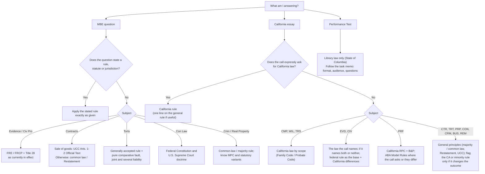

# How the bar exam tests law

**The core idea.** The July 2027 exam has three components, and each one asks a different question about the law:
- **MBE:** do you know the *generally accepted* rule well enough to pick the best answer in under two minutes?
- **Essays:** can you find the issues, state the rule and *use the facts* to reach a conclusion?
- **PT:** can you work like a lawyer from law you have never seen?

Format, timing and scoring details are in [format-and-scoring.md](../00-exam-intel/format-and-scoring.md). Graders' published expectations are in [grader-expectations.md](../00-exam-intel/grader-expectations.md).

---

## 1. The three components at a glance

| | MBE | Essays | Performance Test |
|---|---|---|---|
| Format | 200 multiple-choice questions over two 3-hour sessions: 175 scored, 25 unscored pretest [S-006]. 25 scored per subject in 7 subjects [S-007]. | Five one-hour essays [S-003] | One 90-minute task [S-003] |
| Weight | 50% of the total scaled score [S-011] | Together with the PT, the other 50%. Each essay is graded 40–100 [S-010]. | Counts as **two** essays [S-010] |
| Subjects | Civ Pro, Con Law, Contracts, Crim Law & Procedure, Evidence, Real Property, Torts [S-006] | Any of the 13 written-section subjects [S-041], alone or combined | None: the law is supplied in the Library |
| Law tested | Generally accepted rules + NCBE's stated defaults (§2) | General principles, unless the call or the subject's scope requires California law (§3) | The Library's law only (§4) |
| What earns credit | The single best option | Issues, rules, analysis, organization, conclusions | Compliance with instructions, content, thoroughness, organization [S-076] |

---

## 2. The MBE: one best answer under generally accepted rules

**The standard.** NCBE directs examinees to answer according to generally accepted legal principles unless a question indicates otherwise [S-007] [VERIFY V-044]. Your first job is to know the **majority / black-letter rule**, not California's.

**NCBE's stated defaults (from the Subject Matter Outline [S-040])**

| Subject | Default you must assume |
|---|---|
| Civil Procedure | The **Federal Rules of Civil Procedure as currently in effect**, and the sections of **Title 28** on trial and appellate jurisdiction, venue and transfer |
| Evidence | The **Federal Rules of Evidence as currently in effect** |
| Contracts | The **Official Text of UCC Articles 1 and 2** has been adopted and is in effect. About one-fourth of Contracts questions are based on it. |
| Torts | Survival actions and wrongful-death claims are available. **Joint and several liability and pure comparative fault** are the relevant rules "unless otherwise indicated". |
| Constitutional Law | "The terms 'Constitution,' 'constitutional,' and 'unconstitutional' refer to the **federal** Constitution unless indicated otherwise." |
| Criminal Law, Real Property | No single law default. Where a question quotes a statute, apply it exactly; otherwise use the common-law rule and know where the Model Penal Code or modern statutes differ. |

**"As currently in effect" means recent amendments are testable.** The FRE changes of 2023–2026 are listed in [recent-changes.md](../00-exam-intel/recent-changes.md) §2, including the Rule 801(d)(1)(A) amendment effective Dec 1, 2026 [S-101]. Learn the old and new versions of anything that changed recently.

**How MBE questions are built**
- **One best answer.** Two options may be partly right. The best one states the rule that actually decides *these* facts.
- **Modifiers carry the logic:**
  - "because" means the reasoning must be correct *and* must fit the facts;
  - "if" means the condition need only be plausible on the facts;
  - "unless" means the stated exception must be the only way out.
- **Distractors use commonly confused rules:** a minority rule, the PRC-style answer, the California rule, or a correct rule applied to the wrong element.
- **Facts are fixed.** Do not add facts, and do not fight the hypothetical.

Strategy and timing are covered in `05-mbe/strategy.md` (Phase 2).

---

## 3. The essays: what the grader rewards

**The official instructions** reward analysis, not recall. Answers must "discern the points of law and fact upon which the case turns". "If your answer contains only a statement of your conclusions, you will receive little or no credit" [S-076]. Do not "volunteer information or discuss legal doctrines which are not pertinent" to the call [S-077].

| Skill | What it looks like on the page |
|---|---|
| **Issue spotting** | A heading for every issue the call raises, major issues first. Missing a major issue is the costliest error. |
| **Rule statement** | A 1–3 sentence rule using the term of art, plus elements; California vs general rule where the scope or call requires it |
| **Application** | Element by element, using the specific facts; both sides where the facts cut both ways ([common-law-for-civil-lawyers.md](common-law-for-civil-lawyers.md) §5) |
| **Conclusion** | One for every issue, even if "likely". Answer every call. |
| **Organization** | Headings mirror the call; IRAC under each heading; threshold issues first |

The repo's practice-grading weights (35/20/30/10/5) are Claude's working rubric, not the State Bar's. They are explained in [grader-expectations.md](../00-exam-intel/grader-expectations.md) §4.

**Which law on the essays**
- **Default:** "Unless a question expressly asks you to use California law, you should answer according to legal theories and principles of general application" [S-077].
- **Scope statements bring California law into:**
  - Evidence (FRE and CEC, compare and contrast [S-083]);
  - Civil Procedure (FRCP and CCP [S-084]);
  - Professional Responsibility (California rules, B&P and case law [S-082]);
  - Community Property [S-086], Wills [S-094] and Trusts [S-093].
- Full table: [california-legal-system.md](california-legal-system.md) §6.

---

## 4. The Performance Test: a closed universe

**What the State Bar says** [S-076]:
- You work from a **File** (facts, including the task memorandum) and a **Library** (law).
- The problem is set in the fictional **State of Columbia**.
- Library cases "may be real, modified, or written solely for the purpose of this performance test".
- The answer is graded on "compliance with instructions and on its content, thoroughness, and organization".

**What that means**
1. **Use only the Library's law**, even where you "know" a different real-world rule. Cite Library authorities by name.
2. **The task memo controls:** document type (memo, brief, letter, etc.), audience, tone, format and the exact questions.
3. **The core skill is common-law reasoning from scratch:**
   - synthesize a rule from the Library cases;
   - apply it to the File facts;
   - analogize and distinguish.

   This is why [common-law-for-civil-lawyers.md](common-law-for-civil-lawyers.md) §2 matters for the PT more than for any other component.
4. **It is worth two essays and needs the least memorized law.** That makes it your highest-return written skill ([format-and-scoring.md](../00-exam-intel/format-and-scoring.md) §2).

Method and task-type templates: `04-performance-test/method.md` and `04-performance-test/task-types/` (Phase 2).

---

## 5. The "bar exam version" of a rule vs real practice

| In practice | On the bar exam |
|---|---|
| The jurisdiction's own rule, local variations and recent cases | The generally accepted rule or the NCBE default (MBE); general principles unless California is called (essays); Library law (PT) |
| Facts are discovered, disputed and incomplete | Facts are given and treated as true. Nearly every fact is there to be used; draw reasonable inferences and say so. |
| Limitations periods, insurance, costs and settlement drive outcomes | Generally irrelevant unless the facts or the call raise them |
| Research before answering | Memory: a tight 1–3 sentence rule statement |
| Multi-factor tests briefed at length | One or two sentences applying each factor to the facts |
| Old and new law coexist during transitions | The law in effect at the exam. Learn both versions of anything that changed recently ([recent-changes.md](../00-exam-intel/recent-changes.md) §1). |

**Example: the Rule Against Perpetuities.**
- The MBE outline covers the "common law rule and statutory reforms" [S-040].
- California itself uses a statutory wait-and-see rule: an interest is valid if it either must vest or terminate within lives in being plus 21 years, or actually does so within 90 years (Prob. Code § 21205).
- So on the MBE you learn the common-law rule *and* know that reforms exist. On an essay you state the common-law rule and mention the reform in one line, unless the call asks for California law.

---

## 6. Flowchart: which rule do I apply?

**Notes on the flowchart**
- The EVD/CIV branch for a call that names neither or both legal systems is repo guidance drawn from the scope statements [S-083] [S-084]. Phase 3 found that Evidence calls name either the CEC or the FRE and switch between exams, and that the recent Civil Procedure essays with a visible forum were set in federal court (`06-past-exams/frequency-analysis.md`, finding 8).
- The ABA reference in the PRF branch follows the State Bar's PR content outline, which lists the ABA Model Rules and Model Code [S-082]; recent PR calls ask for "California and ABA authorities".

---

## 7. How crossovers work

- **What the State Bar says:** essays can combine subjects [S-097], and "Professional responsibility issues may be included in conjunction with any subject tested on the examination" [S-082].
- **Why examiners do it:** real legal problems ignore subject boundaries. A crossover tests whether you can see the second subject hiding in the facts.
- **Pairings that follow from doctrine overlap.** Phase 3 measured the ones that actually recur (Feb 2012 – Jul 2026): Wills + Trusts (6), Contracts + Remedies (4), Community Property + Wills (4), Remedies + Torts (3), then BA + PR, Evidence + PR and Criminal + Evidence (2 each) (`06-past-exams/frequency-analysis.md`).

| Pairing | Why they overlap |
|---|---|
| Contracts or Torts + **Remedies** | Every liability question leads to "what relief?" |
| Wills + **Community Property** | What a spouse can dispose of at death depends on CP/SP characterization |
| Trusts or Business Associations + **Professional Responsibility** | Lawyer-trustees, lawyers for entities, conflicts |
| Real Property + Contracts / Remedies | Land sale contracts, specific performance |
| Criminal Procedure + Constitutional Law / Evidence | Fourth, Fifth and Sixth Amendment issues; exclusion |
| Civil Procedure + Evidence | Pre-trial and trial rulings in one lawsuit |

**Handling a crossover**
1. Split the call by subject.
2. Give each subject its own top-level heading.
3. Allocate time in proportion to the issues, not to your comfort with the subject.
4. Never leave the second subject blank. A thin, IRAC'd answer to every call beats a deep answer to one ([grader-expectations.md](../00-exam-intel/grader-expectations.md) §3).

---

## 8. How to use this repo

**Per-subject file set** (built in Phase 4, in `03-subjects/<subject>/`)

| Step | File | Use it to ... |
|---|---|---|
| 1 | `primer.md` | Get the big picture and vocabulary of a subject you have not studied (Contracts, Civ Pro, Con Law, Crim, CP, Remedies) |
| 2 | `outline.md` | Learn the full rule set in NCBE or State Bar order; this is what the coverage matrix maps to |
| 3 | `rule-statements.md` | Memorize the exam-ready 1–3 sentence rules (`R-<CODE>-###`), each with authority and an example |
| 4 | `ca-distinctions.md` | Learn where California differs and **what to write on the essay** |
| 5 | `issue-checklist.md` | Spot issues: the ordered checklist you run against any fact pattern |
| 6 | `worked-examples.md` | See rules applied to facts in exam form |
| 7 | `traps.md` | Learn the commonly confused rules MBE distractors are built on |
| 8 | Practice | MCQs (`07-question-bank/mcq/`), essays (`07-question-bank/essays/`), PTs (`07-question-bank/pt/`) through `/quiz`, `/spot`, `/essay`, `/pt` |

**Supporting files**
- **Memorization:** `flashcards.csv` (exported to Anki by `scripts/build_anki.py`) and `memorization-list.md`.
- **Visual and MBE aids:** `flowcharts.md` (Mermaid decision trees) and `mbe-rules.md` (MBE-specific defaults and traps).
- **Exam-day writing:** `attack-outline.md` and `essay-templates.md`.
- **Leading authorities:** `key-authorities.md`.
- Each subject's [README](../03-subjects/contracts/README.md) states how the subject is tested and what governs it.

**The weekly loop**
1. Learn (steps 1–4).
2. Drill (`/drill`, `/explain`).
3. Practise (`/quiz`, `/spot`, `/essay`, `/pt`).
4. Log every miss in `10-progress/error-log.md`.
5. Review with `/weak-spots` and `/weekly-review`.

The study plan in `01-study-plan/` (Phase 2) sets which subject and step you are on each week.

**Foundations files, in reading order:**
1. [us-legal-system.md](us-legal-system.md)
2. [california-legal-system.md](california-legal-system.md)
3. [common-law-for-civil-lawyers.md](common-law-for-civil-lawyers.md)
4. this file
5. [legal-english-glossary.md](legal-english-glossary.md), kept open as a reference
