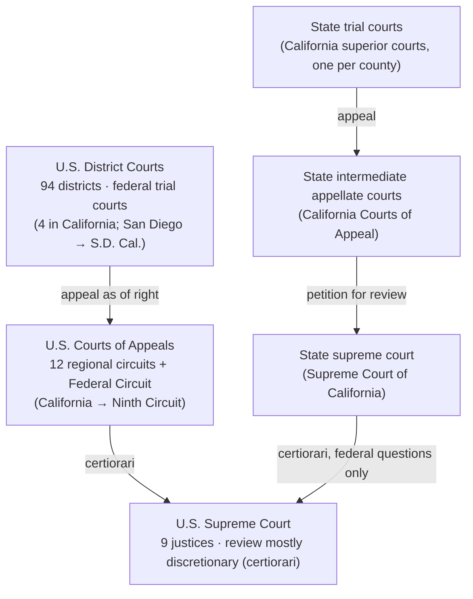

# The US legal system: a map for a civil-law reader

**Why this file exists.** Every subject outline assumes you already know where a rule comes from, which court's decision binds which court, and how to pull a rule out of a case. A PRC-trained lawyer usually has the doctrine but not the map. Read this once before Phase 4, then come back when a subject file uses a concept you can't place.

Companion files: [california-legal-system.md](california-legal-system.md) · [common-law-for-civil-lawyers.md](common-law-for-civil-lawyers.md) · [legal-english-glossary.md](legal-english-glossary.md) · [how-the-bar-exam-tests-law.md](how-the-bar-exam-tests-law.md)

---

## 1. Federalism and separation of powers

**Federalism** means two sovereigns govern the same territory and the same people: the national (federal) government and the 50 states. Each has its own constitution, legislature, executive and courts.

| Principle | Text | What it means in practice |
|---|---|---|
| **Enumerated federal powers** | U.S. Const. art. I, § 8 (Congress's list, incl. commerce, taxing and spending); art. II (executive); art. III (judicial) | The federal government may act only under a power the Constitution grants. Every federal statute needs a constitutional hook. |
| **Supremacy** | U.S. Const. art. VI, cl. 2 | The Constitution, federal statutes made under it and treaties are "the supreme Law of the Land"; state judges are bound by them. Conflicting state law is **preempted**. |
| **Reserved state powers** | U.S. Const. amend. X | Powers not delegated to the United States, nor prohibited to the states, stay with the states or the people. This is the source of the states' general "police power". |
| **Limits on states** | U.S. Const. amend. XIV, § 1 | States may not deny due process or equal protection. Through "incorporation", most of the Bill of Rights binds the states via this clause. |
| **Separation of powers** | Arts. I, II, III | Legislative, executive and judicial power are vested in separate branches, each with checks on the others. |
| **Judicial review** | *Marbury v. Madison*, 5 U.S. (1 Cranch) 137 (1803) | Courts may refuse to apply a statute that violates the Constitution. |

**The consequence you feel on the exam.** Contracts, torts, property, family law, succession, trusts, corporations and most crimes are **state law**. There are therefore 50-plus versions of each rule. A national exam (the MBE) cannot test any one state's version, so it tests the "generally accepted" version. The California essays default to "general application" unless the call asks for California law [S-077]. See [how-the-bar-exam-tests-law.md](how-the-bar-exam-tests-law.md).

> 🇨🇳 PRC bridge: the PRC is a unitary state. Local people's congresses legislate within national law, and there is no counterpart to the states' reserved sovereign powers (approx.).

---

## 2. Court structure

| Level | Federal system | State system (California detail in [california-legal-system.md](california-legal-system.md)) |
|---|---|---|
| Trial | **94 district courts** [S-149]. One judge; jury where the right exists. California has four federal districts: Northern, Eastern, Central and Southern (28 U.S.C. § 84). | General-jurisdiction trial courts. They hear the great majority of all US cases, including most federal claims (concurrent jurisdiction). |
| Intermediate appeal | **12 regional circuits**, each with a court of appeals, plus the **Federal Circuit** (nationwide but subject-limited, e.g. patents) [S-149]. Panels of three; review the record, no new evidence. | Most states have one. Appeal from a final judgment is usually a matter of right. |
| Top court | **U.S. Supreme Court**: nine justices (28 U.S.C. § 1). Review by writ of certiorari (28 U.S.C. §§ 1254, 1257). | The state supreme court is the **final word on its own state's law**. |
| Judges | Article III judges hold office "during good Behaviour" (U.S. Const. art. III, § 1), in effect for life. | Selection varies by state (election, appointment, retention votes). |

**Two points that trip up newcomers:**
1. **The U.S. Supreme Court is not a general court of cassation.** It reviews a state-court judgment only on a federal question (28 U.S.C. § 1257). It will not review one that rests on an adequate and independent state-law ground (*Michigan v. Long*, 463 U.S. 1032 (1983)).
2. **Federal courts are not "higher" than state courts on state law.** A federal court applying California law must follow the Supreme Court of California.

> 🇨🇳 PRC bridge: the PRC has one national four-level court system (basic, intermediate, high, Supreme People's Court) with two-instance finality (两审终审). The US has two parallel systems, federal and state, that meet only at the U.S. Supreme Court (approx.).

---

## 3. Jurisdiction in one paragraph (full treatment in Civil Procedure)

Federal courts are courts of **limited subject-matter jurisdiction**. They hear only the categories in U.S. Const. art. III, § 2 that Congress has also granted by statute. The main grants are:
- **federal question**: claims "arising under" federal law (28 U.S.C. § 1331);
- **diversity**: citizens of different states, with complete diversity (*Strawbridge v. Curtiss*, 7 U.S. (3 Cranch) 267 (1806)) and an amount in controversy exceeding $75,000 (28 U.S.C. § 1332);
- **supplemental** jurisdiction (28 U.S.C. § 1367) and **removal** from state court (28 U.S.C. § 1441).

State courts have general jurisdiction. Every court also needs **personal jurisdiction** over the defendant, limited by due process (*International Shoe Co. v. Washington*, 326 U.S. 310 (1945)), and proper **venue** (28 U.S.C. § 1391). The rules, tests and California differences are in [Civil Procedure](../03-subjects/civil-procedure/README.md) (`03-subjects/civil-procedure/outline.md`, Phase 4).

---

## 4. Sources of law and their hierarchy

| Rank | Source | Who makes it | Examples you will meet |
|---|---|---|---|
| 1 | **U.S. Constitution** | Ratification and amendment (art. V) | Commerce Clause, Bill of Rights, Fourteenth Amendment |
| 2 | **Federal statutes and treaties**; then **federal regulations** within the statute's grant | Congress / President; federal agencies | Title 28 (jurisdiction), securities laws; Federal Rules of Evidence (enacted by Congress in 1975) |
| 2a | **Federal court rules** | Supreme Court under the Rules Enabling Act (28 U.S.C. § 2072), subject to congressional review | Federal Rules of Civil Procedure; FRE amendments |
| 3 | **State constitution** | State voters | California Constitution (incl. voter initiatives) |
| 4 | **State statutes** | State legislature (in California, also voters by initiative) | California Evidence Code, Probate Code, Commercial Code |
| 5 | **State regulations and court rules** | State agencies; state judicial council or supreme court | California Rules of Court |
| 6 | **Common law (case law)** | Judges, case by case | Negligence, most contract formation rules, the Rule Against Perpetuities |

**How the ranks interact**
- Any valid federal law beats any state law (supremacy). Within a state, its constitution beats its statutes, and statutes beat common law.
- Common law fills the gaps that statutes leave, and a statute can change the common law at any time.
- A court's **interpretation** of a statute becomes part of the law: you must read the statute *together with* the cases construing it.

**Persuasive (secondary) sources: not law unless adopted**

| Source | What it is | Status |
|---|---|---|
| **Restatements** (e.g., Restatement (Second) of Contracts; Restatement (Second) and (Third) of Torts) | Published by the American Law Institute (ALI). They summarize, and sometimes reform, the common law in black-letter sections with comments. | Persuasive only. Courts often adopt a section, after which it is that state's law. Many "majority" and "modern" rules you will learn are stated in Restatement sections. |
| **Uniform Commercial Code (UCC)** | A *uniform act* drafted by the Uniform Law Commission and ALI | Law **only as enacted by each state**. California's enactment is the Commercial Code (Com. Code § 2207 = UCC § 2-207). The MBE assumes the **Official Text** of Articles 1 and 2 has been adopted and is in effect [S-040]. |
| **Other uniform acts** (Uniform Probate Code, Revised Uniform Partnership Act, etc.) | Drafted by the Uniform Law Commission for states to enact | Law only where enacted, often with local changes. |
| **Model codes** (Model Penal Code; ABA Model Rules of Professional Conduct; Model Business Corporation Act) | Drafted by ALI or ABA as models | Same: law only where adopted. The MPC is the usual source of "modern" criminal-law rules (e.g., the substantial-step test for attempt). |
| Treatises, law reviews | Scholarship | Persuasive only. |

> 🇨🇳 PRC bridge: in the PRC the code is the primary source and judicial interpretations (司法解释) of the Supreme People's Court bind lower courts. In the US the common law is itself primary law, and a Restatement is closer to an authoritative scholarly commentary than to a 司法解释 (approx.).

---

## 5. Stare decisis: which decisions bind whom

**Stare decisis** ("stand by things decided"): a court follows the legal rule of earlier decisions on materially similar facts.

| Concept | Meaning | Exam use |
|---|---|---|
| **Binding (mandatory) authority** | A decision a court *must* follow: from a higher court in the same hierarchy, on the same jurisdiction's law | "Under [state] law, which binds this court, ..." |
| **Persuasive authority** | A decision a court *may* follow: from another state, a lower court, a different hierarchy, a Restatement | Majority/minority discussions |
| **Vertical stare decisis** | Lower courts must follow higher courts in their own system. Absolute. | — |
| **Horizontal stare decisis** | A court generally follows its own earlier decisions, but a top court can overrule itself. | Overruling questions in Con Law |
| **Holding** | The rule of law **necessary** to decide the case on its material facts. Only the holding binds. | The "rule" you extract from a case |
| **Dictum** (pl. dicta) | Anything in the opinion not necessary to the result: hypotheticals, broader statements, side comments | Persuasive only |
| **Overruling** | A court with power to do so declares an earlier rule no longer law. Example: *Brown v. Board of Education*, 347 U.S. 483 (1954), rejected the "separate but equal" doctrine of *Plessy v. Ferguson*, 163 U.S. 537 (1896). | Recent overrulings are listed in `00-exam-intel/recent-changes.md` |
| **Distinguishing** | Showing that a precedent's material facts differ, so its holding does not control | The core move in essay and PT analysis |

**Who binds whom**

| Decision of ... | Binds | Persuasive for |
|---|---|---|
| U.S. Supreme Court, on federal law | **Every** court, federal and state | — |
| Federal court of appeals | District courts in its circuit; later panels of the same circuit (generally changed only en banc or by the Supreme Court) | Other circuits; **state courts**, even on federal questions (California: *People v. Bradley* (1969) 1 Cal.3d 80, 86) |
| Federal district court | No other court. See *Camreta v. Greene*, 563 U.S. 692 (2011). | Everyone |
| State supreme court, on its own state's law | All courts of that state, **and federal courts applying that state's law** | Courts of other states |
| State intermediate appellate court | That state's trial courts (California: statewide; see [california-legal-system.md](california-legal-system.md) §4) | — |

> 🇨🇳 PRC bridge: the SPC's guiding cases (指导性案例) are to be "referred to" (参照) in similar cases. That is the nearest PRC analogue to binding precedent, but it is much narrower: in the US **every** published appellate holding is precedent (approx.).

---

## 6. *Erie* in two sentences

A federal court hearing a state-law claim (usually in diversity) applies the **substantive law of the state**, including that state's judge-made common law, because there is no "federal general common law" (*Erie R.R. Co. v. Tompkins*, 304 U.S. 64 (1938); see 28 U.S.C. § 1652). The court still applies **federal procedural law**. Where a valid Federal Rule covers the point, the Rule controls (*Hanna v. Plumer*, 380 U.S. 460 (1965)). The tests are in [Civil Procedure](../03-subjects/civil-procedure/README.md).

---

## 7. How to read a case

**Anatomy of a citation**
- *Erie R.R. Co. v. Tompkins*, 304 U.S. 64 (1938) = volume 304 of the *United States Reports*, starting at page 64, decided 1938.
- California official style puts the year first: *Auto Equity Sales, Inc. v. Superior Court* (1962) 57 Cal.2d 450.

**The case brief (use this template for PT library cases and for any case a subject file cites)**

| Field | Question to answer | Tip |
|---|---|---|
| **Facts** | What happened, *only* the facts the court relied on? | Mark which facts were outcome-determinative. You will compare your facts to these. |
| **Procedural posture** | Who sued whom; what the trial court did; who appealed; what motion is being reviewed? | Posture sets the standard of review (de novo for law; deference for facts). |
| **Issue** | The precise legal question, phrased as a yes/no question that includes key facts | "Does X, when Y, constitute Z?" |
| **Holding** | The court's answer to the issue, as narrow as the facts | Yes/no + the rule applied to these facts |
| **Reasoning** | Why: text, precedent, policy, analogy | This is what you borrow to argue *your* facts |
| **Rule** | The general rule the case stands for, in one sentence | This becomes your essay rule statement |
| **Disposition** | Affirmed, reversed, remanded, vacated | Tells you who won *this* appeal |
| (Concurrence / dissent) | Other views | Useful for "the other side will argue" |

**Worked mini-brief: *Hadley v. Baxendale* (1854) 9 Exch. 341, 156 Eng. Rep. 145**
- **Facts:** a mill's crankshaft broke. A carrier was hired to take it to the maker as a pattern for a new one, and delivery was delayed. The mill stood idle in the meantime. The court treated the special circumstance (that the mill had no spare shaft and could not run without this one) as never communicated to the carrier.
- **Posture:** the jury awarded damages including lost profits, and the carrier sought a new trial.
- **Issue:** is a breaching carrier liable for lost profits it had no reason to know would follow from delay?
- **Holding:** no. A new trial was ordered.
- **Rule:** damages for breach are recoverable only if they arise naturally from the breach or were reasonably in the contemplation of both parties at contracting as the probable result of breach.
- **Use:** this is the foreseeability limit on consequential damages, tested in Contracts and Remedies.

**Synthesizing several cases into one rule (the common-law skill)**
1. Line up the cases with their outcomes.
2. Find the fact that flips the outcome (e.g., "the defendant *knew* of the special circumstance").
3. State the rule at the level of generality that explains all of them.
4. Test it against the hardest case.

PT libraries require exactly this. See [common-law-for-civil-lawyers.md](common-law-for-civil-lawyers.md) §2.

---

## 8. How to read a statute

**Reading order**
1. **Definitions** section, because a defined term can mean something narrower or broader than ordinary English.
2. **Scope and application**: what transactions and persons are covered (e.g., UCC Article 2 covers "transactions in goods").
3. **Operative rule**: break it into **elements**. "And" = all elements required; "or" = alternatives.
4. **Exceptions and provisos** ("unless", "except as provided in", "provided that").
5. **Mandatory vs permissive**: "shall" (must) vs "may" (discretion).
6. **Burden and standard**, if stated; cross-references; effective date.

**Worked example: the UCC statute of frauds (UCC § 2-201(1), paraphrased)**
- **Rule:** a contract for the sale of goods for **$500 or more** is not enforceable unless there is a writing that is:
  - (1) sufficient to indicate a contract for sale, and
  - (2) signed by the party against whom enforcement is sought.
- **Gap-filling:** a writing is not insufficient merely because it omits or misstates a term, but the contract is not enforceable beyond the **quantity** shown.
- **Exceptions:** found in § 2-201(2) and (3), e.g., the merchant's confirmation, specially manufactured goods, admission, and goods paid for or received.
- **Elements test:** goods? price ≥ $500? writing? signed by the defendant? quantity stated? Then check every exception.

**Canons of construction (courts' interpretive conventions)**

| Canon | Meaning |
|---|---|
| Plain meaning | Start with the ordinary meaning of the text; stop if it is unambiguous. |
| Whole-text | Read a provision in the context of the whole statute; avoid surplusage. |
| *Expressio unius est exclusio alterius* | Listing some items implies the exclusion of others. |
| *Ejusdem generis* | General words after specific ones ("cars, trucks and other vehicles") cover only things of the same kind. |
| *Noscitur a sociis* | A word is known by its neighbors. |
| Specific over general; later over earlier | Resolves conflicts between provisions. |
| Rule of lenity | Genuine ambiguity in a criminal statute is resolved for the defendant. |
| Constitutional avoidance | Prefer a reading that avoids a serious constitutional question. |
| Derogation canon | Statutes in derogation of the common law are construed narrowly. |

> 🇨🇳 PRC bridge: the reading discipline is familiar from 法律解释 (文义、体系、目的解释). The difference is that a US court's construction then becomes precedent, so "the statute" means text + cases (approx.).

---

## 9. Majority rules, minority rules and why the bar tests "general principles"

| Label | Meaning |
|---|---|
| **Majority rule** | The rule most US jurisdictions follow |
| **Minority rule** | A rule a smaller group follows, sometimes including California |
| **Modern trend** | The direction courts and Restatements are moving; often becomes the majority |
| **Common-law rule** | The traditional judge-made rule, often since modified by statute (e.g., the Rule Against Perpetuities) |
| **Restatement / UCC / MPC position** | The rule in the named model text |

**Why national exams test general principles**
- The MBE serves many jurisdictions, so it is built on the generally accepted view unless a question says otherwise [S-007] [VERIFY V-044].
- It also states defaults where states split. For example, the Torts outline says joint and several liability and pure comparative fault are "the relevant rules unless otherwise indicated" [S-040].
- California's essays instruct: "Unless a question expressly asks you to use California law, you should answer according to legal theories and principles of general application" [S-077].

**What to write when rules split (essays)**
1. State the majority/general rule and apply it. That is your main analysis.
2. In **one or two sentences**, flag the minority or California rule **only if it changes the outcome** or the call asks for it.
3. If unsure which view is the majority, write "Under the traditional rule ... ; under the modern approach ...". Then apply both briefly and conclude.

Which law to apply in each component, as a decision flowchart: [how-the-bar-exam-tests-law.md](how-the-bar-exam-tests-law.md) §6.
