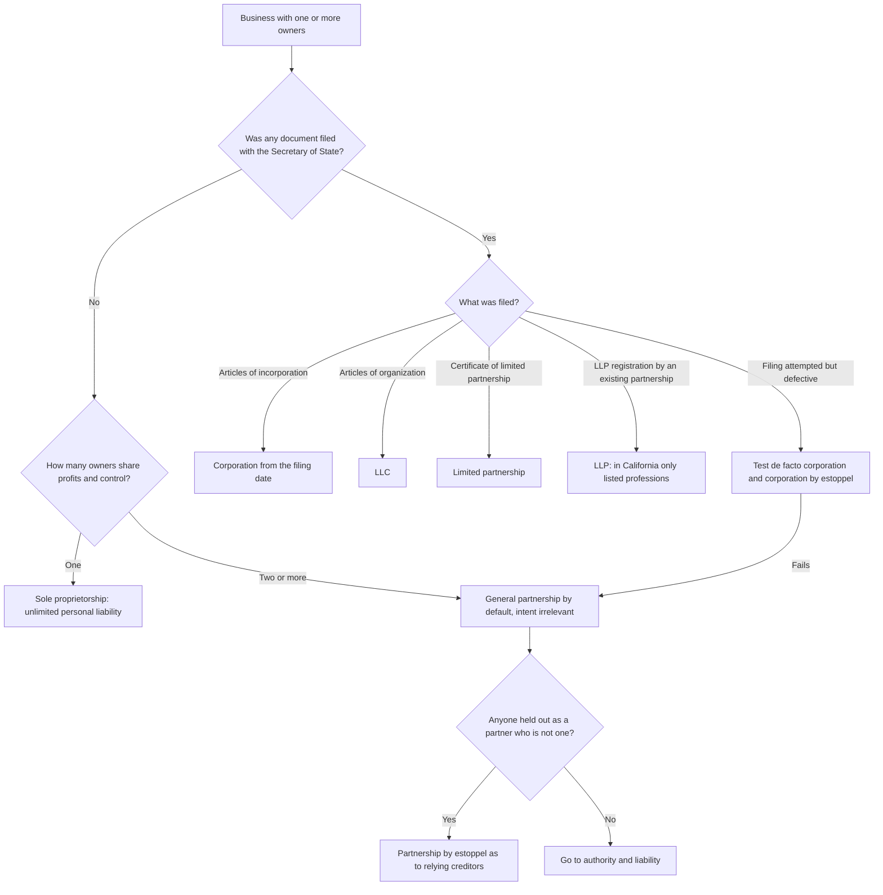
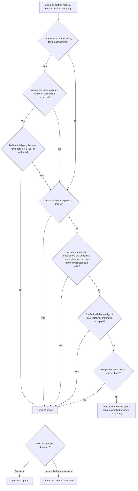
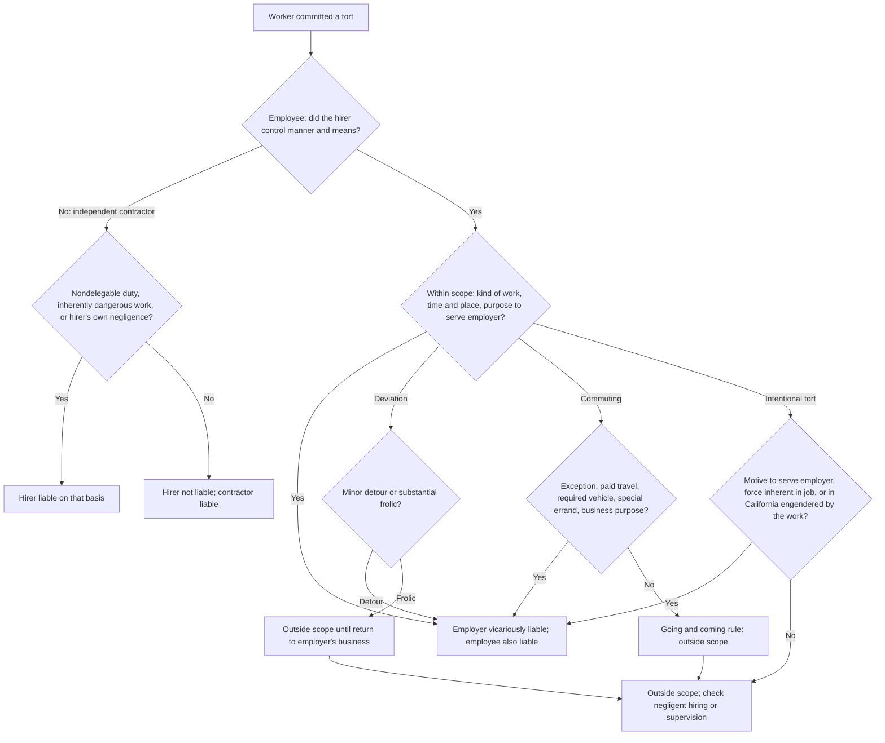
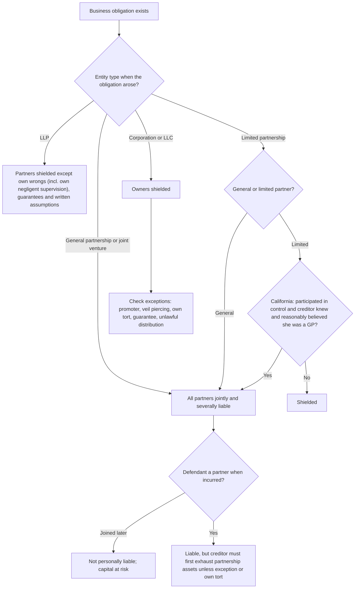
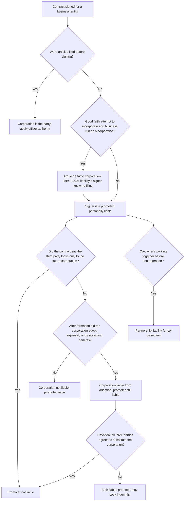
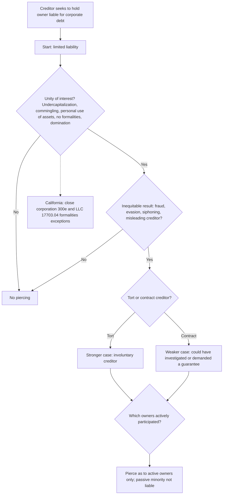
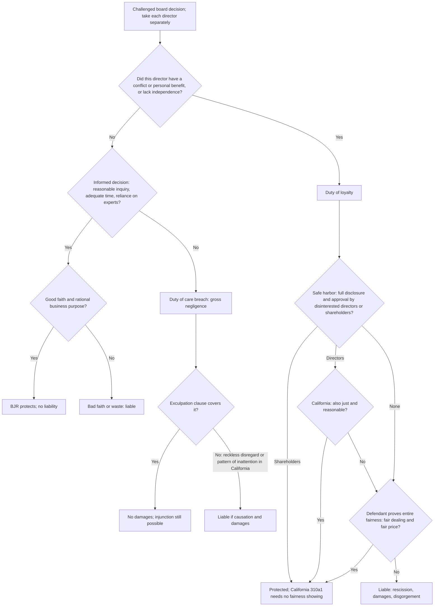
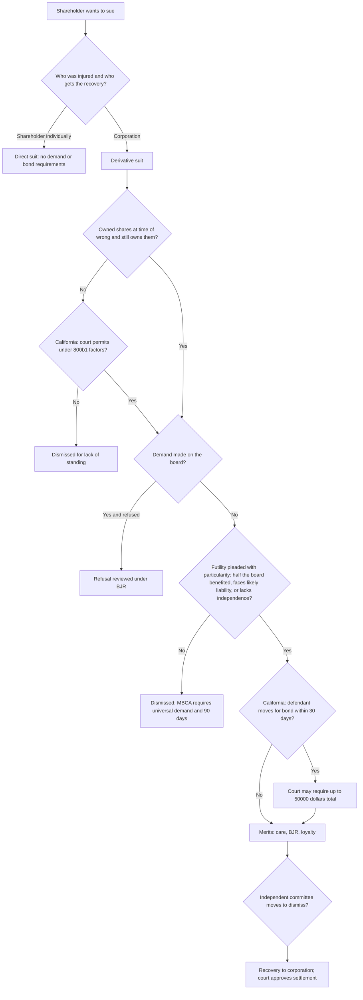
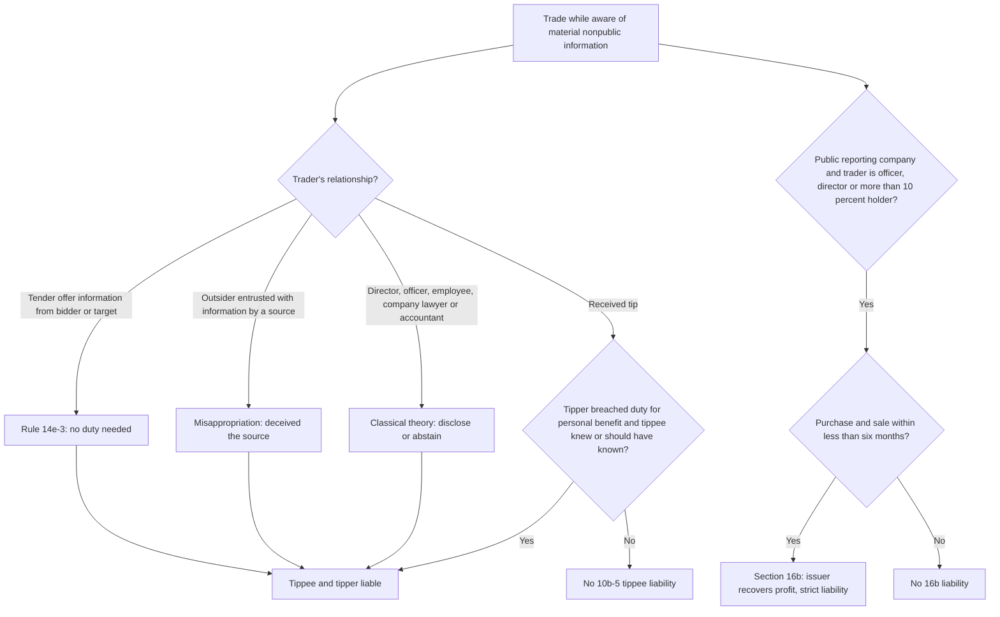
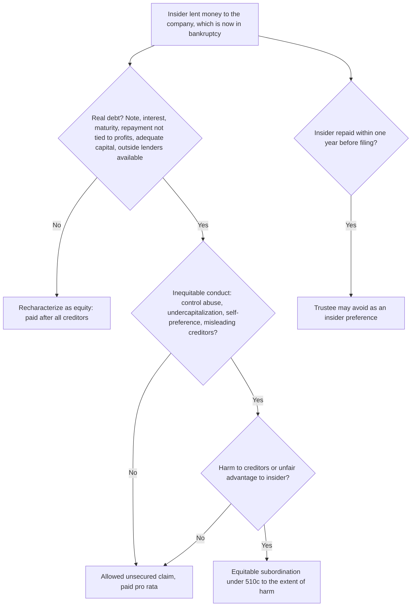

# Business Associations — flowcharts

Ten decision trees for the analyses you will run most often. Rule IDs point to [`rule-statements.md`](rule-statements.md).

## 1. What kind of entity is it? (R-BUS-021, R-BUS-040, R-BUS-044, R-BUS-051, R-BUS-101, R-BUS-107)

## 2. Is the principal bound by the contract? (R-BUS-008 to R-BUS-013, R-BUS-025)

## 3. Respondeat superior (R-BUS-002, R-BUS-014 to R-BUS-018)

## 4. Partner and owner personal liability for a business debt (R-BUS-028 to R-BUS-030, R-BUS-042, R-BUS-045)

## 5. Promoter and pre-incorporation contracts (R-BUS-051 to R-BUS-055)

## 6. Piercing the corporate veil (R-BUS-046 to R-BUS-049)

## 7. Director liability: care, BJR, loyalty (R-BUS-061 to R-BUS-070)

## 8. Shareholder suit procedure (R-BUS-081 to R-BUS-084)

## 9. Insider trading and short-swing profits (R-BUS-088 to R-BUS-092)

## 10. Insider loan in the company's bankruptcy (R-BUS-099, R-BUS-100)

