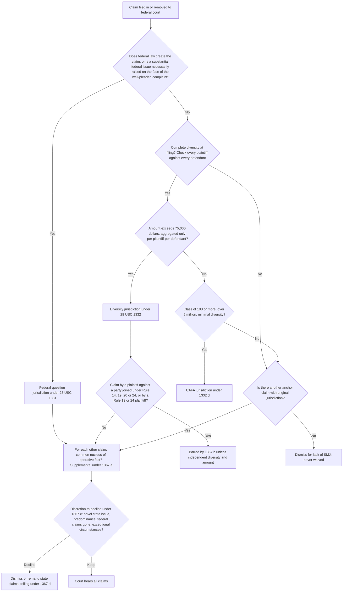
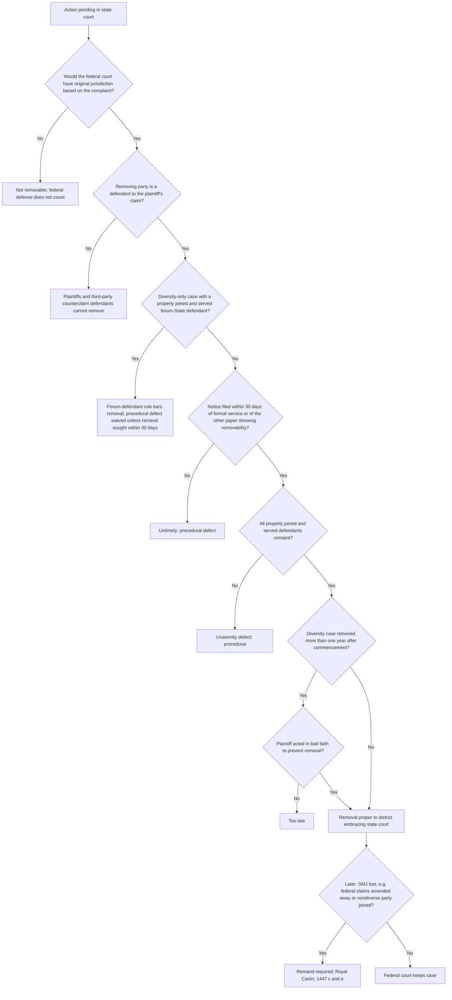
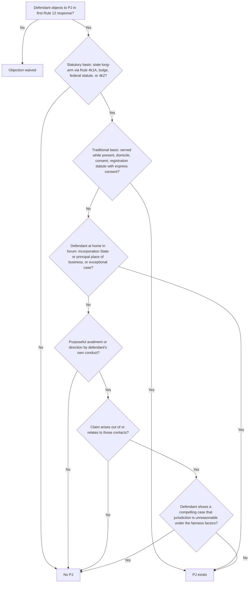
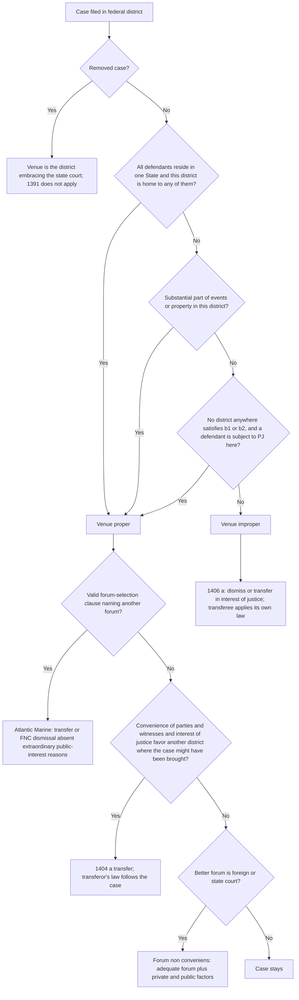
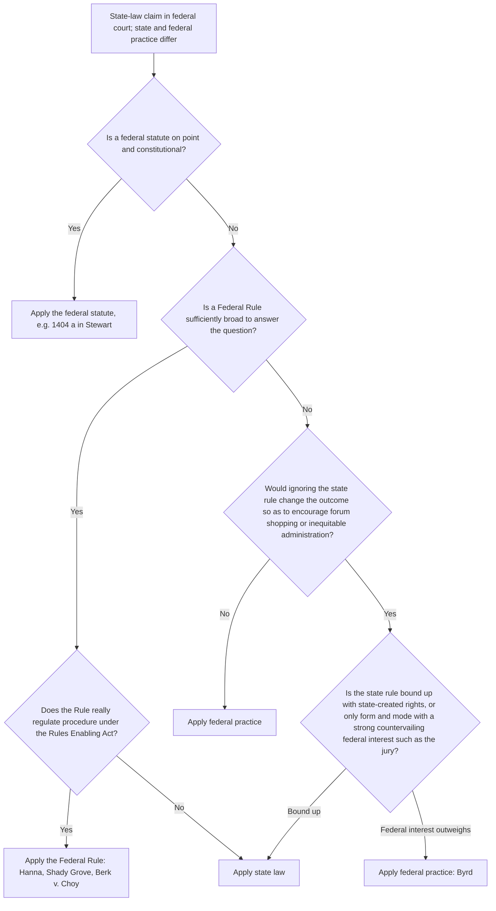
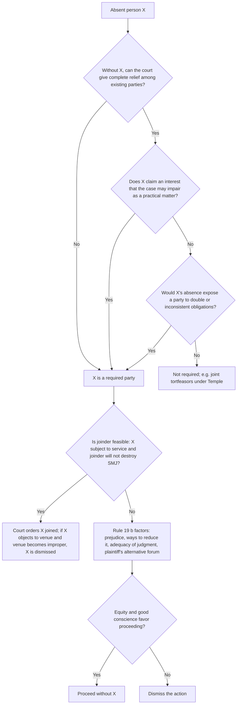
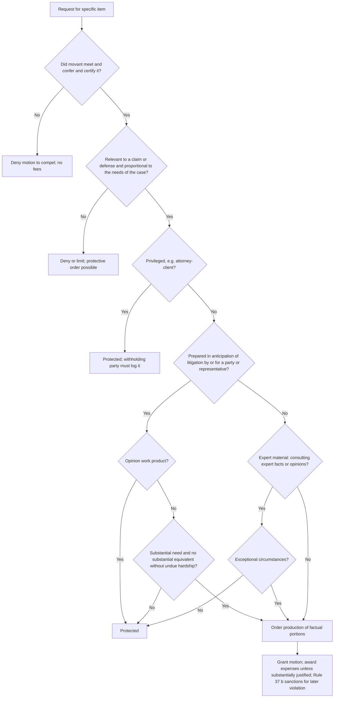
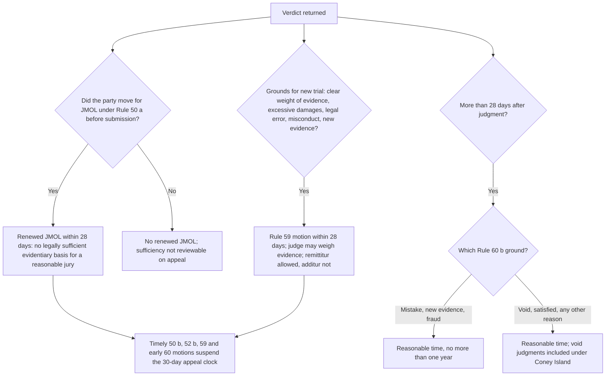
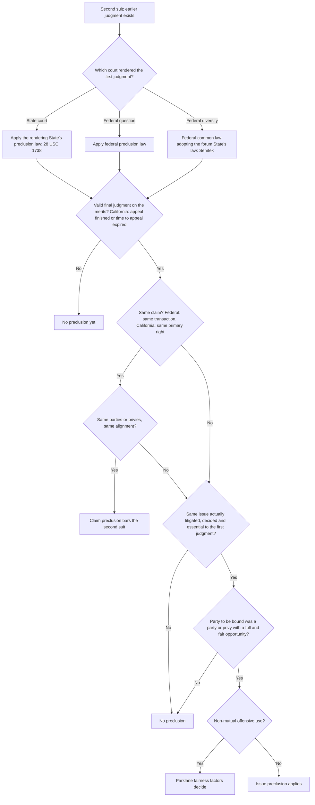
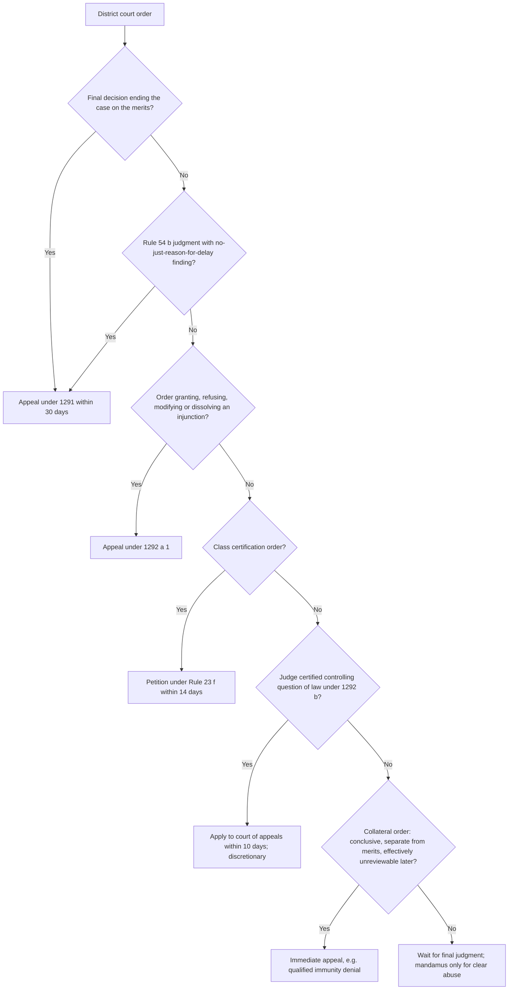

# Civil Procedure — flowcharts

Each chart cites the rule blocks in [rule-statements.md](rule-statements.md). Labels avoid parentheses so the diagrams render in any Mermaid viewer.

## 1. Federal subject-matter jurisdiction (R-CIV-001 to R-CIV-012)

## 2. Removal and remand (R-CIV-013 to R-CIV-016)

## 3. Personal jurisdiction (R-CIV-017 to R-CIV-027)

## 4. Venue and transfer (R-CIV-031 to R-CIV-036)

## 5. Erie analysis (R-CIV-037 to R-CIV-040)

## 6. Required joinder under Rule 19 (R-CIV-054, R-CIV-055)

## 7. Discovery dispute on an essay (R-CIV-062 to R-CIV-073)

## 8. Post-trial motions (R-CIV-087 to R-CIV-090)

## 9. Claim and issue preclusion (R-CIV-094 to R-CIV-098, R-CIV-114, R-CIV-115)

## 10. Can this order be appealed now? (R-CIV-099 to R-CIV-101, R-CIV-118)

