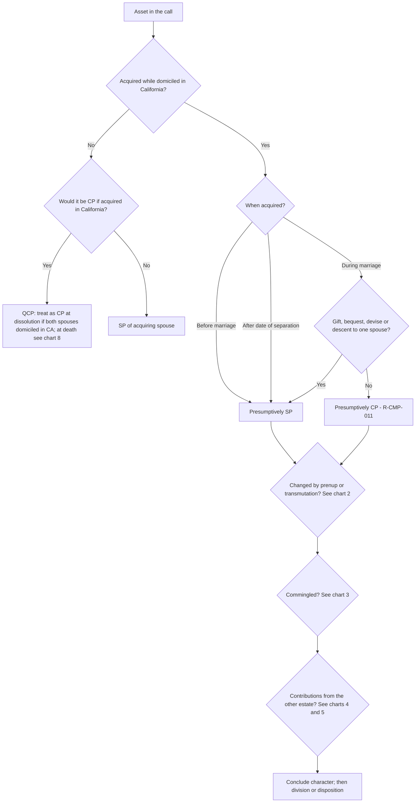
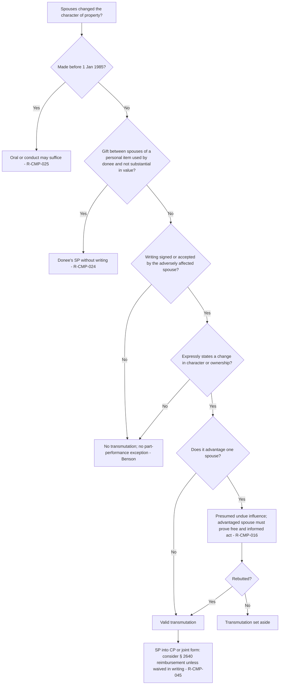
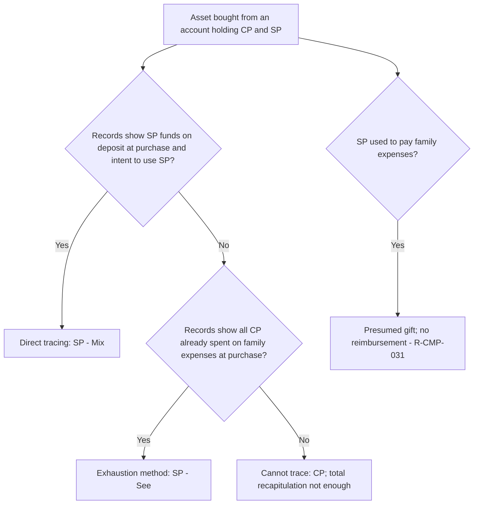
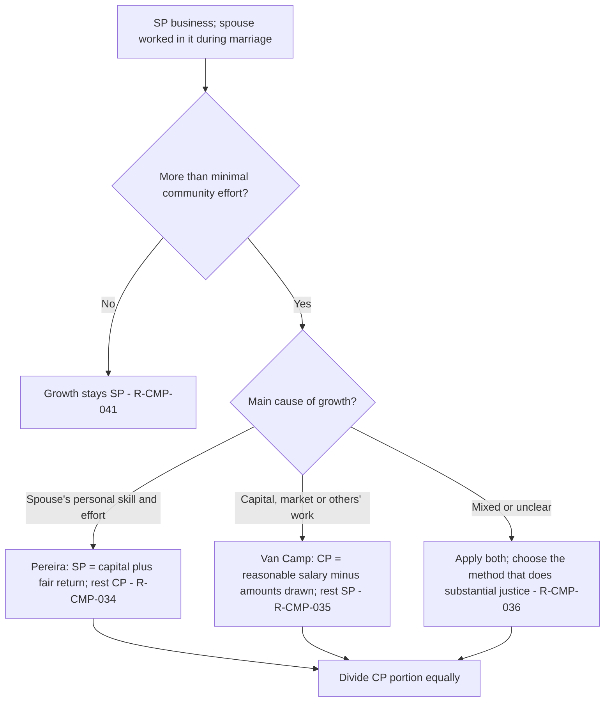
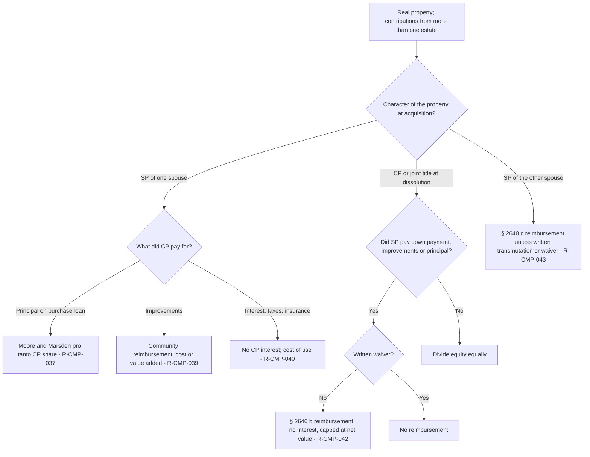
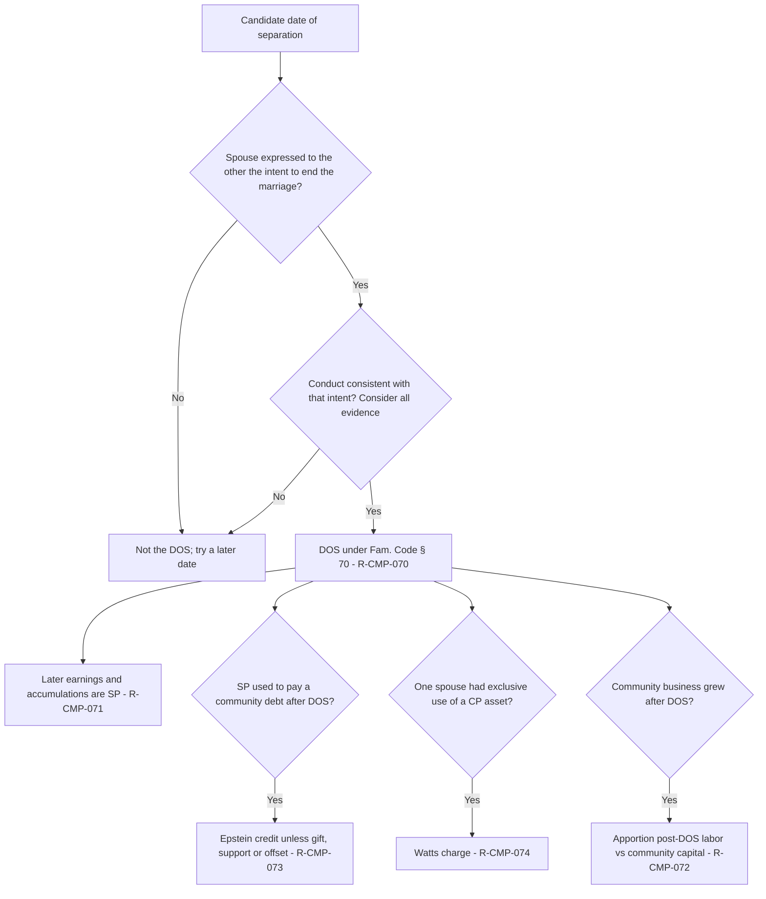
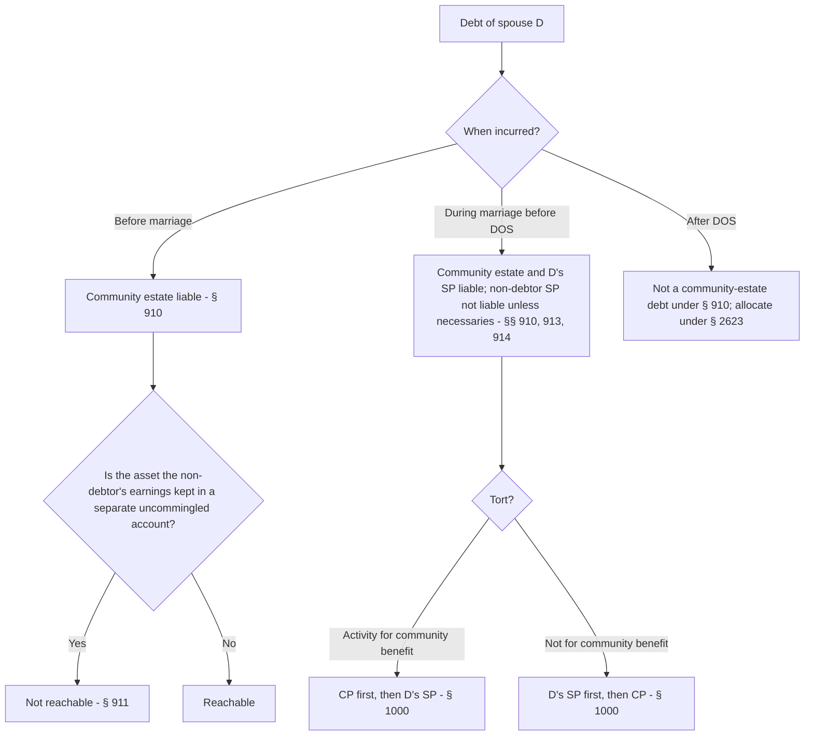
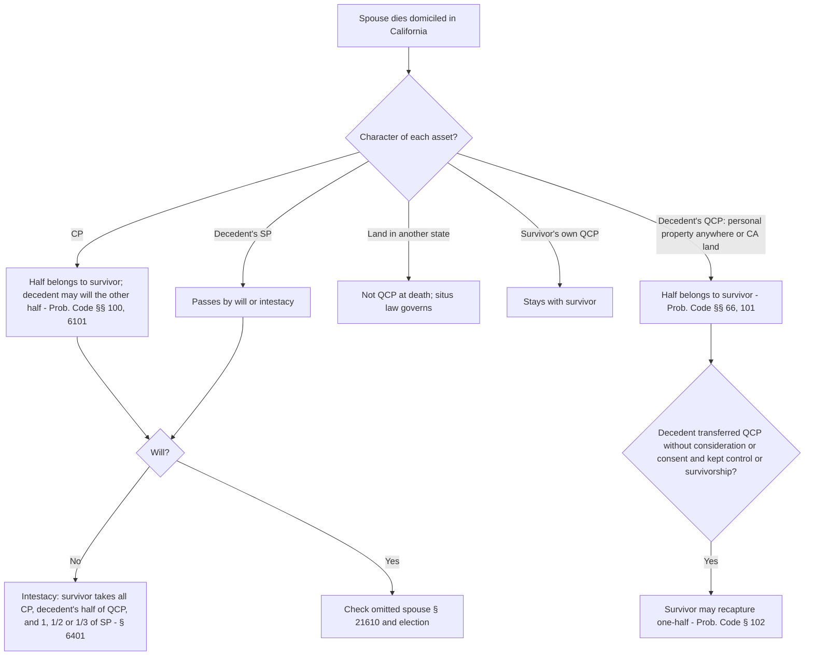

# Community Property — flowcharts

Eight decision trees for the analyses that recur on California CP essays. Rule IDs point to [`rule-statements.md`](rule-statements.md).

## 1. Characterizing one asset (the master loop)

## 2. Transmutation (Fam. Code § 852)

## 3. Commingled account tracing

## 4. Separate business grown during marriage (Pereira / Van Camp)

## 5. Who paid for the real property? (Moore/Marsden, § 2640, improvements)

## 6. Date of separation and post-separation accounting

## 7. Can the creditor reach it? (debts)

## 8. Property at death (CP, QCP, SP)

