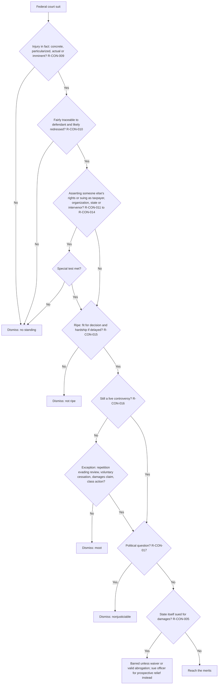
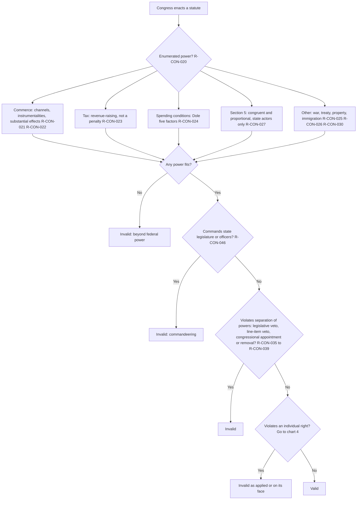
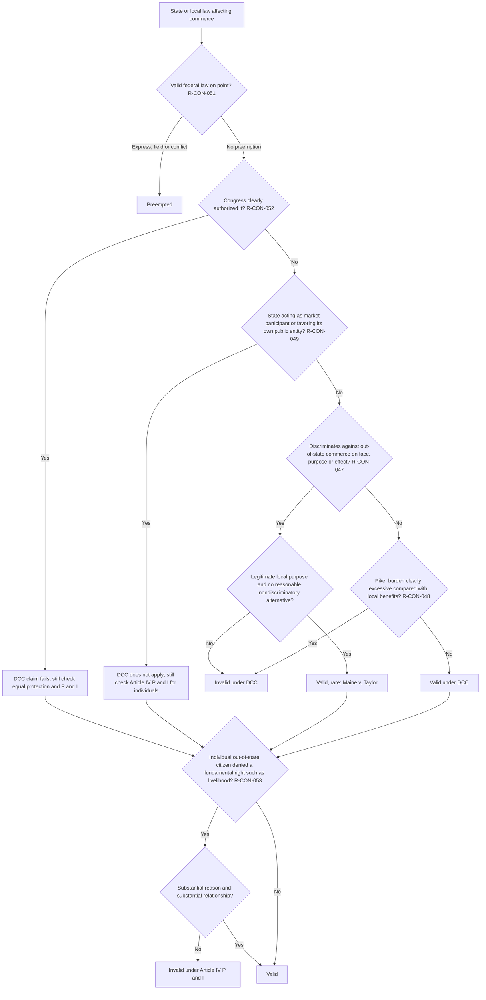
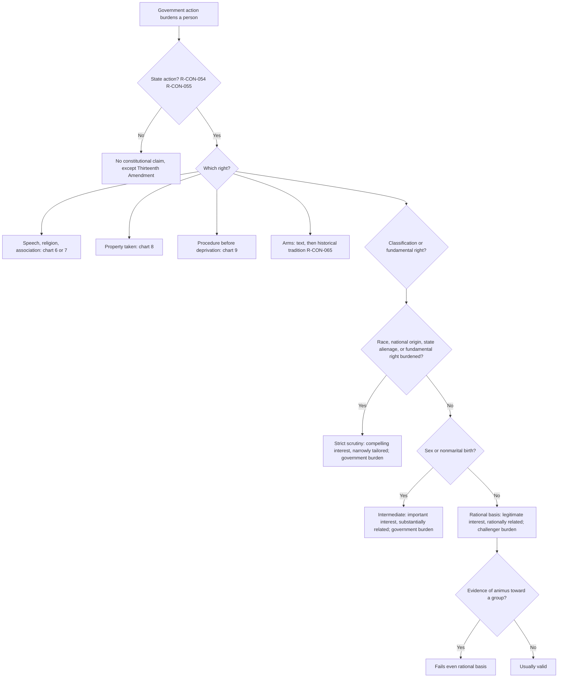
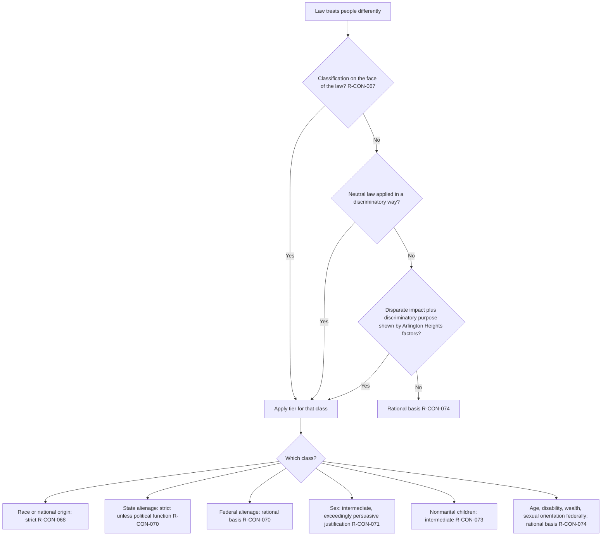
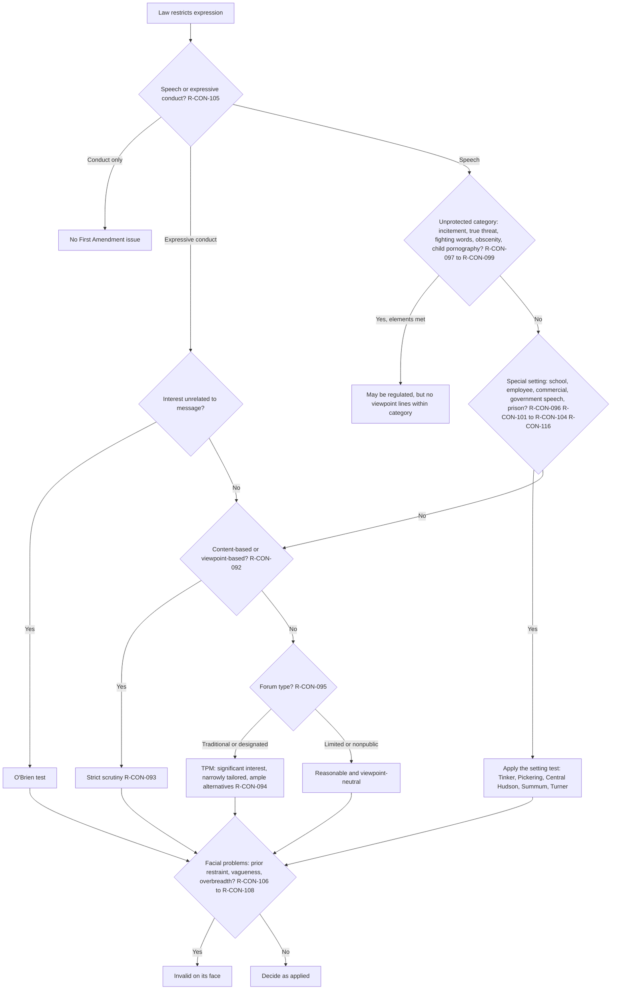
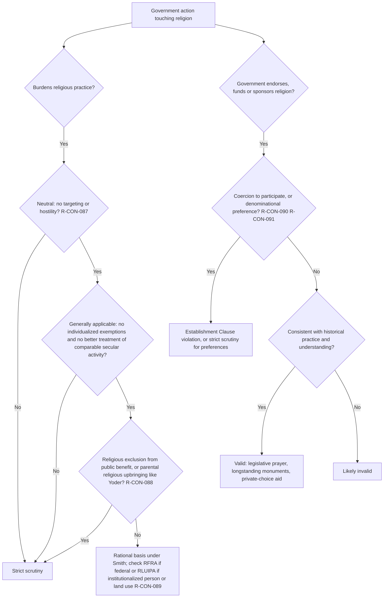
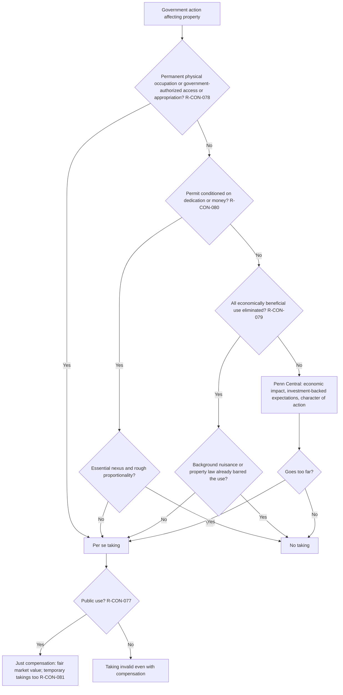
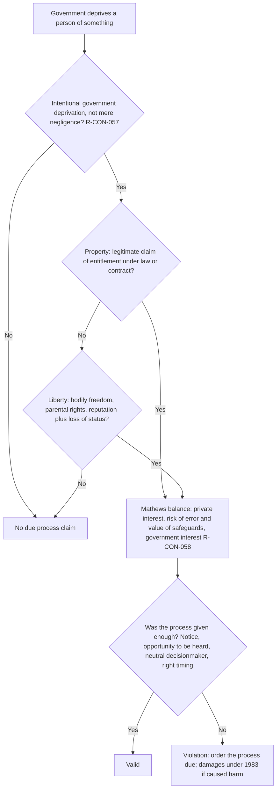
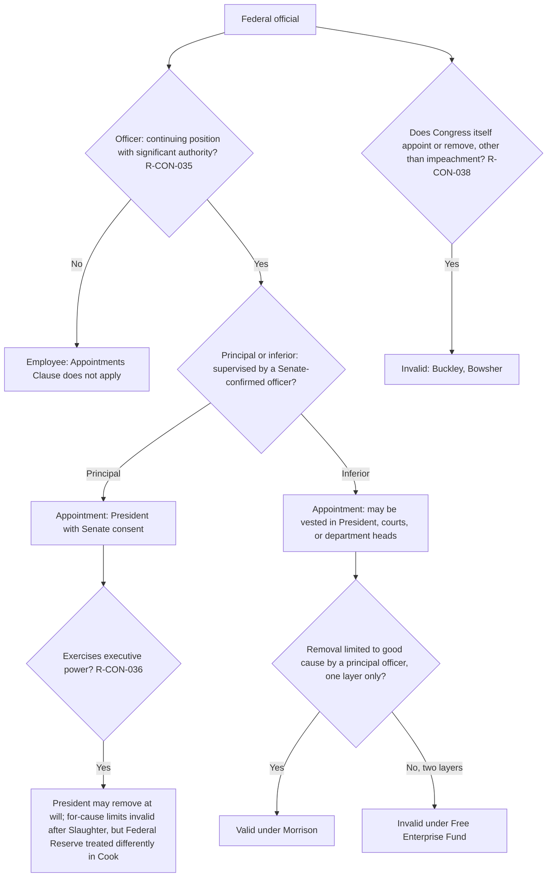

# Constitutional Law — flowcharts

Rule IDs in each node point to [rule-statements.md](rule-statements.md).

## 1. Justiciability (run for each plaintiff)

## 2. Validity of a federal statute

## 3. State law that affects interstate business

## 4. Individual rights: choosing the test

## 5. Equal protection: is there a suspect classification?

## 6. Free speech

## 7. Religion clauses

## 8. Takings

## 9. Procedural due process

## 10. Appointment and removal

