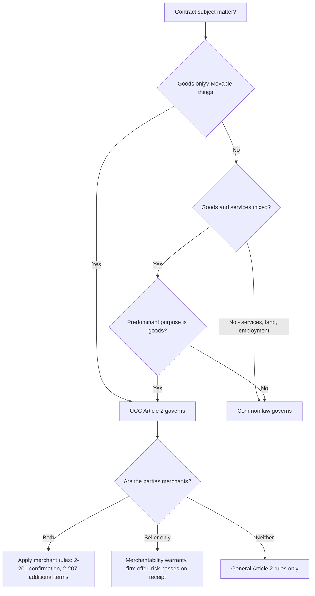
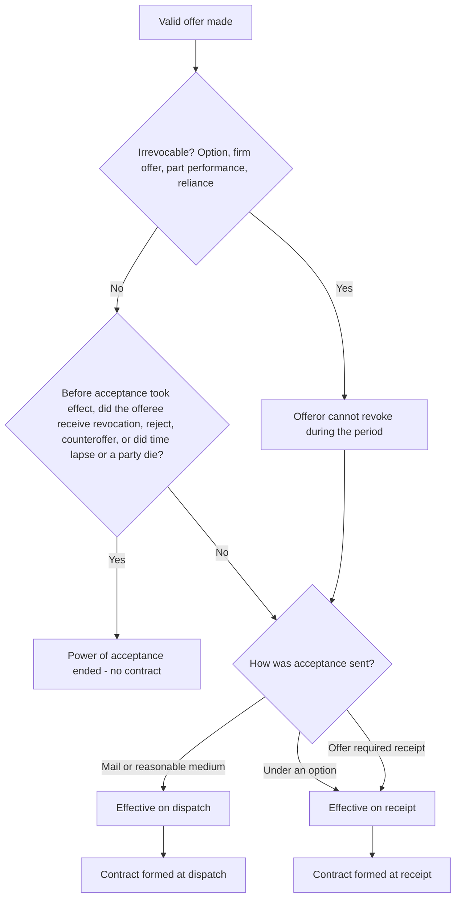
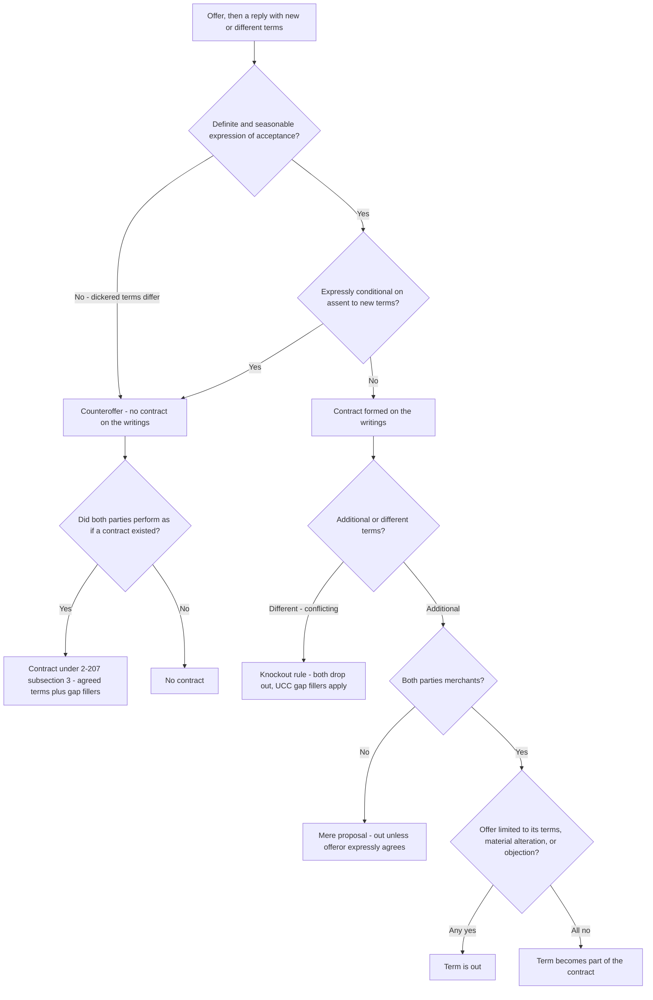
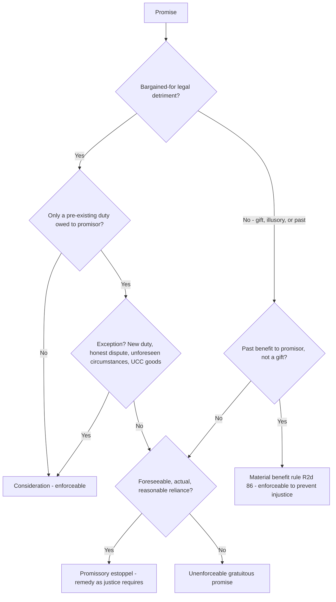
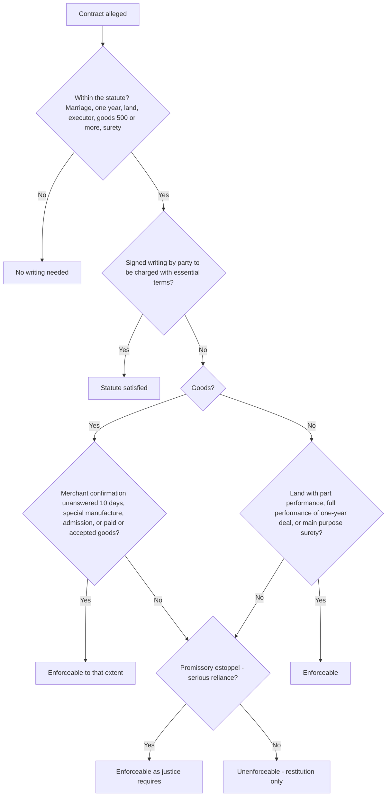
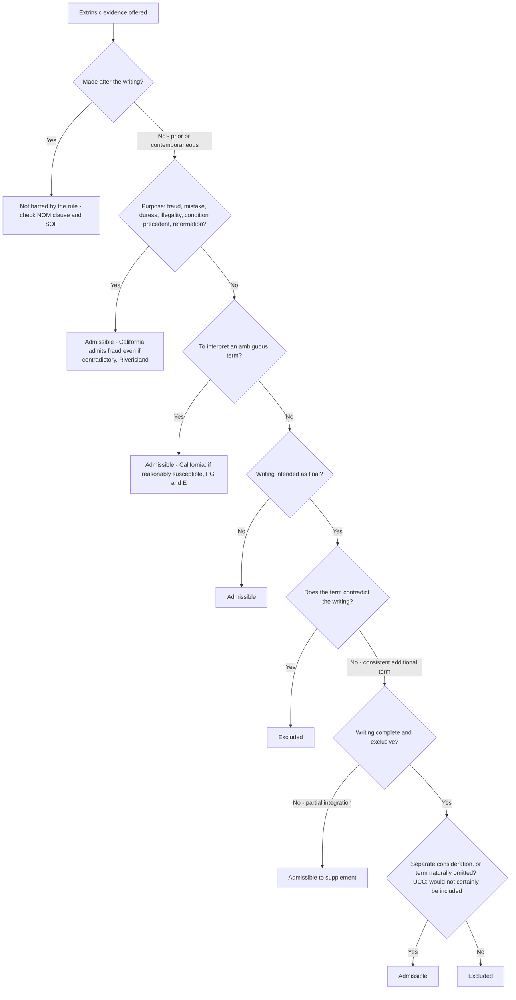
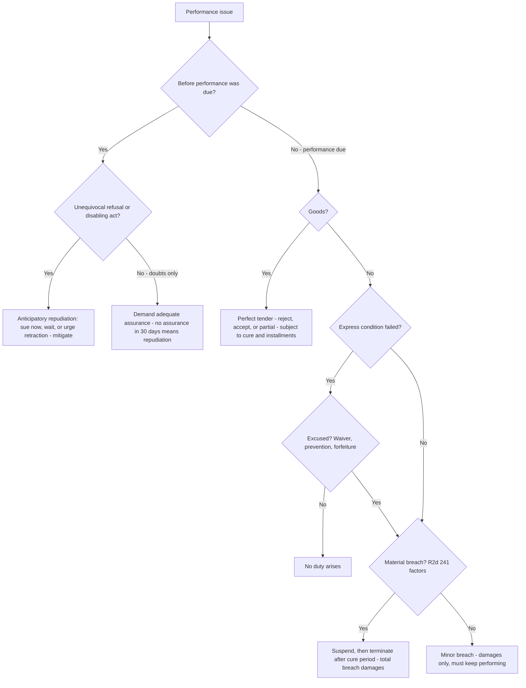
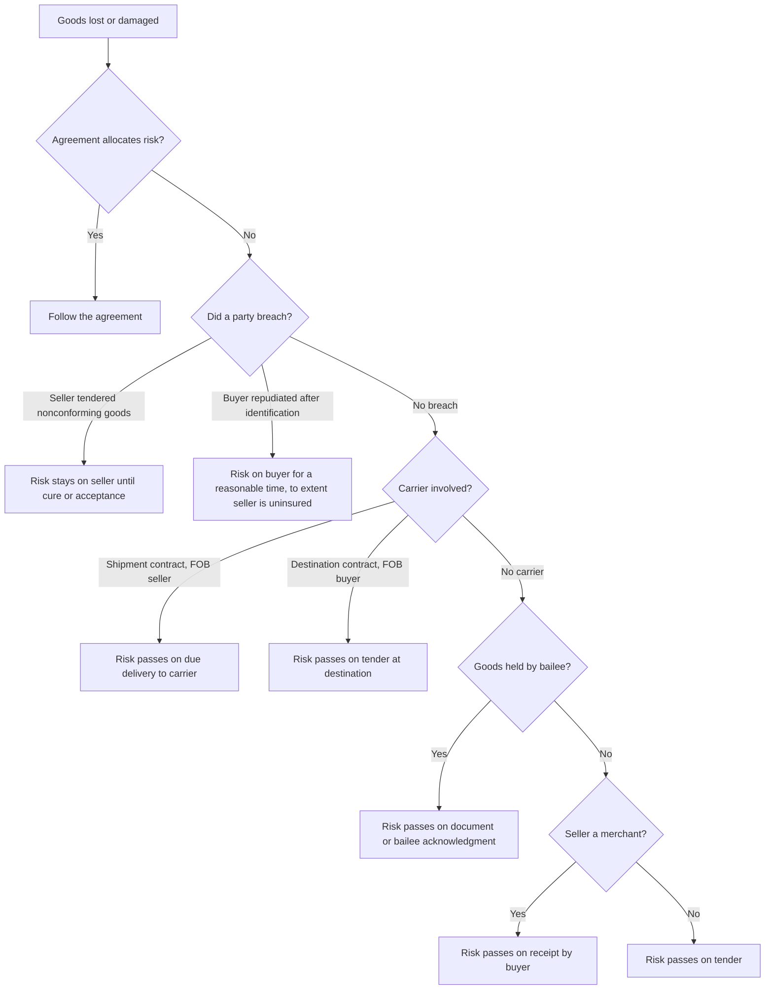

# Contracts — flowcharts

Eight decision trees for the analyses you will run most often. Rule IDs point to [`rule-statements.md`](rule-statements.md).

## 1. Which law governs? (R-CTR-001, R-CTR-002)

## 2. Was the offer still open when acceptance took effect? (R-CTR-006 to R-CTR-011, R-CTR-015)

## 3. Battle of the forms, UCC 2-207 (R-CTR-013, R-CTR-014)

## 4. Is the promise enforceable without a bargain? (R-CTR-022 to R-CTR-027)

## 5. Statute of frauds (R-CTR-042 to R-CTR-048)

## 6. Parol evidence (R-CTR-049 to R-CTR-052)

## 7. Breach and the injured party's options (R-CTR-062 to R-CTR-070)

## 8. UCC risk of loss (R-CTR-077 to R-CTR-080)

