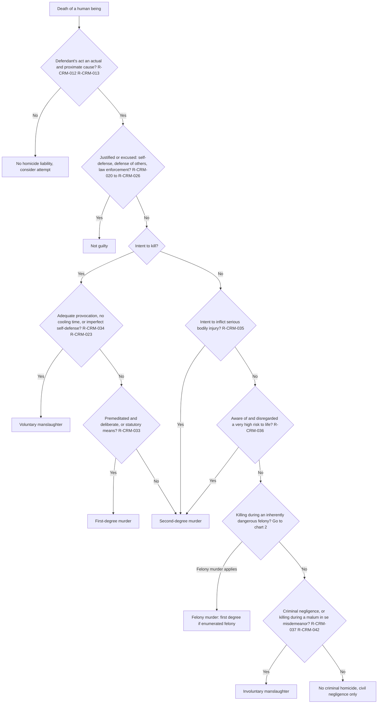
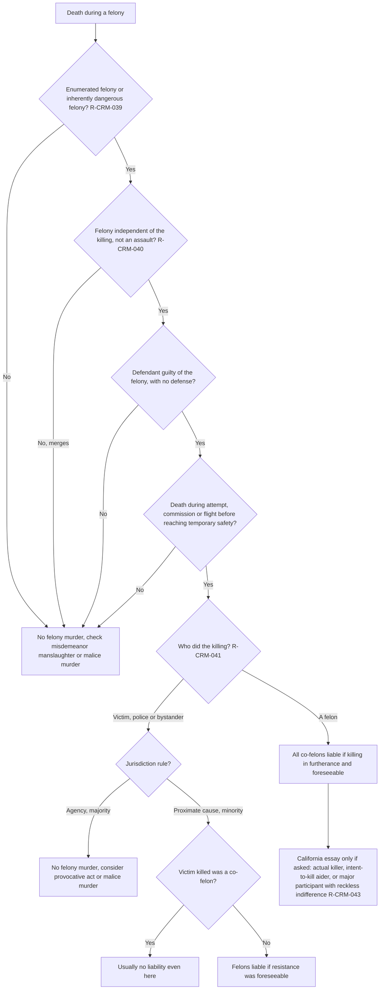
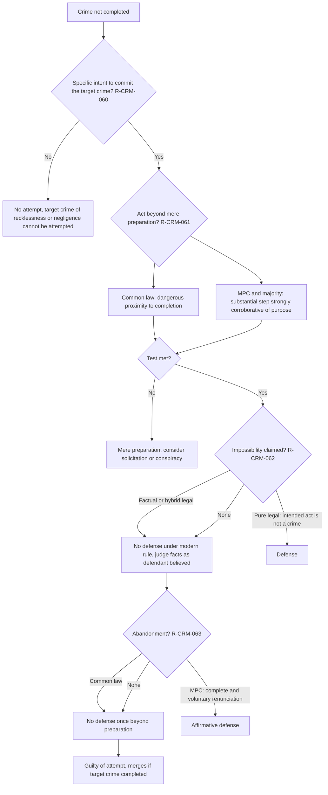
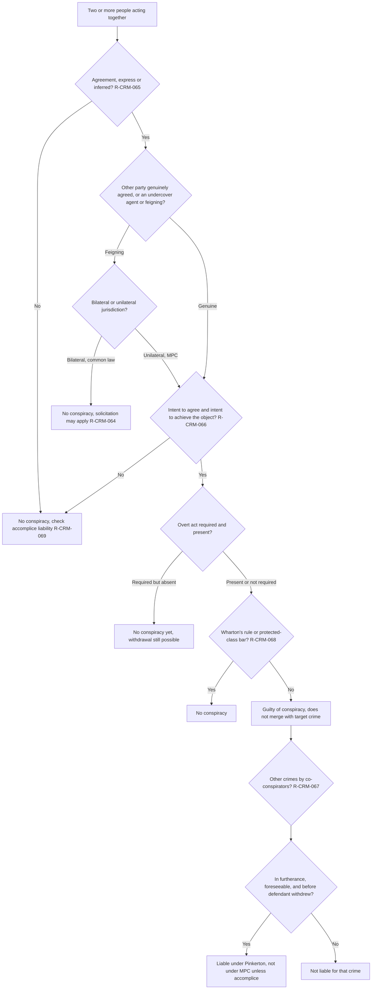
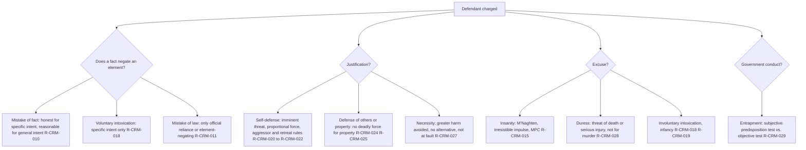
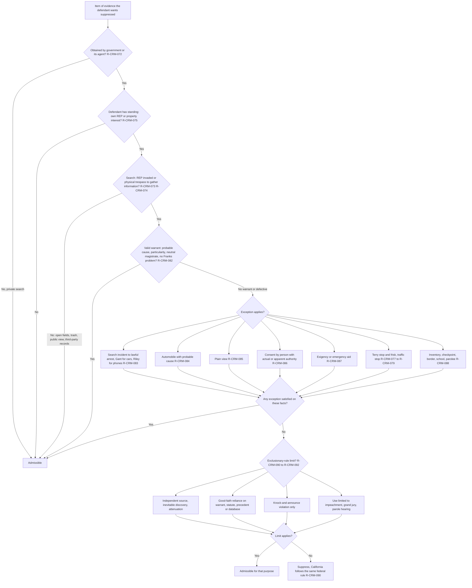
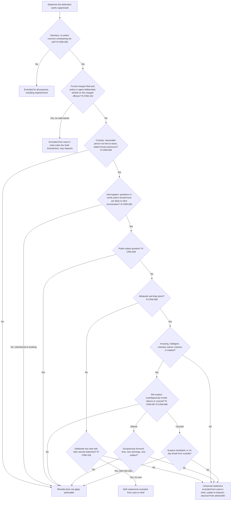
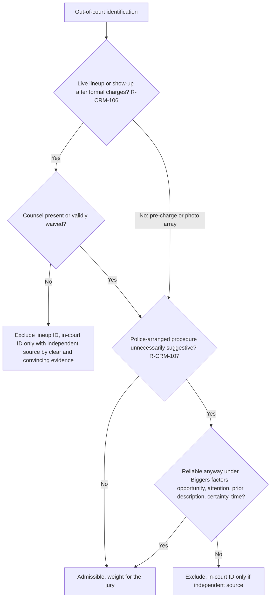
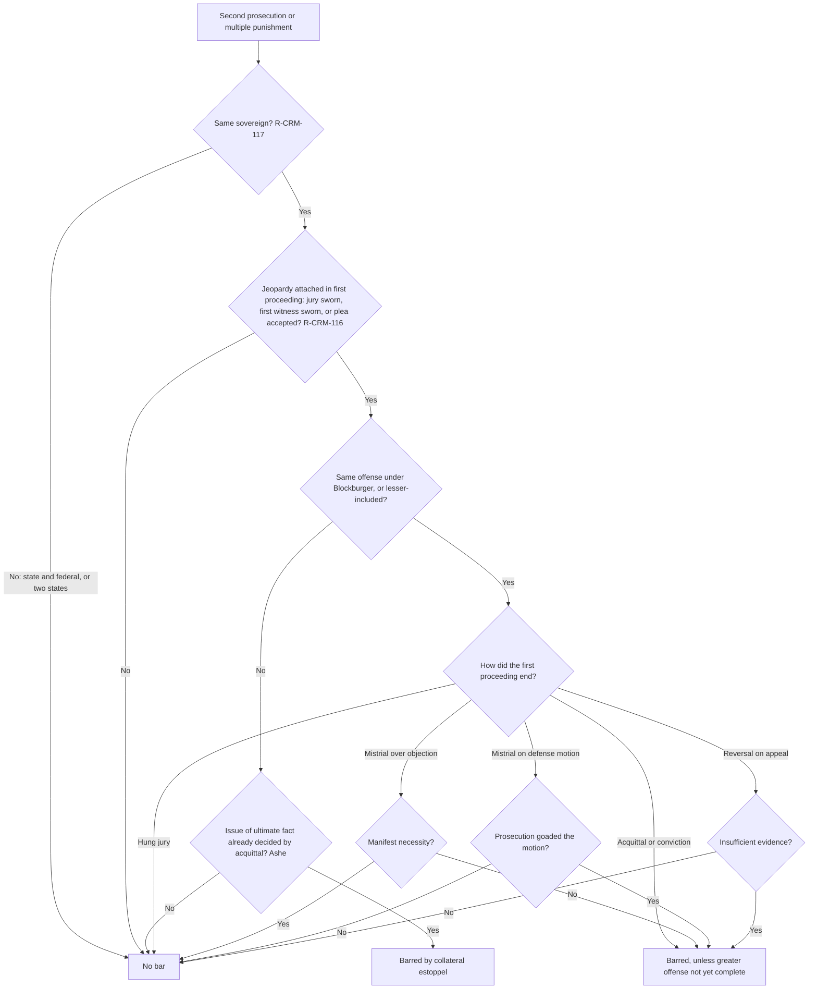

# Criminal Law and Procedure — flowcharts

Rule IDs in each node point to [rule-statements.md](rule-statements.md). Run chart 1 for every death, chart 6 for every item of physical evidence, and chart 7 for every statement.

## 1. Homicide classification (run for each death)

## 2. Felony murder

## 3. Attempt

## 4. Conspiracy and Pinkerton

## 5. Defenses to a charge

## 6. Fourth Amendment — one item of physical evidence

## 7. Statements — Miranda and related rights

## 8. Identification evidence

## 9. Double jeopardy

