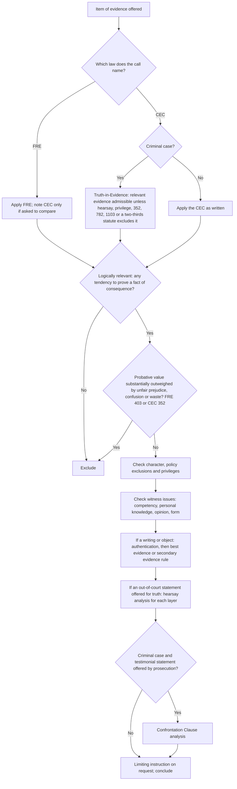
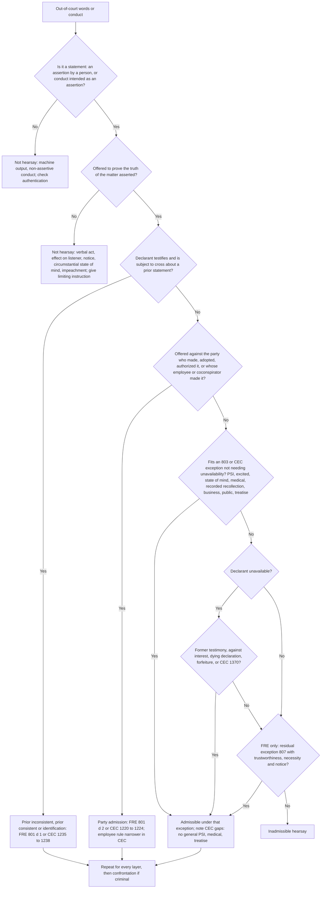
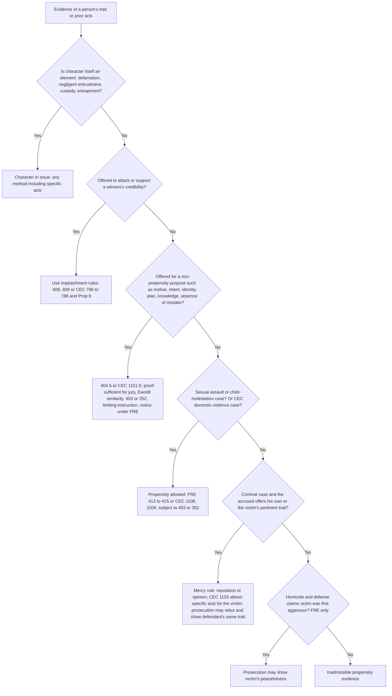
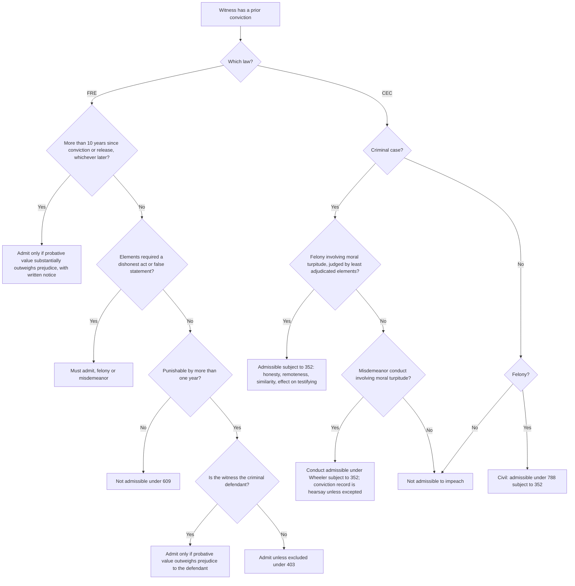
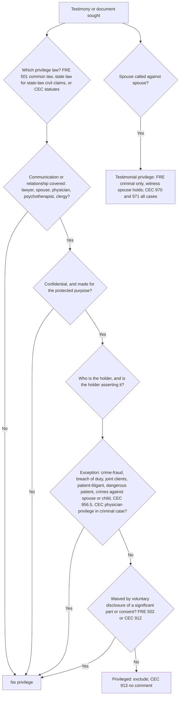
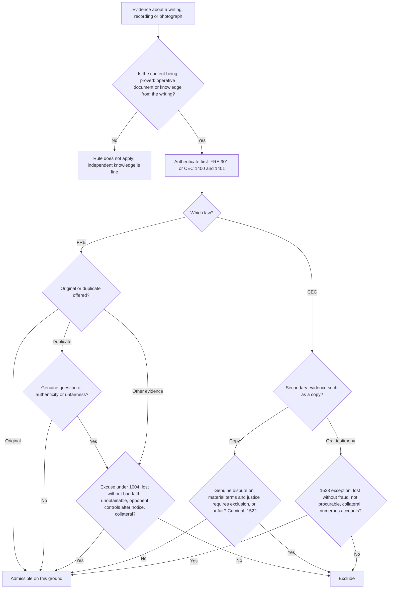
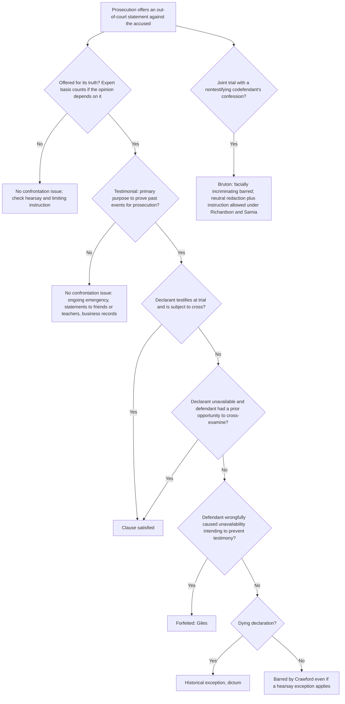
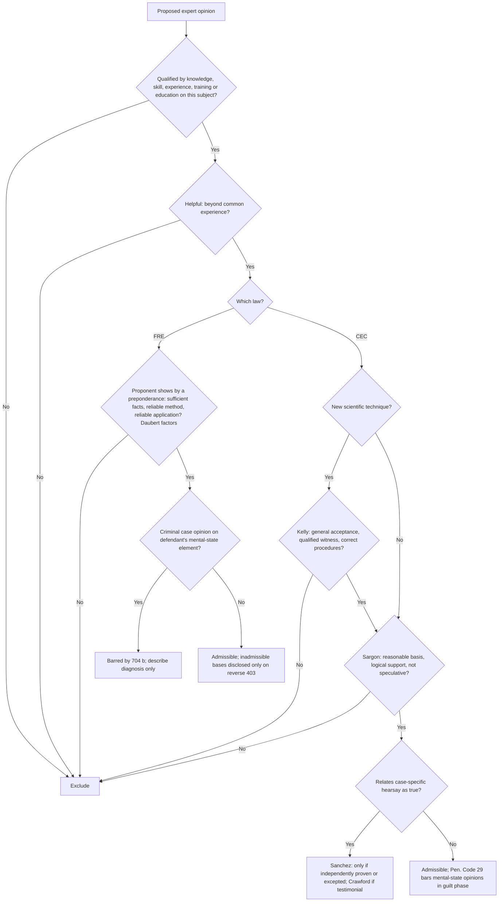

# Evidence — flowcharts

Each chart cites the rule blocks in [rule-statements.md](rule-statements.md). Labels avoid parentheses and inner quotation marks so the diagrams render in any Mermaid viewer. "CEC" means the California Evidence Code.

## 1. The item-by-item sequence (R-EVD-001 to R-EVD-008)

## 2. Is it hearsay, and is it admissible? (R-EVD-083 to R-EVD-109)

## 3. Character evidence (R-EVD-035 to R-EVD-046)

## 4. Impeachment by prior conviction (R-EVD-025, R-EVD-026)

## 5. Privilege analysis (R-EVD-062 to R-EVD-072)

## 6. Best evidence rule and California secondary evidence rule (R-EVD-078 to R-EVD-081)

## 7. Confrontation Clause (R-EVD-110 to R-EVD-114)

## 8. Expert testimony (R-EVD-054 to R-EVD-061)

