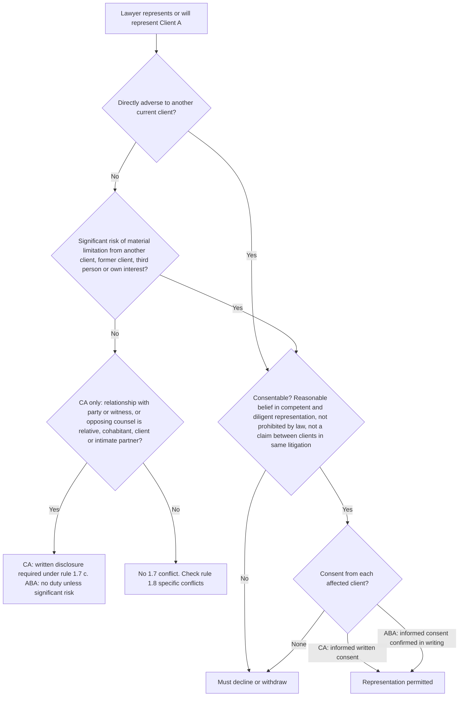
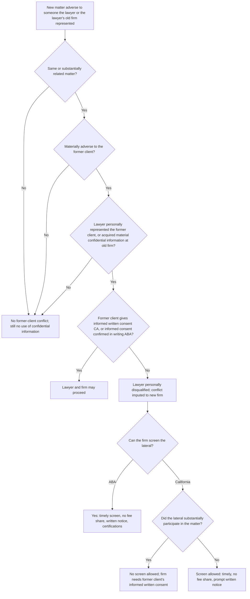
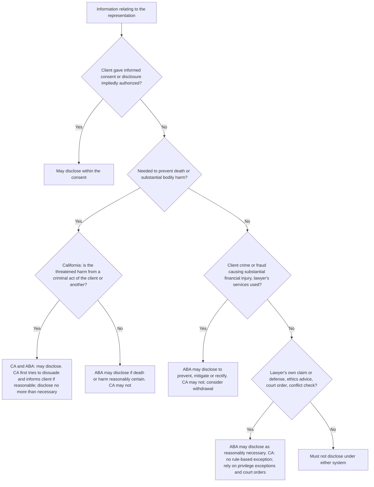
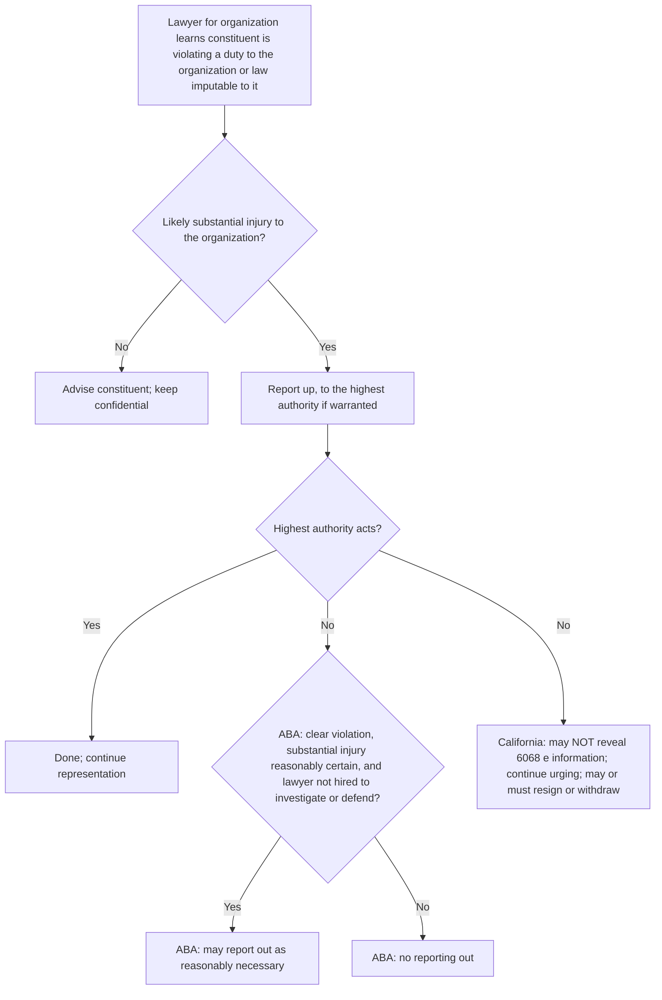
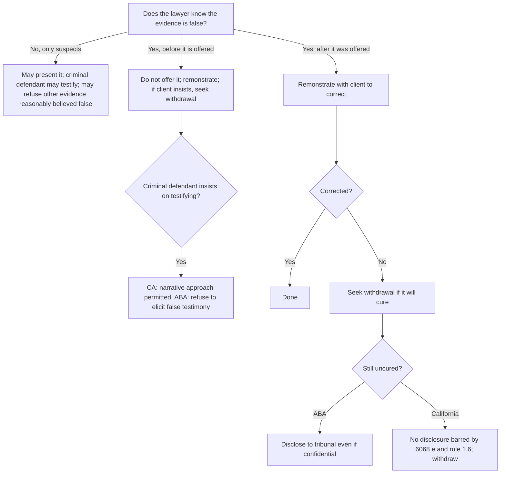
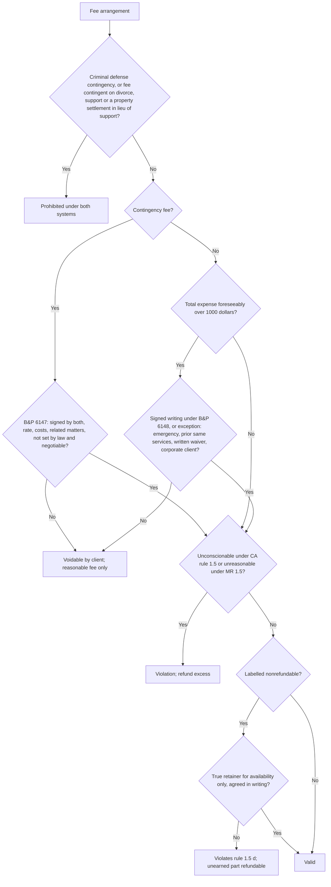
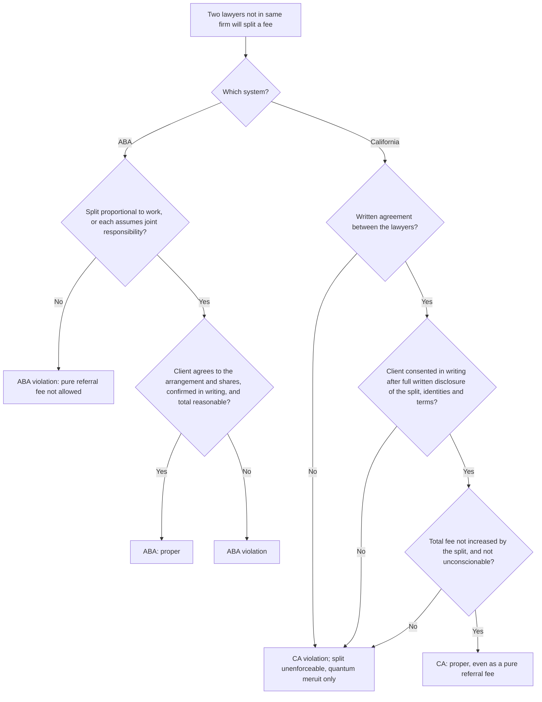
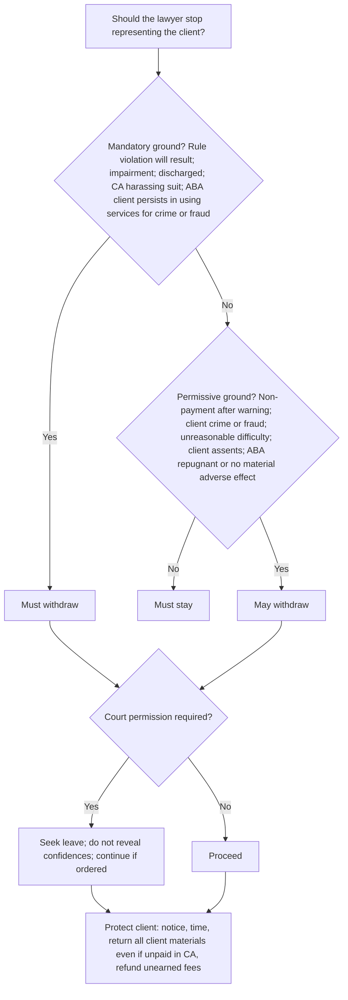
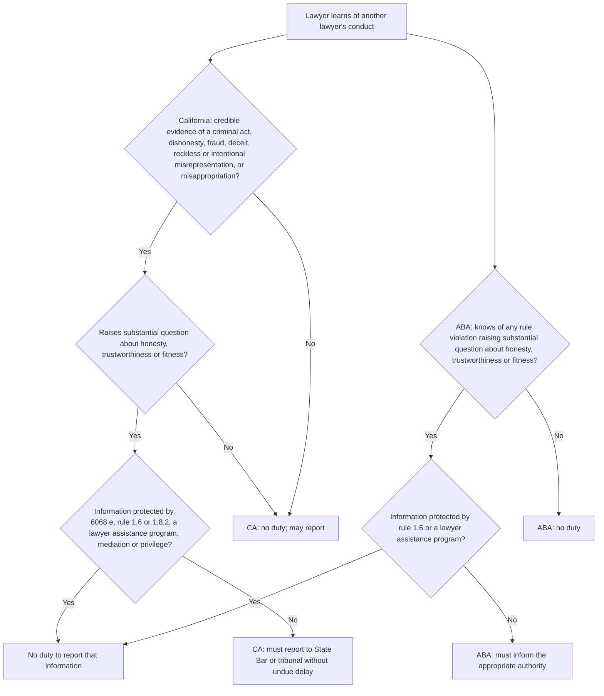
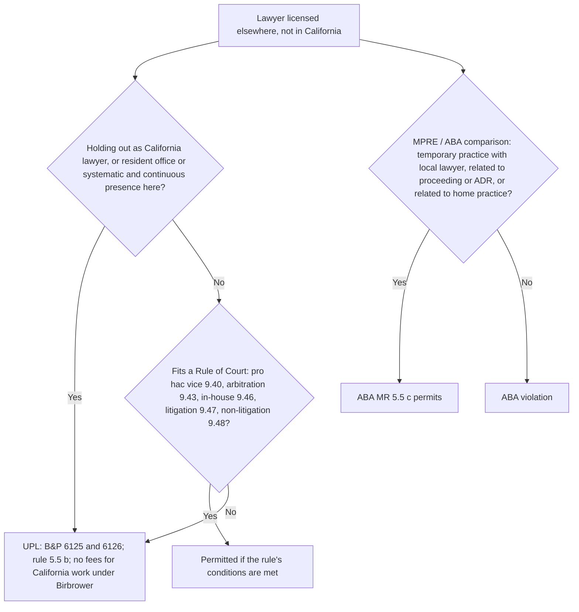

# Professional Responsibility — flowcharts

Each chart ends in a California result and an ABA result where they differ. Rule IDs point to [`rule-statements.md`](rule-statements.md).

## 1. Current-client conflict (rule 1.7 / MR 1.7) — R-PRF-021 to R-PRF-024

## 2. Former client, imputation and screening (rules 1.9–1.10) — R-PRF-034 to R-PRF-037

## 3. May the lawyer reveal confidential information? — R-PRF-013 to R-PRF-015

## 4. Organization client and constituent wrongdoing (rule 1.13) — R-PRF-055, R-PRF-056

## 5. False evidence and client perjury (rule 3.3) — R-PRF-061

## 6. Is the fee arrangement valid in California? — R-PRF-041 to R-PRF-045

## 7. Fee division between lawyers in different firms — R-PRF-046

## 8. Withdrawal — R-PRF-050 to R-PRF-053

## 9. Must the lawyer report another lawyer? (rule 8.3) — R-PRF-091

## 10. Out-of-state lawyer working on a California matter — R-PRF-082, R-PRF-083

