# Real Property — flowcharts

Each chart is a decision tree for one recurring analysis. Rule IDs point to [`rule-statements.md`](rule-statements.md).

## 1. Classifying a defeasible fee and its future interest (R-PRP-002 to R-PRP-005)

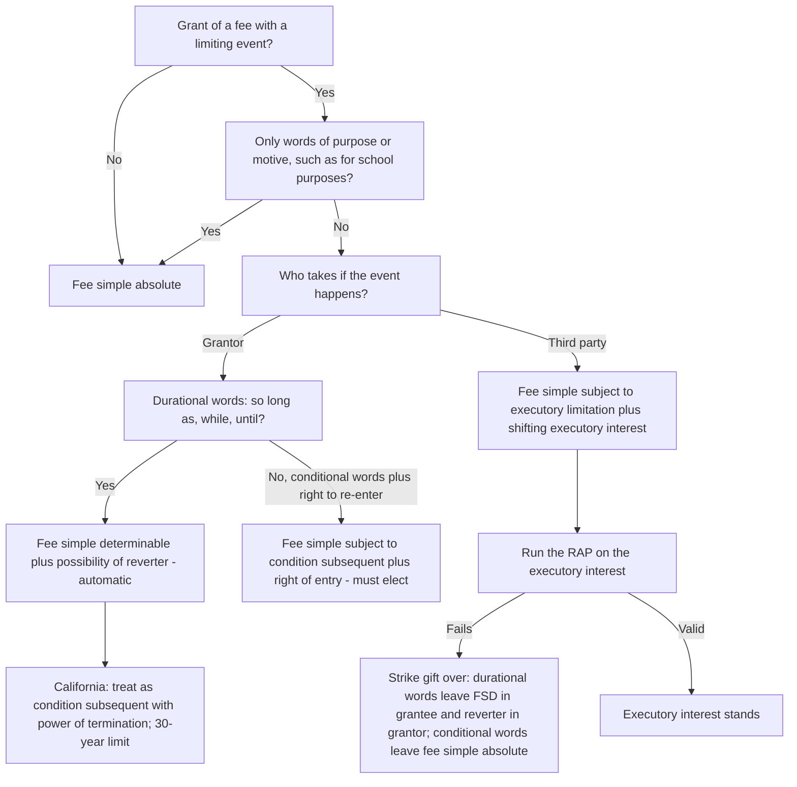

## 2. Classifying remainders and executory interests (R-PRP-008 to R-PRP-011)

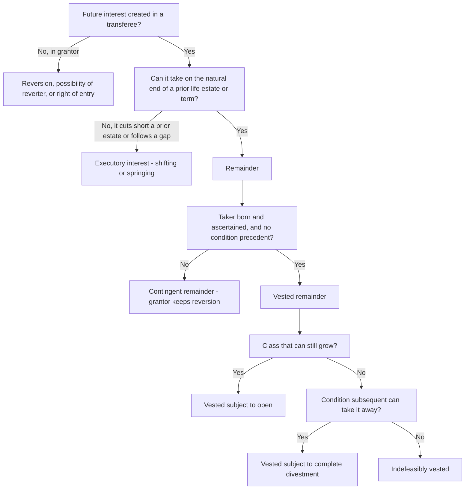

## 3. Rule against perpetuities (R-PRP-014 to R-PRP-016)

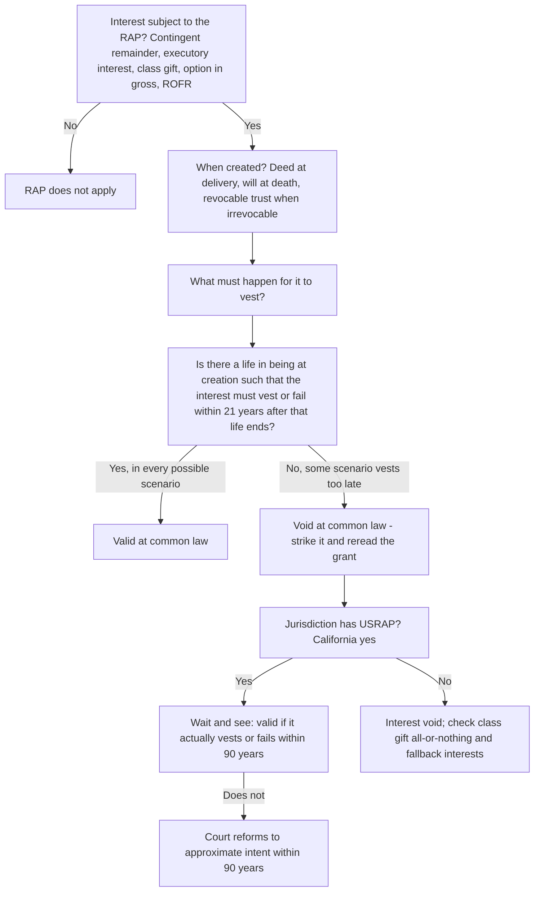

## 4. Joint tenancy: what happened to it? (R-PRP-020 to R-PRP-022)

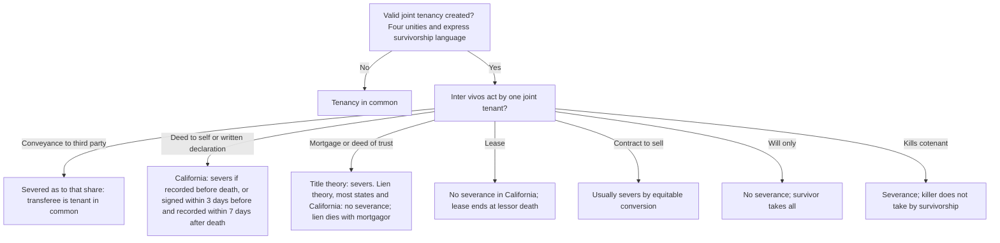

## 5. Tenant's remedies for possession and condition problems (R-PRP-030 to R-PRP-038)

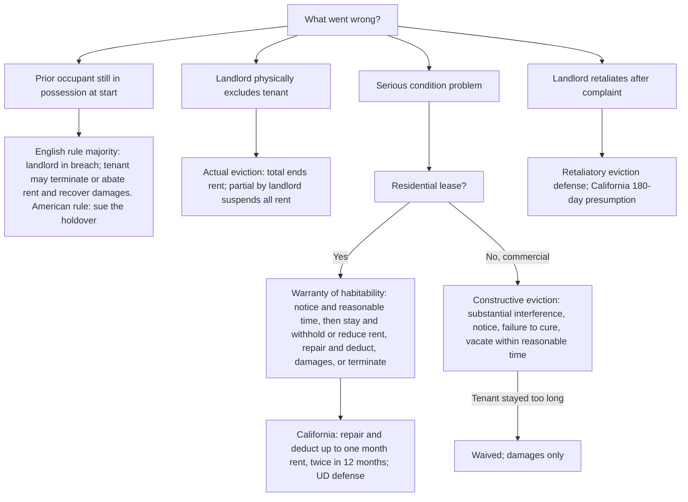

## 6. Tenant abandons before the term ends (R-PRP-033, R-PRP-047)

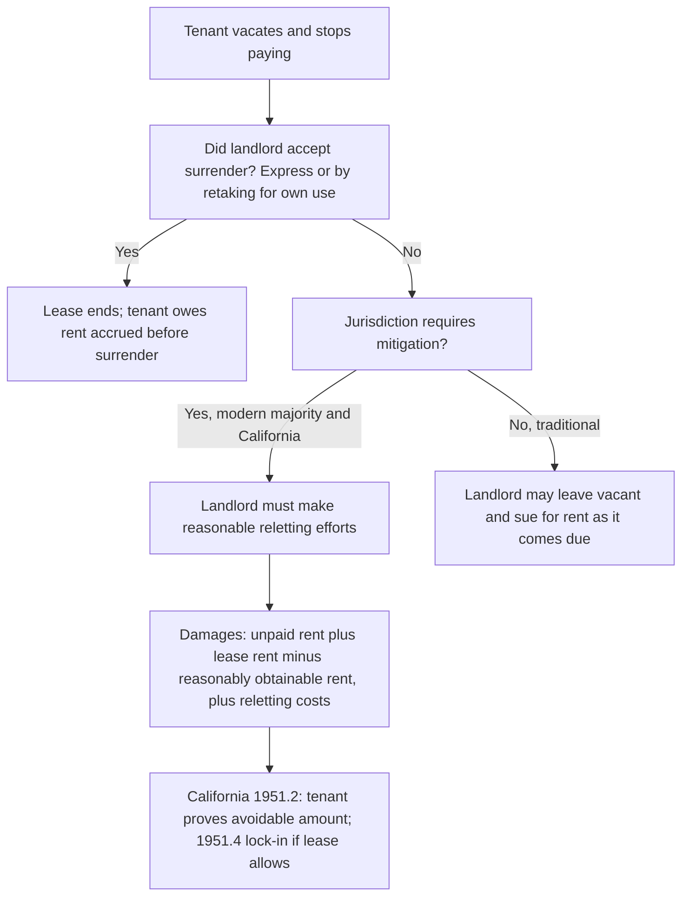

## 7. Does a promise about land bind a successor? (R-PRP-050 to R-PRP-056)

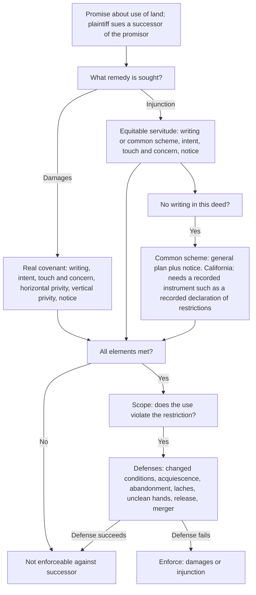

## 8. Was an easement created, and by which method? (R-PRP-061 to R-PRP-065)

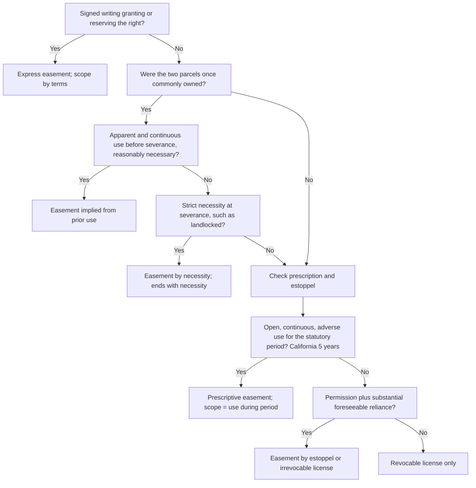

## 9. Recording acts: who wins? (R-PRP-116 to R-PRP-119)

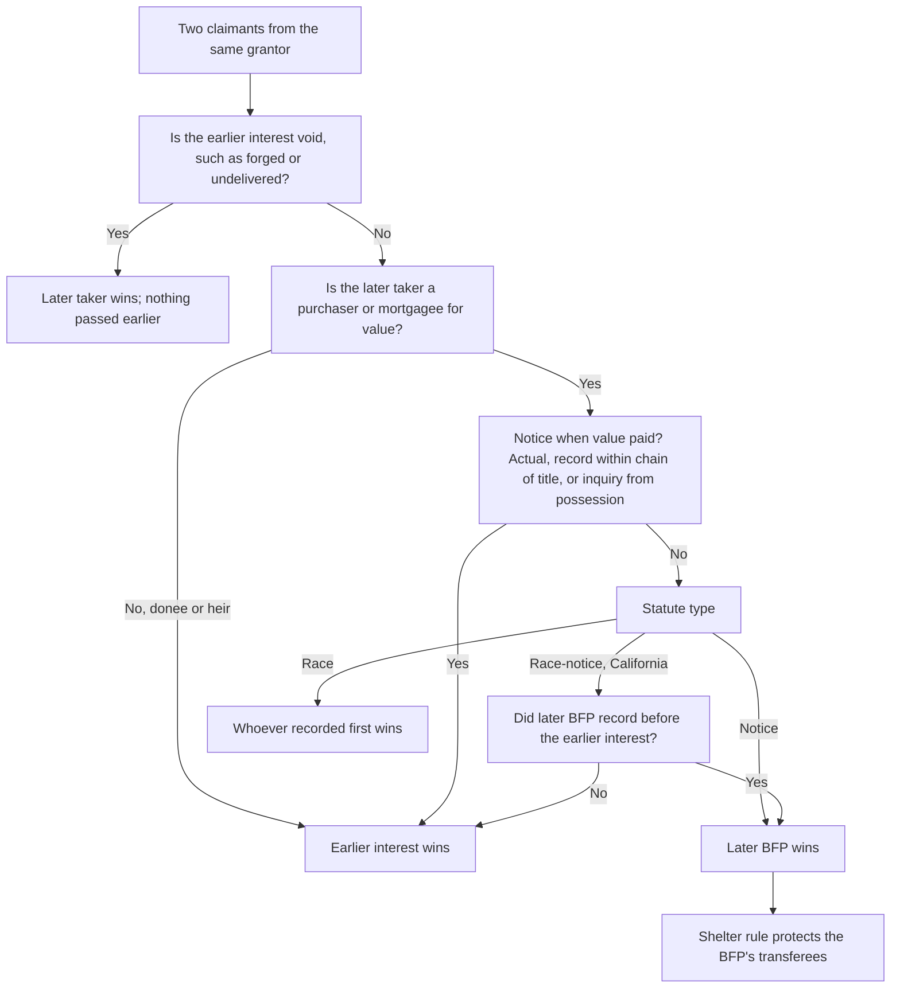

## 10. Foreclosure: what happens to each interest? (R-PRP-099 to R-PRP-104)

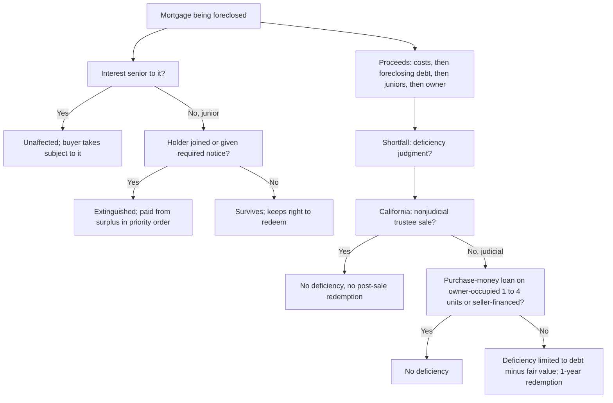

## 11. Adverse possession, with the California overlay (R-PRP-105 to R-PRP-108)

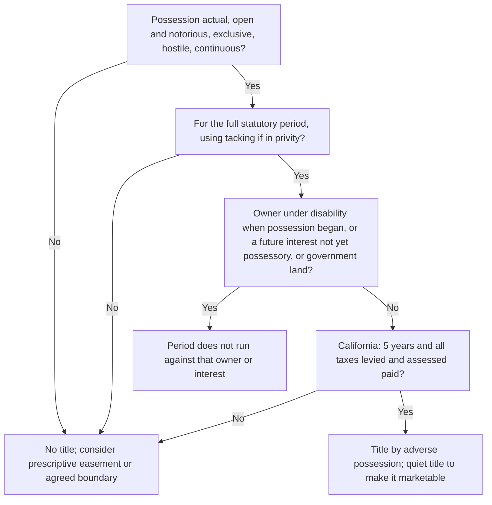
