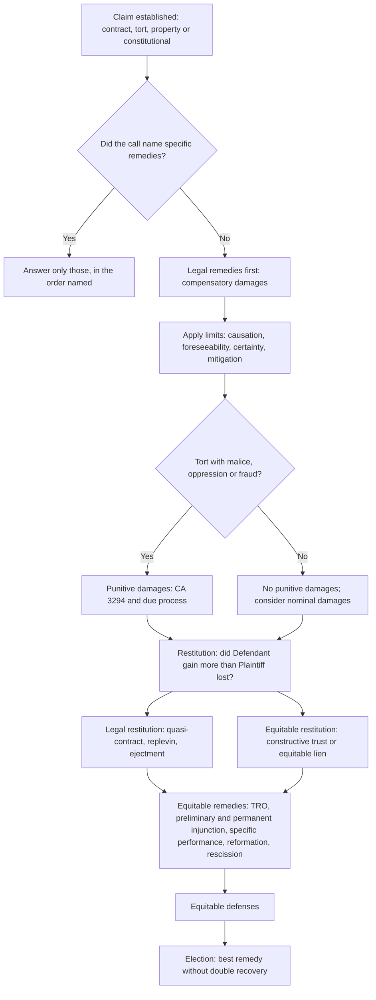
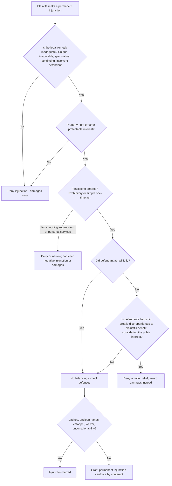
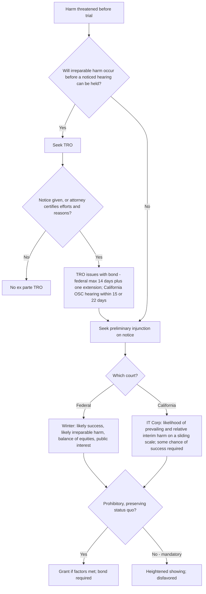
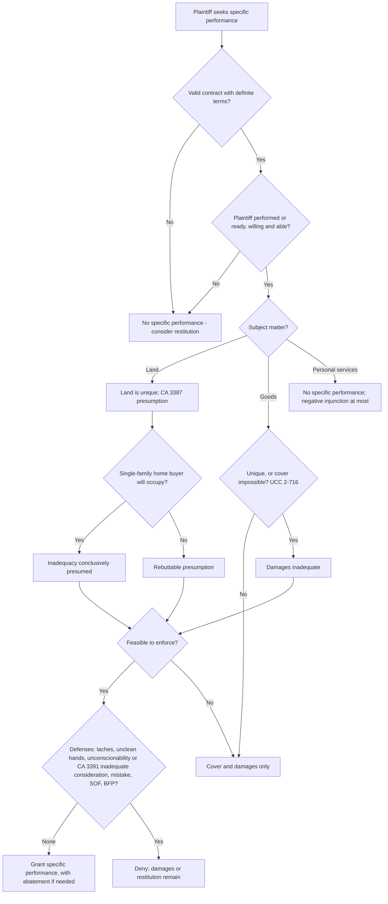
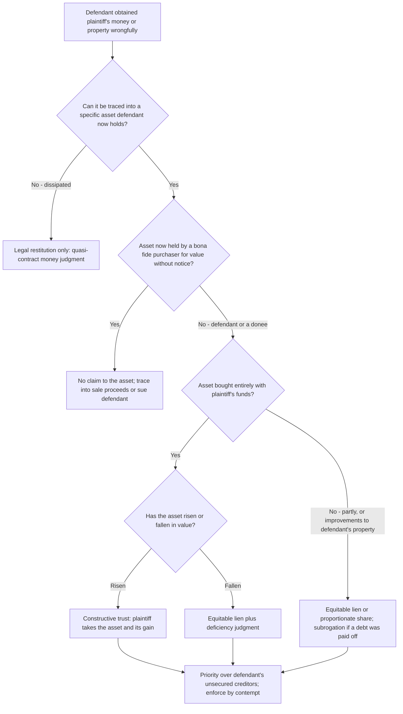
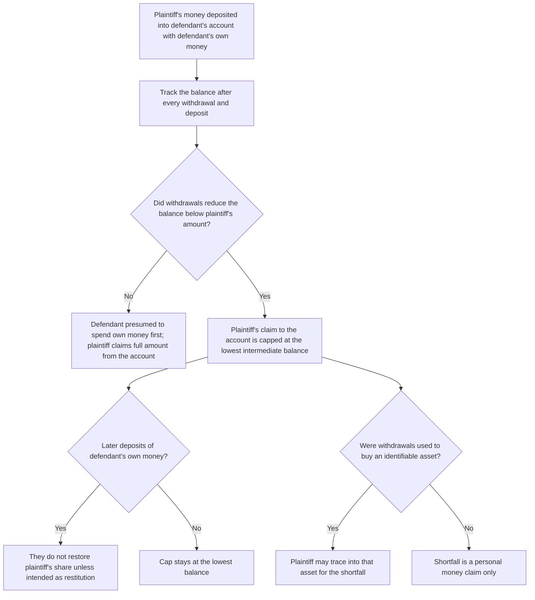
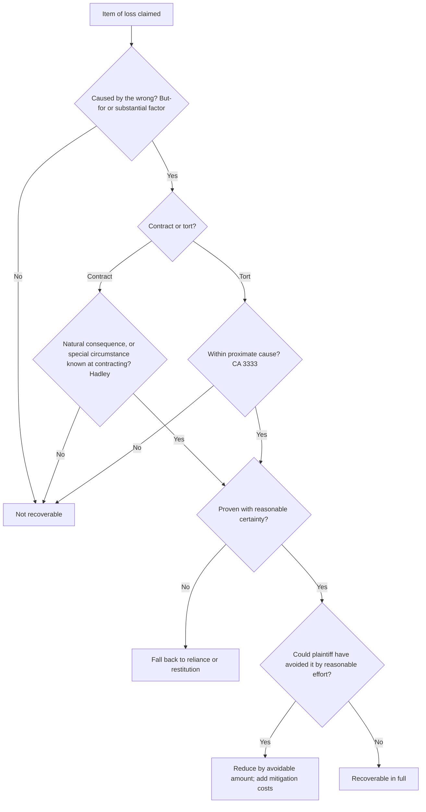
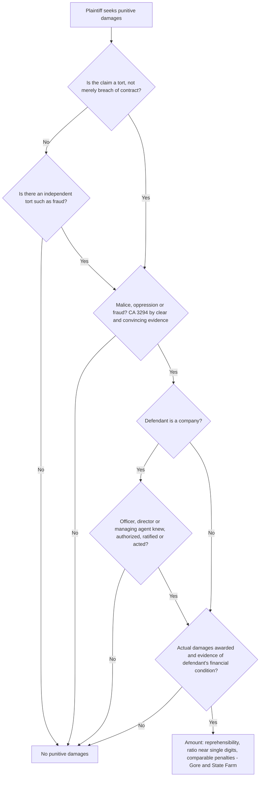
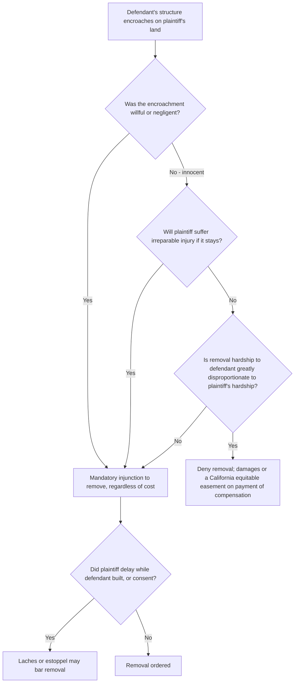
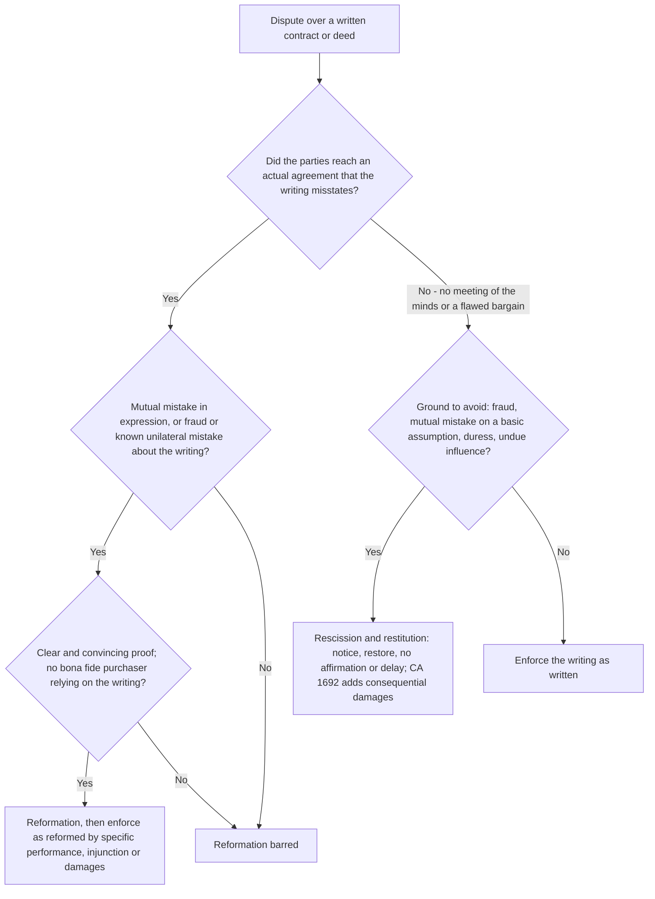

# Remedies — flowcharts

Ten decision trees for the analyses you will run most often. Rule IDs point to [`rule-statements.md`](rule-statements.md).

## 1. Master flow: which remedies to discuss for one claim (R-REM-001, R-REM-006)

## 2. Permanent injunction: I-P-F-B-D (R-REM-055 to R-REM-060)

## 3. TRO and preliminary injunction (R-REM-065 to R-REM-069)

## 4. Specific performance (R-REM-070 to R-REM-074)

## 5. Equitable restitution: constructive trust or equitable lien? (R-REM-044 to R-REM-049)

## 6. Commingled bank account: lowest intermediate balance (R-REM-048)

## 7. Each item of damages: the four limits (R-REM-007 to R-REM-011)

## 8. Punitive damages (R-REM-026 to R-REM-031)

## 9. Encroachment: removal or equitable easement? (R-REM-061)

## 10. Writing does not match the deal: reformation or rescission? (R-REM-043, R-REM-075)

