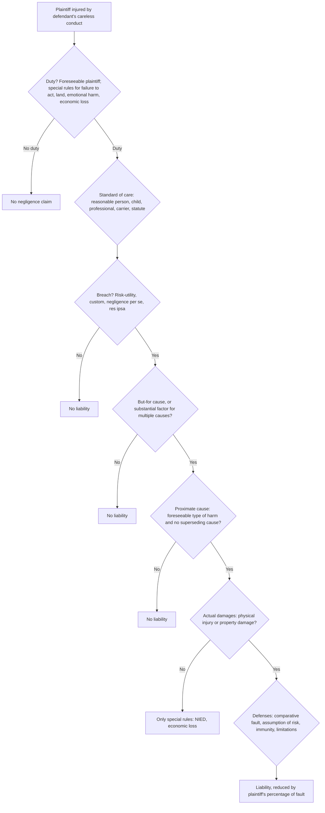
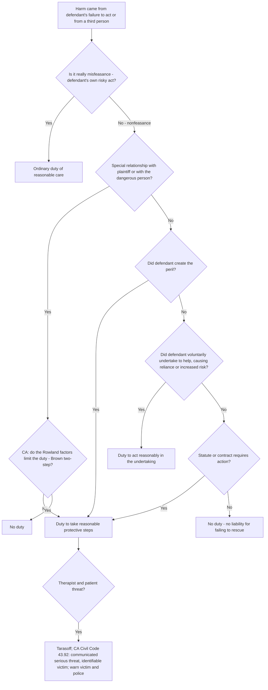
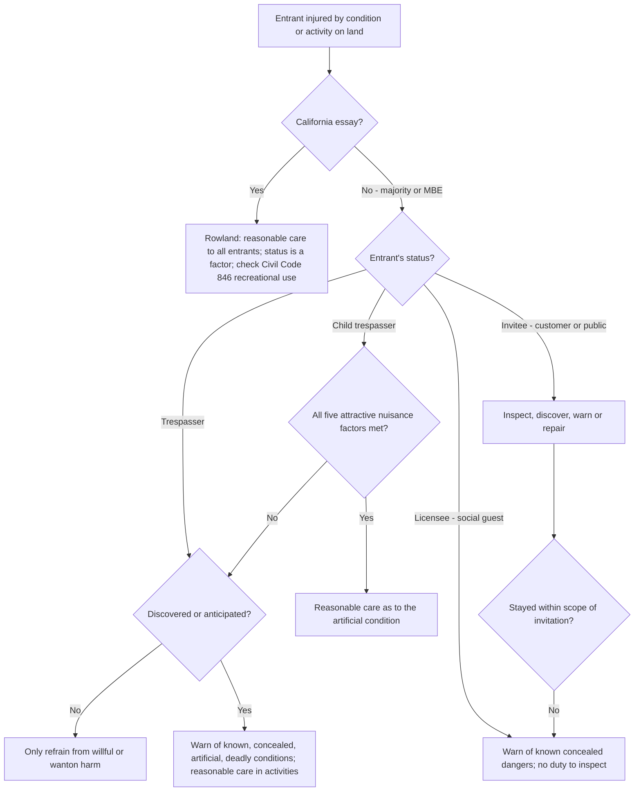
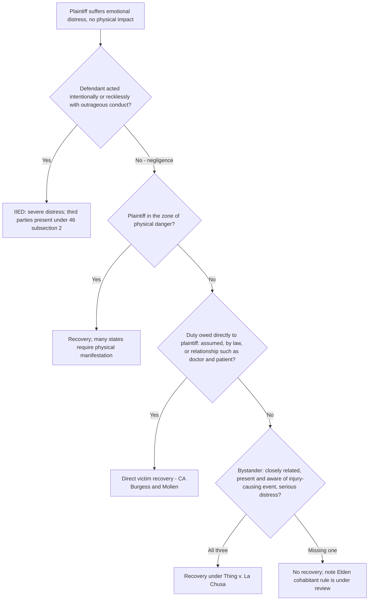
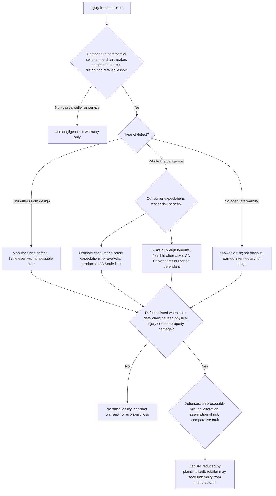
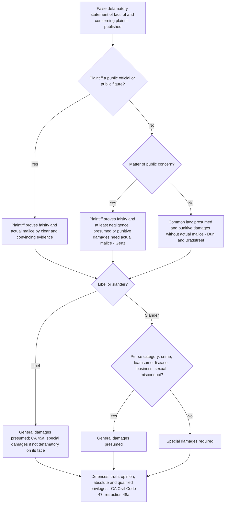
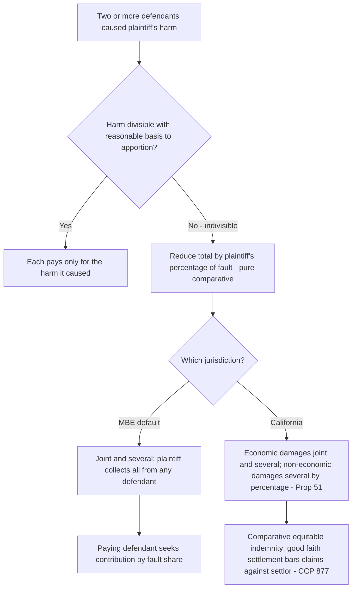
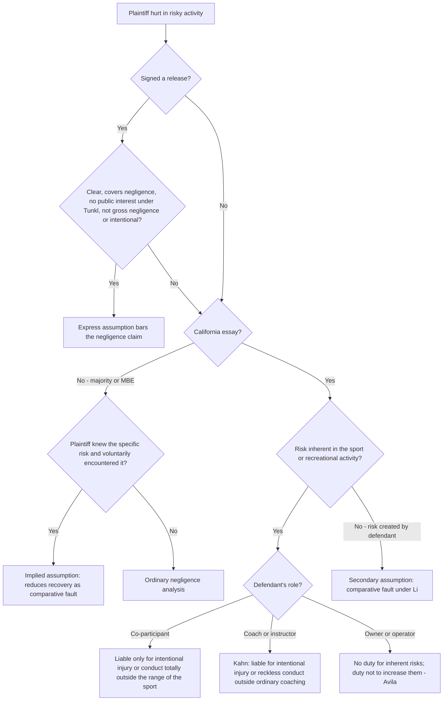
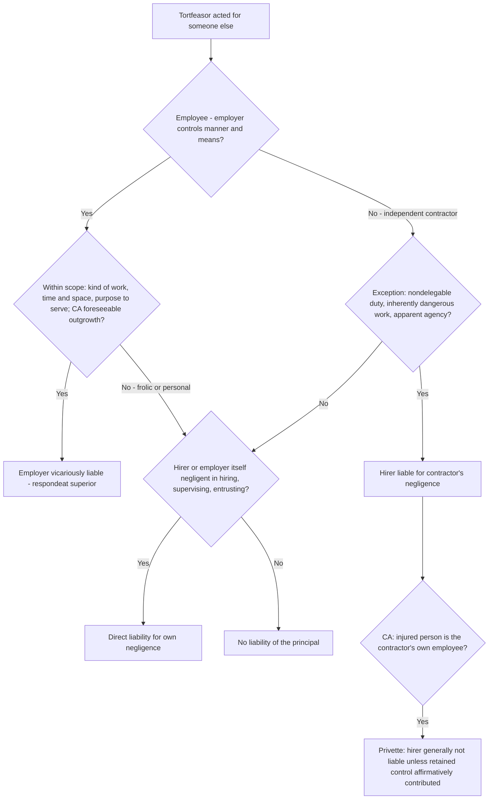

# Torts — flowcharts

Nine decision trees for the analyses you will run most often. Rule IDs point to [`rule-statements.md`](rule-statements.md). "CA" boxes show where California departs from the majority/MBE rule ([`ca-distinctions.md`](ca-distinctions.md)).

## 1. Negligence master flow (R-TRT-018 to R-TRT-046)

## 2. Is there a duty to act or to protect from a third person? (R-TRT-021 to R-TRT-023)

## 3. Land entrants (R-TRT-047 to R-TRT-051)

## 4. Emotional distress without physical injury (R-TRT-054 to R-TRT-057)

## 5. Products liability - strict liability analysis (R-TRT-081 to R-TRT-087)

## 6. Defamation: which fault and damages rules? (R-TRT-096 to R-TRT-100)

## 7. Apportionment among multiple defendants (R-TRT-041 to R-TRT-043, R-TRT-070)

## 8. Assumption of risk and sports injuries (R-TRT-071 to R-TRT-073)

## 9. Vicarious liability (R-TRT-063 to R-TRT-067)

