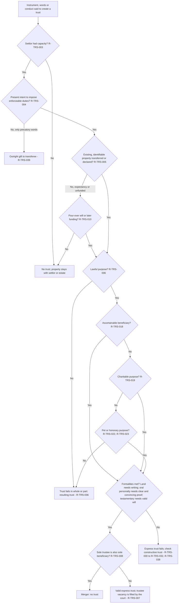
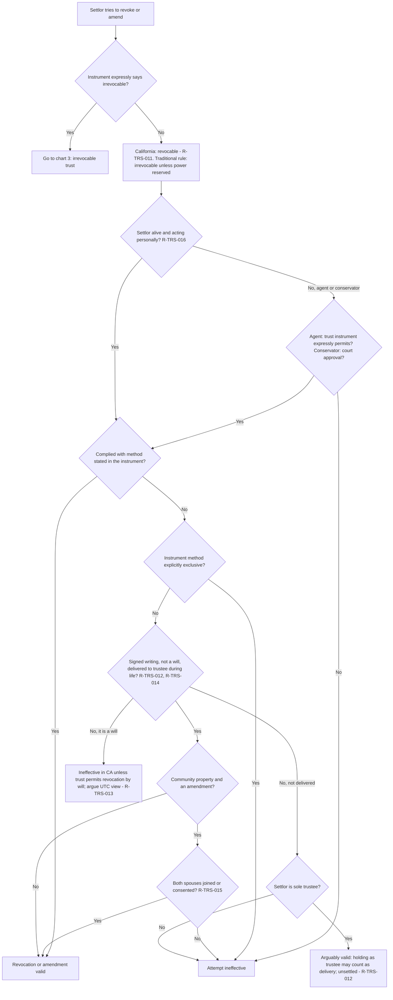
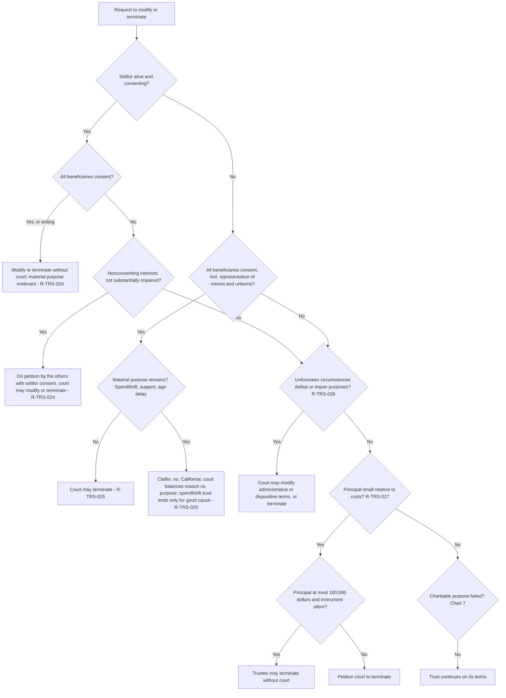
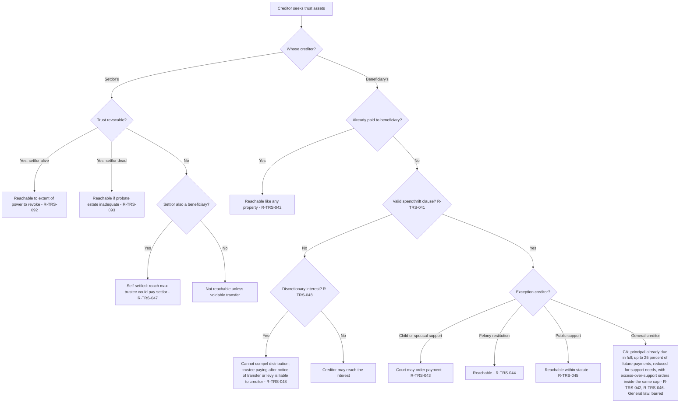
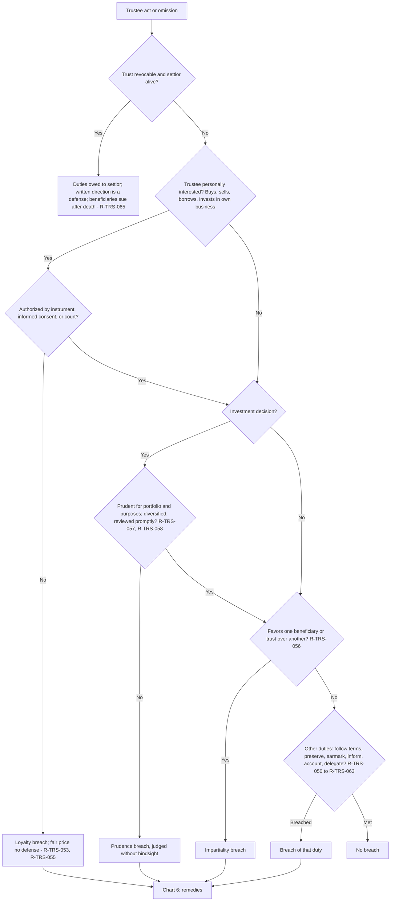
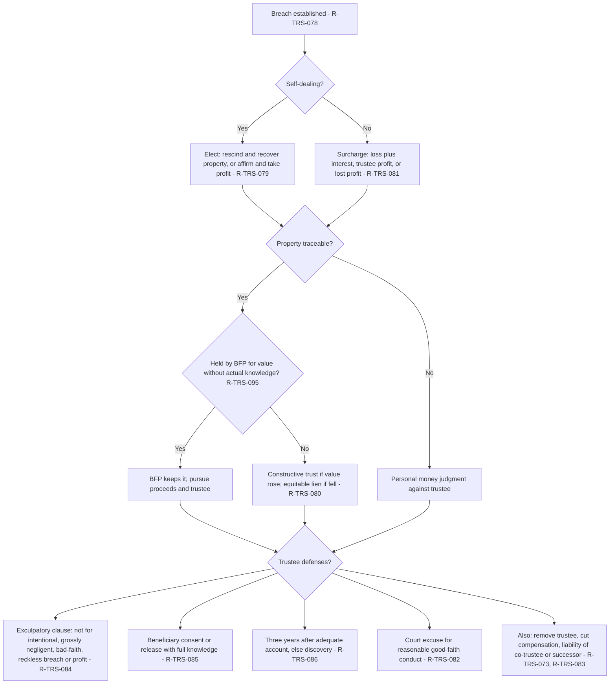
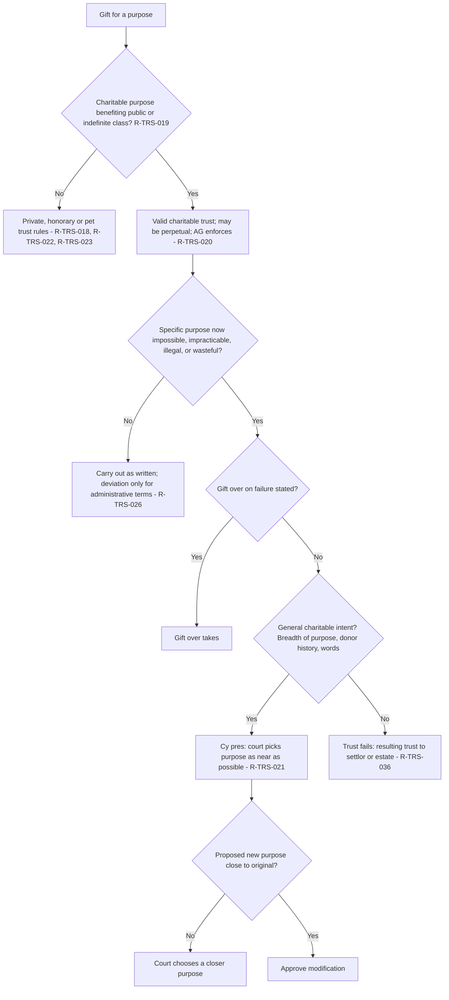
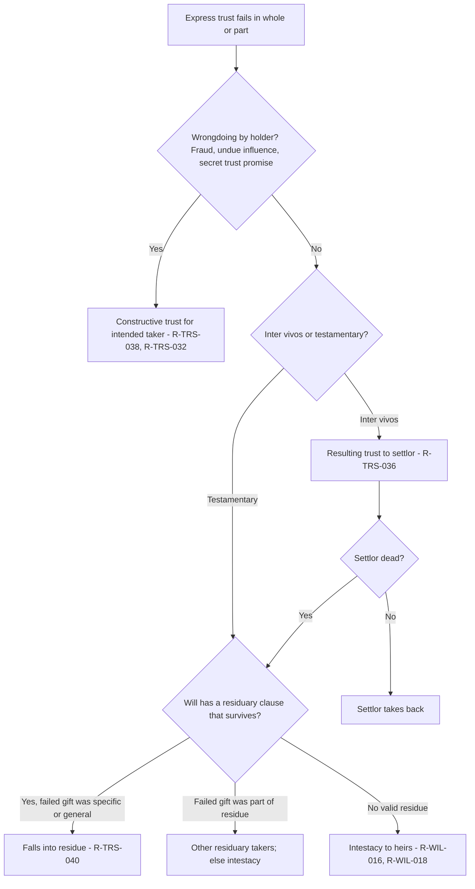

# Trusts — flowcharts

Eight decision trees for the analyses that recur on California Trusts essays. Rule IDs point to [`rule-statements.md`](rule-statements.md).

## 1. Was a valid express trust created?

## 2. Was the trust revoked or amended? California after Haggerty

## 3. Can an irrevocable trust be modified or terminated?

## 4. Can a creditor reach the trust?

## 5. Did the trustee breach a duty? Run once per act

## 6. Remedies and liability after a breach

## 7. Charitable trust and cy pres

## 8. The trust failed: where does the property go?

