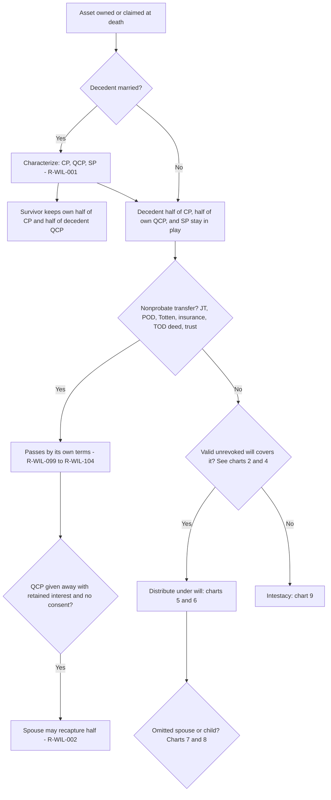
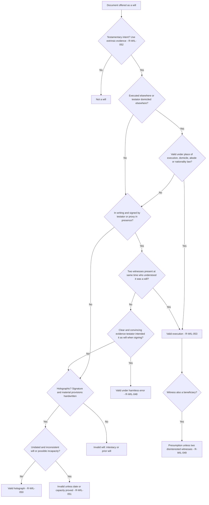
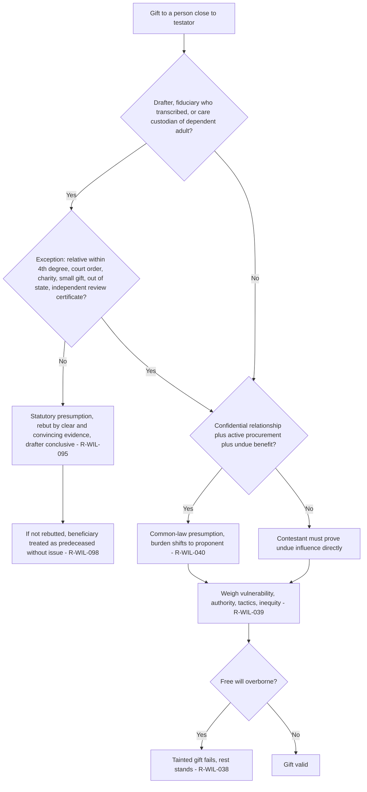
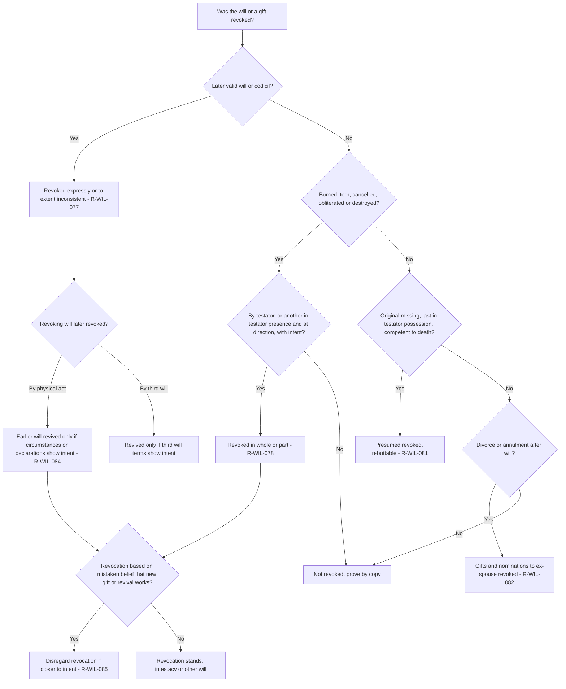
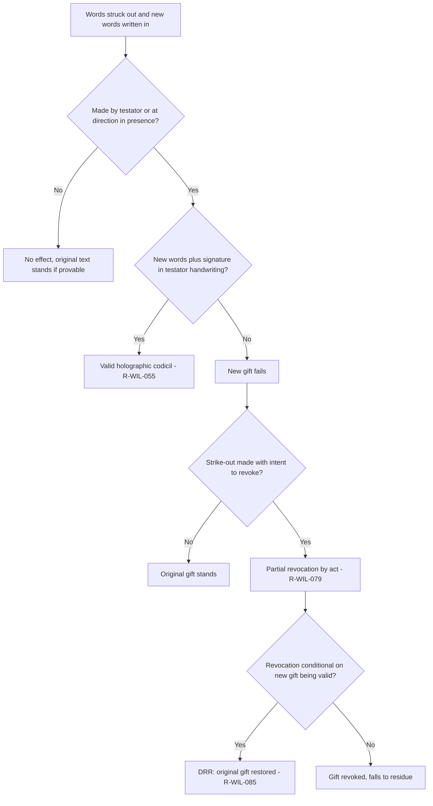
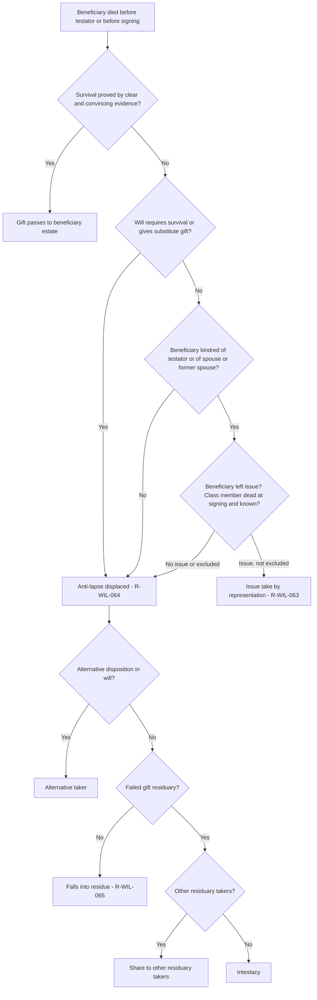
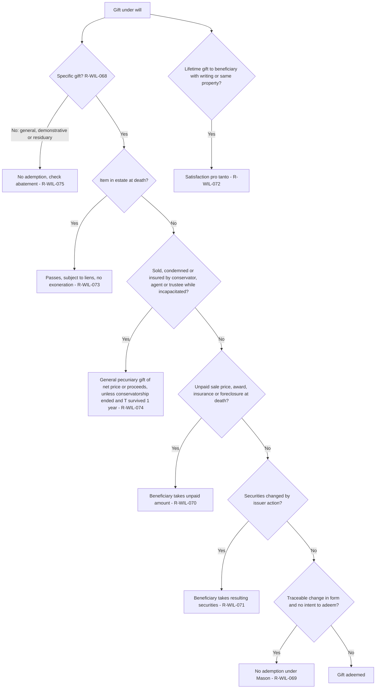
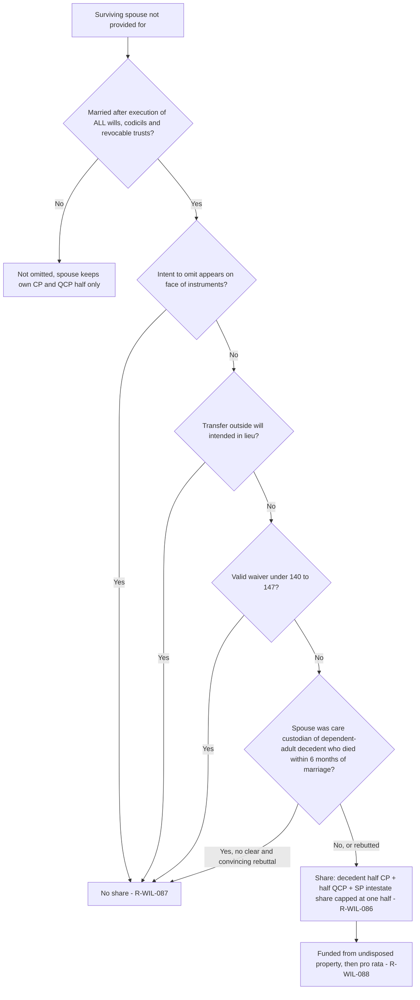
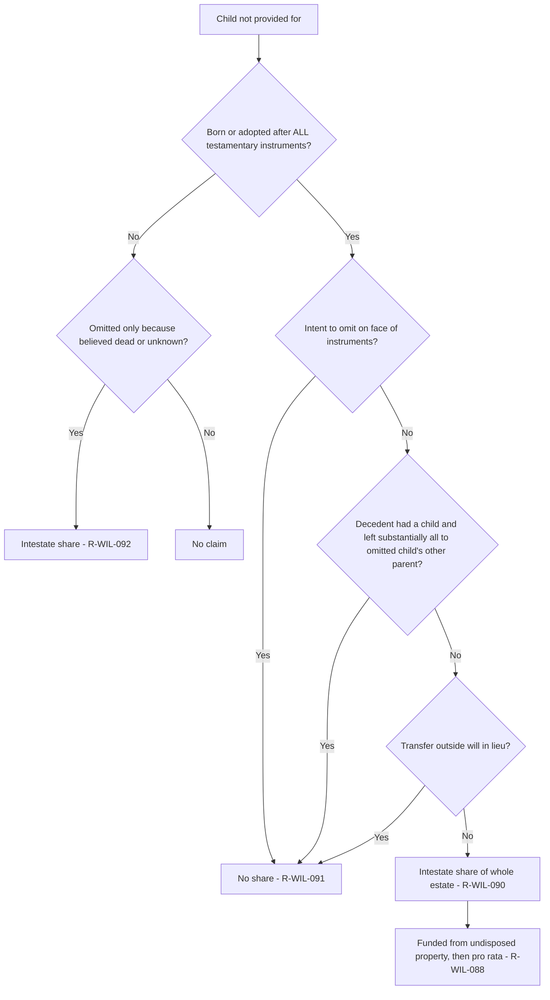
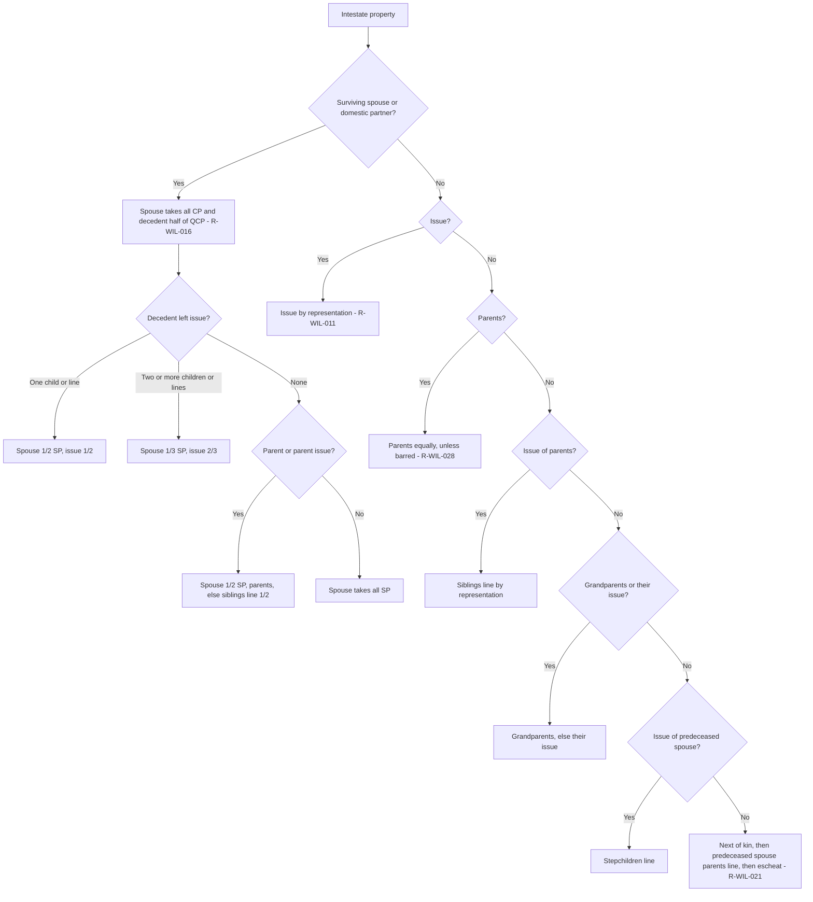

# Wills and Succession — flowcharts

Ten decision trees for the analyses that recur on California Wills essays. Rule IDs point to [`rule-statements.md`](rule-statements.md).

## 1. Estate map: where does each asset go?

## 2. Is the will validly executed?

## 3. Undue influence and related attacks

## 4. Revocation, revival and DRR

## 5. Handwritten changes to a will

## 6. Lapse, anti-lapse and failed gifts

## 7. Ademption, satisfaction and the conservator's sale

## 8. Omitted spouse

## 9. Omitted child

## 10. Intestate distribution ladder

