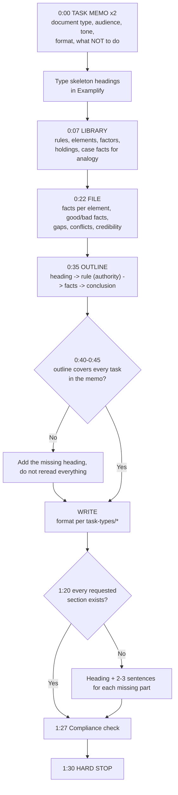

# Performance Test method: File and Library, task memo compliance, 90-minute time plan

## 1. What the PT is and why it matters

| Fact | Source |
|---|---|
| One **90-minute** Performance Test, in the Day 1 afternoon session together with Essays 4–5 (3.5 h in total). | [S-003] [S-080] |
| The PT **counts as two essays**: written raw maximum = 5 essays × 100 + PT × 2 × 100 = 700. | [S-010] [S-011] |
| You get "two separate sets of materials with which to work: a File and a Library." | [S-076] |
| "The File contains factual materials about your case. The first document is a memorandum containing the instructions for the tasks you are to complete." | [S-076] |
| The Library's "case reports may be real, modified, or written solely for the purpose of this performance test." | [S-076] |
| "The problem is set in the fictional State of Columbia, one of the United States." | [S-076] |
| "Your response will be graded on its compliance with instructions and on its content, thoroughness, and organization." | [S-076] (2026 wording [VERIFY V-021]) |

**Why the PT is your highest-return written skill:**
- **It is worth double.** With the Feb 2026 formula, one raw PT point ≈ 4 total scaled points ([format-and-scoring.md](../00-exam-intel/format-and-scoring.md) §2).
- **The law is supplied.** You are graded on reading, organizing and lawyering skills you already use in M&A and corporate development work.
- **Method alone moves the score.** Most lost PT points come from not following instructions, poor time management, or a format that does not match the task, not from missing law.

## 2. The closed-universe principle

- **The Library is the law.** Use its statutes, cases and rules even when you know real-world (or California) law is different. Columbia is fictional [S-076], and the cases may be modified or invented [S-076], so your memory of a "real" case is unreliable.
- **The File is the facts.** Use only its facts. You may draw **reasonable inferences**, and you should say they are inferences. Point out missing facts when the task calls for it ("we need to confirm whether...").
- **Cite Library authorities by name**: *Smith v. Jones* (Columbia Ct. App.), Columbia Civil Code § 12. This shows the grader you used the Library. Pin cites are not required, but the case name and its holding or rule are.
- **Outside law:** only general legal reasoning (how to read a statute, how to distinguish a case). No outside rules.

## 3. The 90-minute plan

**Default: about 40 minutes reading and outlining, about 50 minutes writing.** Acceptable range: 35–45 reading, 45–55 writing.

**Why about 40/50?**
1. "Compliance with instructions" is graded [S-076]. You cannot comply with a task you have not decoded, and the Library's tests decide which File facts matter. Reading below about 35 minutes usually produces a well-written answer to the wrong question.
2. Most of the points are in the **written** analysis: content, thoroughness and organization [S-076]. Reading beyond about 45 minutes leaves under 45 minutes to write, which is not enough to cover every requested part in typed English at a non-native writing pace.
3. **Organization** is graded [S-076]. A good outline (minutes 30–40) produces it almost for free, so outline time counts as writing time.

| Clock | Step | Output |
|---|---|---|
| **0:00–0:05** | **Task memo**, read twice | Answers to the five task questions (§4). The skeleton of headings typed in Examplify. |
| 0:05–0:07 | Skim the **File and Library contents pages** | What documents exist; which are long. |
| **0:07–0:22** | **Library**: read actively | For each authority: rule, elements or factors, key facts, holding, and a "use it for..." note. |
| **0:22–0:35** | **File**: read for facts by element | Facts tagged to each element; good and bad facts; gaps; conflicts. |
| **0:35–0:40** | **Outline mapped to the task** | Element × authority × facts grid under each heading. |
| **0:40–1:27** | **Write** | The document, in the required format. |
| **1:27–1:30** | **Compliance check** | §6 checklist. |

**Hard stops:**
- Be writing by **0:45** at the latest.
- At **1:20**, every requested section must at least exist (heading plus 2–3 sentences).
- **1:30** is absolute ([time-management.md](../09-exam-strategy/time-management.md) §A3).



## 4. Step 1: decode the task memo (0:00–0:05)

The task memo is the most important page in the PT. Read it **twice**, and answer these five questions in your outline before reading anything else.

| # | Question | Examples |
|---|---|---|
| 1 | **What document?** | Objective memo, persuasive brief, client letter, demand letter, will or trust provisions, contract clauses, closing argument, declaration, discovery plan... See §7. |
| 2 | **Who reads it?** | Supervising partner, judge, client (layperson or sophisticated), opposing counsel, jury. |
| 3 | **What tone?** | Objective (predict) or persuasive (advocate). Plain English or technical. |
| 4 | **What format and limits?** | Required sections; whether to include a statement of facts (often expressly *not*); headings; length; who signs; attachments. |
| 5 | **What exactly must it cover, and what must it not?** | "Address only the first two claims", "do not address damages", "assume the court will find X". |

- **Type the skeleton at once:** one heading per required section or issue, in the memo's order.
- **Copy any "do not" instruction into a comment at the top**, and delete it before the end.

## 5. Steps 2–4: Library, File, outline

### Library (0:07–0:22): read as a lawyer building tools
- **Statutes and rules:** extract the elements and definitions. Note "shall/may", exceptions and burdens.
- **Cases:** for each case, note:
  - (a) the **rule** it states or applies;
  - (b) the **key facts**;
  - (c) the **holding**;
  - (d) **how it helps or hurts** your side, as an analogy or a distinction.
- **Look for a synthesized test.** Several cases often build a multi-factor test that no single case states in full. Putting it together is high-value work that graders notice.
- **Note conflicts between authorities** (majority/dissent, older/newer, higher/lower court). Explain which controls and why.

### File (0:22–0:35): read for facts, by element
- Tag each fact to an element from your Library notes.
- **Good facts / bad facts** for your client. Persuasive tasks must deal with the bad ones. Objective tasks must weigh them.
- **Gaps:** which facts are missing for an element? Flag them if the task allows ("we should obtain...").
- **Conflicts:** inconsistent witness accounts or documents. Note who says what, and why one source may be more reliable.
- **Ignore irrelevant material.** The File contains distractions. A fact with no element attached probably does not belong in the answer.

### Outline (0:35–0:40): map to the task
```text
I. [Heading = issue or section the memo requires]
   Rule: [element/test] (Smith v. Jones; Col. Code § 12)
   Facts: [fact 1 (File doc, para)] [fact 2] | counter: [bad fact] -> [answer]
   Analogy/distinction: Smith (similar because...) / Doe (different because...)
   Conclusion: [likely / requested result]
II. ...
```

## 6. Writing (0:40–1:27) and compliance check (1:27–1:30)

**Writing rules for every PT:**
- **The format is part of the grade.** Use the template for your task type (§7).
- **Organize by issue or element, not by document.** Never summarize the Library case by case. Use the cases inside your analysis of each element.
- **Each paragraph: rule (authority), then facts, then reasoning, then conclusion.** For persuasive tasks, lead with the conclusion (CREAC: Conclusion, Rule, Explanation, Application, Conclusion).
- **Name authorities every time you state a rule.**
- **Write for the stated reader.** A client letter in legalese fails "compliance with instructions" even if the law is perfect.

**Compliance checklist (final 3 minutes):**
- [ ] The document is the type the memo asked for, addressed to the right reader.
- [ ] Every task in the memo is answered, in the memo's order or another logical order.
- [ ] Every "do not" instruction is respected (e.g., no statement of facts if told not to include one).
- [ ] Every issue has a rule **with a Library authority by name**.
- [ ] Every issue uses specific File facts and ends with a conclusion or requested result.
- [ ] Gaps or further facts are flagged if the task asks for them.
- [ ] Headings are present and match the task's structure.
- [ ] No real name anywhere. Answers are graded anonymously by code number [S-010], so sign with the role or placeholder name the memo gives.
- [ ] No leftover outline fragments or comments.

## 7. Performance Test task types

Each template gives the purpose, a format skeleton, tone, common mistakes and a checklist. How often each type has appeared on California PTs will be filled in from [past-pt-index.csv](past-pt-index.csv) in Phase 3.

| Task type | Template | Tone |
|---|---|---|
| Objective (predictive) memo | [objective-memo.md](task-types/objective-memo.md) | Neutral, predictive |
| Persuasive brief / points and authorities | [persuasive-brief.md](task-types/persuasive-brief.md) | Persuasive, formal |
| Client letter (advice) | [client-letter.md](task-types/client-letter.md) | Plain English, advisory |
| Demand letter | [demand-letter.md](task-types/demand-letter.md) | Firm, professional, persuasive |
| Drafting a will or trust | [drafting-will-or-trust.md](task-types/drafting-will-or-trust.md) | Precise, operative |
| Drafting a contract or clauses | [drafting-contract.md](task-types/drafting-contract.md) | Precise, operative |
| Closing argument | [closing-argument.md](task-types/closing-argument.md) | Oral, persuasive |
| Other tasks (opening statement, discovery plan, declaration, statement of facts, ...) | [other-tasks.md](task-types/other-tasks.md) | Varies |

**Hybrid tasks:** some memos ask for two documents, for example a short cover memo explaining a drafted clause. Split the time by the weight the memo signals. If it gives none, split by the amount of analysis each part needs, and make sure **both** exist by 1:20.

## 8. Practice protocol
1. **First 2–3 PTs: untimed, method-focused.** Follow each step and compare your outline with the model answer's structure. Original PTs are in `07-question-bank/pt/`; past California PTs are indexed in [past-pt-index.csv](past-pt-index.csv) (Phase 3). The State Bar's sample 90-minute PT is [S-080].
2. **Then timed at 90 minutes, always.** Grade with `/pt`, which uses the State Bar's grading language [S-076].
3. **Rotate task types.** Do not only practise objective memos.
4. **Keep a PT error list:** instruction missed, format wrong, Library authority not cited, facts not used, ran out of time. Review it before every PT.
5. Protect the weekly PT slot ([time-management.md](../09-exam-strategy/time-management.md) §B3).
