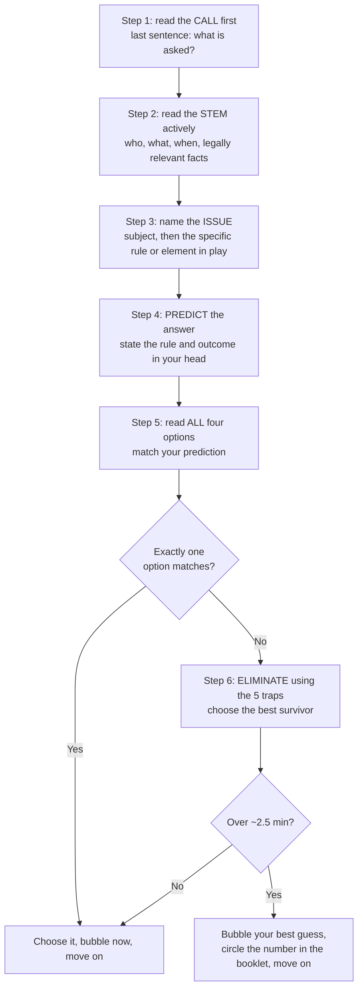

# MBE strategy

The MBE is half of your total score [S-011]. It is the part of the exam where high practice volume reliably raises your score. This file covers how to answer one question, how to pace 100 of them, how to fill in the answer sheet, and how to learn from every miss.

## 0. Format facts this strategy relies on

| Fact | Source |
|---|---|
| 200 multiple-choice questions in two 3-hour sessions of 100 questions each, on Day 2 (Wed, July 28, 2027). | [S-006] [S-003] [S-001] |
| 175 questions are scored and 25 are unscored **pretest** questions. **You cannot tell them apart.** | [S-006] [S-007] |
| 25 scored questions per subject, across 7 subjects. | [S-007] |
| No scheduled breaks inside a session. You can move between questions within a session but cannot go back to a closed session. | [S-006] [S-003] |
| Paper Scantron answer sheet. No laptop on MBE day. | [S-003] [S-008] |
| Only answers on the answer sheet are graded. Marks in the question book are not graded, and **no extra time is given to transfer answers**. | [S-003] |
| Scoring counts the questions you answer correctly. **No points are subtracted for wrong answers.** A question with more than one answer marked is scored as wrong. | [S-007] |
| Raw scores are converted to a scaled score by **equating**, which adjusts for differences in difficulty between administrations. No fixed raw count guarantees a given scaled score. | [S-160] |

**Two consequences:**
- **Never leave a bubble blank.** A blank and a wrong answer both score zero, but a guess has roughly a one-in-four chance of scoring.
- **Never mark two bubbles** on one question.

## 1. Answering one question: the 6-step method



### Step 1: read the call first
The call is the last sentence before the options. Read it first so that you read the stem knowing what to look for.

| Call wording | What it really asks | Common trap |
|---|---|---|
| "Is the evidence admissible?" / "Should the court grant the motion?" | Outcome under one rule | Picking an option whose reason is wrong |
| "Which is the plaintiff's **best** argument?" / "**strongest** defense" | The most persuasive of four arguments. It may still lose. | Rejecting an argument because it would not win |
| "Most likely result" / "Will the plaintiff prevail?" | Probable outcome on these facts | Choosing the result you think is fair |
| "Which fact, **if proved**, would most help the defendant?" | A new fact that changes the analysis | Choosing a fact that is merely sympathetic |
| "Of which crimes is the defendant guilty?" | Every element of every listed crime | Missing an element such as intent or timing |
| "...**EXCEPT**" / "**least** likely" | Inverted call | Choosing the first correct statement |

### Step 2: read the stem actively
- Identify the **parties** and their roles (buyer/seller, landlord/tenant, government actor/private actor).
- Identify the **timeline**. Many MBE questions turn on sequence: offer, revocation, acceptance; or arrest, warning, statement.
- Notice the **jurisdiction-neutral defaults**. For example, Torts assumes pure comparative fault unless the question says otherwise [S-040] (see [subject-weighting.md](subject-weighting.md) §4).
- **Take every fact at face value.** Do not add facts and do not assume facts that are not stated. If the stem says "reasonably believed", the belief was reasonable.

### Steps 3–4: name the issue, then predict
- Before looking at the options, say the issue and your answer in a few words, e.g., "mailbox rule: acceptance on dispatch, so a contract exists".
- This is the most important habit. Options are written to sound right, and a prediction protects you from being talked out of what you know.
- If you cannot name the issue, you probably lack the rule. That is a `didnt-know` miss (§6), and a signal to move faster on this question rather than spend longer.

### Step 5: read all four options
- Read every option, even when (A) matches your prediction. A better match may come later.
- Read the **reasoning connectors** precisely:

| Connector | The option is correct only if... |
|---|---|
| "Yes, **because** X" | X is true on these facts **and** X is the reason that resolves the issue. |
| "Yes, **if** X" | X is plausible on these facts **and** X, if true, is enough for that result. |
| "No, **unless** X" | "No" is the default result, and X is the condition that would change it. |
| "...**only if** X" | X is a **necessary** condition, not just a helpful one. |

### Step 6: eliminate using the five traps
When your prediction does not match an option, or two options look right, test each option against these traps.

| # | Trap | What it looks like | Original illustration |
|---|---|---|---|
| 1 | **Wrong standard** | Correct outcome language with the wrong test, burden or level of scrutiny. | An option applies rational-basis review to a government race classification. All racial classifications by government get strict scrutiny (*Adarand Constructors, Inc. v. Peña*, 515 U.S. 200 (1995)). |
| 2 | **True but irrelevant** | A correct statement of law that does not decide **this** issue. | The option correctly states the excited-utterance exception (FRE 803(2)), but the statement is offered to show the listener's notice, not for its truth, so it is not hearsay at all (FRE 801(c)). |
| 3 | **Right result, wrong reason** | The yes/no is correct, but the "because" clause is false or not the deciding reason. | See the worked example in §2, option (C). |
| 4 | **Overbroad absolute** | "always", "never", "must", "in all cases", "any". | Most rules have exceptions, so treat an absolute as a red flag. Do not eliminate it automatically: some rules really are absolute. |
| 5 | **Minority, outdated or California rule** | The option states a real rule, but not the one the MBE applies. | The option applies a California Evidence Code rule; the MBE uses the FRE "as currently in effect" [S-040]. Or the option bars recovery for any plaintiff fault (contributory negligence) when NCBE's default is pure comparative fault [S-040]. |

Two more filters:
- **Wrong party or wrong claim.** The option answers a question about a different defendant, or about a claim the call did not ask about.
- **Choose the best answer, not a perfect one.** If all four options look flawed, choose the one with the smallest flaw.

> 🇨🇳 PRC bridge: civil-law training rewards finding the governing code article. MBE options are often all "real law", so the skill tested is choosing **which** rule this fact pattern triggers (approx.).

## 2. Worked example (original question)

> A painter mailed a homeowner a signed letter offering to paint the homeowner's house for $8,000 and stating, "This offer will remain open until June 10." The homeowner paid nothing for that promise. On June 5, the homeowner mailed a letter accepting the offer. On June 6, before the acceptance arrived, the painter telephoned the homeowner and revoked the offer. The acceptance arrived on June 7.
>
> Is there an enforceable contract?
> (A) No, because the painter revoked the offer before the homeowner's acceptance was received.
> (B) No, because a promise to keep an offer open is unenforceable without consideration.
> (C) Yes, because the offer was a firm offer that could not be revoked before June 10.
> (D) Yes, because the acceptance took effect when it was mailed.

**Walk-through**
1. **Call:** contract formation, yes or no.
2. **Stem:** this is a services contract, so the common law applies, not UCC Article 2. The sequence is: offer, acceptance **mailed** June 5, revocation **received** June 6.
3. **Issue:** which came first legally, the revocation or the acceptance?
4. **Prediction:** an acceptance sent by an invited medium is effective when dispatched (Restatement (Second) of Contracts § 63(a)). A revocation is effective only when the offeree receives it (Restatement (Second) of Contracts § 42). The contract was formed June 5, so the answer is "Yes, because of the mailbox rule."
5. **Options:**
   - **(A)** applies a receipt rule to the acceptance. **Trap 1, wrong standard.**
   - **(B)** states true law: the "open until June 10" promise was not supported by consideration, so the painter *could* revoke. But it does not matter, because acceptance came first. **Trap 2, true but irrelevant.**
   - **(C)** has the right result for the wrong reason. The firm-offer rule (UCC § 2-205) applies only to a **merchant's** signed offer to buy or sell **goods**, and painting is a service. **Trap 3**, and also trap 5 (wrong body of law).
   - **(D)** matches the prediction. **Answer: (D).**

> 🇨🇳 PRC bridge: under PRC contract law an offer that fixes an acceptance period is generally irrevocable, and an acceptance generally takes effect on arrival. US common law reverses **both** instincts: the offer is revocable without consideration, and a mailed acceptance is effective on dispatch (approx.).

## 3. Pacing: 100 questions in 180 minutes

- **Budget:** 180 min ÷ 100 = **1.8 min (108 s) per question** [S-006].
- **Target pace:** about **1.7 min**. That finishes all 100 by about 2:50 and leaves time for flagged questions and a bubble audit.

| Elapsed session time | You should have finished question | If you are behind |
|---|---|---|
| 0:30 | ~17 | Normal: the first questions feel slow. |
| **1:00** | **33** | More than 3 behind: stop re-reading stems; trust your prediction. |
| 1:30 | 50 | Halfway check. Take a 10-second reset (§5). |
| **2:00** | **67** | More than 5 behind: use the 2-minute cap on every question. |
| 2:30 | 83–84 | |
| **2:50–2:55** | **100** | All bubbled. |
| 2:55–3:00 | — | Return to circled questions. Final bubble audit. |

**Rules**
- **Hard cap at about 2.5 minutes.** At the cap, bubble your best guess, circle the question number in the booklet, and move on. Writing in the question book is allowed: the July 2026 bulletin says applicants may take notes in the hard-copy book, and no scratch paper is provided for the MBE [S-003] [S-1736]. Only the Scantron is graded, and no extra time is given to transfer answers [S-003].
- **Long stems are not harder.** A long fact pattern often hides a simple issue. Read the call first and skim for the triggering facts.
- **Pretest questions** are 25 of the 200, and you cannot spot them [S-006] [S-007]. A strange or unanswerable question might be a pretest item, or it might be scored. Either way, give it the normal time and move on. Never let one question take time from five others.
- **Do not change an answer** at the end unless you can name a concrete reason: a misread fact or a rule you now remember. A vague feeling is not a reason.

## 4. Scantron bubbling routine

There is **no transfer time** at the end [S-003]. Bubble as you go.

1. **Bubble each answer as soon as you choose it.** It costs 3–5 seconds and removes the end-of-session risk.
2. **Check alignment at every page turn.** The number on the sheet must match the question you just answered.
3. **Check alignment at the 1:00 and 2:00 checkpoints**: question 33 on the sheet must be question 33 in the booklet.
4. **Flagged questions:** bubble your best guess immediately, then circle the number in the booklet. If you never get back to it, a guess is still on the sheet.
5. **Final 5 minutes:** read nothing new. Check that every row 1–100 has **exactly one** mark, and fully erase stray or changed marks, because multiple marks score as wrong [S-007].
6. **Practise with a paper bubble sheet** in every full-length timed set. Bubbling speed and alignment are trainable.

## 5. Fatigue across two 3-hour sessions

Day 2 comes after 6.5 hours of essays and the PT on Day 1 [S-003]. Plan for fatigue rather than hoping to avoid it.

| When | What to do |
|---|---|
| Every page turn | Check the bubble alignment. This also restarts your attention. |
| Each checkpoint (Q33, Q50, Q67) | **10-second reset:** sit back, two slow breaths, shoulders down, sip water, then the next question. |
| A run of hard questions | It is normal, and they may be pretest items. Do not read meaning into it. |
| Last 20 questions of a session | Read the call twice. Fatigue errors cluster in `misread` and `careless` (§6). |
| Lunch break | Eat food you tested during simulations. **Do not discuss questions** with anyone. Walk briefly. Review nothing heavier than a one-page list. |

**Build stamina in practice:**
- **Phase 1:** timed blocks of 17 questions in 30 minutes, then 33 in 60 minutes.
- **Phase 2:** full 100-question, 3-hour blocks.
- **Phase 3:** at least two full **2 × 100** days (`python scripts/build_simulation.py`), ideally the day after a full written simulation, to rehearse the real sequence.
- **Use your own data.** Compare your accuracy on questions 1–50 with 51–100 in each full block. If the second half is more than about 5 points lower, schedule more full-length blocks.

More in [time-management.md](../09-exam-strategy/time-management.md) and [mindset-and-fatigue.md](../09-exam-strategy/mindset-and-fatigue.md).

## 6. How to review practice questions

Reviewing is where learning happens. **Spend at least as long reviewing a set as answering it.**

### Review routine for each set
1. Review **every wrong answer and every guess you got right**. A lucky guess is an unlearned rule.
2. For each one, write the rule **in your own words** in one sentence. Check it against `03-subjects/<slug>/rule-statements.md` once that file exists.
3. Explain why **each** wrong option is wrong and which trap (§1, step 6) it uses.
4. Assign **one root cause** from the taxonomy below. These are the exact `error_type` values in [attempts.csv](../10-progress/attempts.csv).
5. Add a row to [error-log.md](../10-progress/error-log.md) for every missed rule. Use `/weak-spots` weekly to find patterns.

### Error taxonomy

| `error_type` | Definition | Diagnostic question | Fix |
|---|---|---|---|
| `didnt-know` | You did not know the rule, or remembered it wrong. | Could I have written this rule before seeing the options? | Repair the rule card. Run `/drill` on that rule. Add a flashcard. |
| `misapplied` | You knew the rule but chose the wrong branch, element or exception for these facts. | Did I know the rule but miss which fact triggered which part of it? | Use the subject's decision tree. Write a "trigger fact → rule" pair. Redo two similar questions within 3 days. |
| `misread` | You missed or misread a fact or the call ("not", "except", which party, the date order). | If I re-read slowly, does my answer change? | Read the call first. Underline negatives. Re-read the call before choosing. |
| `timing` | You rushed, or guessed because of the clock. | Did I spend under about 45 s or over about 2.5 min? | Pacing drills with checkpoints (§3). |
| `careless` | Your reasoning was right but the mark was wrong, or you changed a right answer without a reason. | Does my chosen letter match my own reasoning? | Bubbling routine (§4). The no-vague-changes rule (§3). |

**What the mix tells you:**
- Mostly `didnt-know` → spend time on rules, not more questions.
- Mostly `misapplied` → do more questions with slow, element-by-element review.
- Mostly `misread`, `timing` or `careless` → the problem is process. Fix it with timed sets, not with more reading.

### Logging licensed questions (never copy their text)
Licensed NCBE study aids and commercial question banks are copyrighted. **Never paste their questions, options or explanations into this repo** (CLAUDE.md §2.6). Log the attempt by ID only, and write notes about the **rule** in your own words, not about the fact pattern:

```bash
python scripts/quiz.py log --source official --item "NCBE-<product>-<set>-Q<n>" --subject EVD --correct N \
    --seconds 110 --coverage EVD-MBE-V.F --error-type misapplied --notes "excited utterance needs a startling event"
```

- Use `--source commercial` for commercial banks.
- For a correct answer that was a guess, add `--notes "guess"` so it comes back in review.
- Track which resources you are using in [official-practice-tracker.md](official-practice-tracker.md).

## 7. Weekly MBE habits (the study plan sets the volume)
- **Mixed sets beat single-subject sets** once a subject has been learned, because they train issue identification.
- Keep one running list of "rules I keep missing". Read it before every timed set.
- Re-take missed repo questions after 2 days or more. `quiz.py pick` does this automatically.
- Watch two numbers in `python scripts/quiz.py stats`: accuracy by subject, and average seconds per question.
