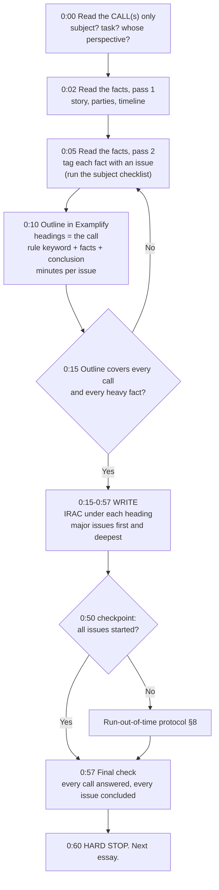

# The 60-minute essay method

You will write five one-hour essays [S-003]. Each is scored separately on the 40–100 scale [S-010]. This file is the method for every one of them. It is built on what the State Bar says it rewards ([grader-expectations.md](../00-exam-intel/grader-expectations.md) §1–§3):
- identifying the issues;
- telling material facts from immaterial ones;
- applying law to facts in a logical, lawyer-like way;
- answering the call, and nothing beyond it [S-076] [S-077].

## 1. The method at a glance



**Default split: about 15 minutes reading and outlining, about 45 minutes writing.** Adapt it:

| Essay type | Read + outline | Write | Why |
|---|---|---|---|
| Standard single-subject, 2–4 calls | 15 | 45 | Default |
| Dense crossover, or many parties | 18 | 42 | A missed issue costs more than a shorter paragraph |
| Short facts, one broad call ("Discuss") | 12 | 48 | Less to map, more to write |
| A subject you find hard | 15 | 45 | Do **not** add reading time. Outline what you can and write. |

Never go past 20 minutes before you start writing. An unwritten outline earns nothing.

## 2. Read the call first (0:00–0:02)

The call tells you:
- **The subject(s).** "What claims may Paula bring against Dan?" points to Torts. "What rights and liabilities do the parties have regarding the house?" may be Community Property.
- **The task.** "What arguments...", "Is the evidence admissible?", "What remedies...", "Discuss."
- **The perspective.** Whose claims, against whom.
- **The governing law**, if stated ("Answer according to California law"). See §6.
- **The structure of your answer.** Numbered calls become numbered headings.

**Copy each call into Examplify as a heading** before you read the facts. Your answer's skeleton then exists from minute one.

## 3. Issue-spotting (0:02–0:10)

**Pass 1, the story (about 3 min):** read straight through. Who are the parties, what happened, in what order, and what went wrong?

**Pass 2, active (about 5 min):** go fact by fact and ask **"why is this fact here?"**
- **Almost every fact is there for a reason.** A date suggests a timing rule (statute of limitations, revocation, anticipatory repudiation). A relationship suggests a duty, privilege or presumption. A state of mind suggests intent, mens rea or good faith. A dollar amount suggests damages or a jurisdictional amount.
- **Run the subject checklist.** Each subject will have a memorized checklist in `03-subjects/<slug>/issue-checklist.md` (built in Phase 4). Say the checklist in order and ask, for each item, "is this raised by these facts?" The checklist catches issues your reading misses.
- **Tag facts to issues.** In your Examplify outline, write the issue and paste or paraphrase the facts under it.
- **Facts left over?** If a fact has no issue after pass 2, look again. It probably signals one you missed.

**Do not over-read.** Take facts at face value and do not invent hidden facts. If a fact is ambiguous, argue both readings in the answer (§5); do not spend reading time resolving it.

## 4. Outline in Examplify (0:10–0:15)

Type the outline at the top of your answer. Write over it as you go, deleting each outline line once you have written its paragraph, so the grader does not see fragments.

**Outline format:**

```text
1. [Call 1 heading, e.g., "Lin v. Wen: Contract"]
   Consideration (R2d 71): bargain? | "quit... enroll" = price (L) vs. condition of gift (W) | -> likely no  [6 min]
2. [Call 2 heading]
   Promissory estoppel (R2d 90): promise | expect reliance | actual reliance | injustice | remedy  [14 min]
...
```

**Depth allocation by issue weight:**

| Issue type | How to recognize it | Share of writing time | Treatment |
|---|---|---|---|
| **Major** | Several facts are built around it; the call names it; both sides have real arguments | ~60–70% total across the major issues | Full IRAC, element by element, both sides |
| **Minor** | Raised by one or two facts; the answer is fairly clear | ~25–30% | Short IRAC: rule in one sentence, application in 2–3 sentences, conclusion |
| **Dismissal** | Plausibly raised but clearly fails, or is undisputed | ~5% | One or two sentences: "X is satisfied because [fact]." |

Write the minutes per issue in the outline. When an issue reaches its minutes, conclude it and move on.

## 5. Writing: IRAC under headings (0:15–0:57)

### Headings mirror the call
- Call 1 gets heading 1. Under it, one subheading per issue, in a logical order: threshold issues first (jurisdiction before merits, formation before breach, duty before breach).
- Graders read quickly and calibrate across many answers [S-010]. Headings let them find each issue in seconds.

### The paragraph pattern: rule → because → facts → therefore

**Issue (heading)**
**Rule:** 1–3 sentences, exam-ready, with authority where you know it.
**Application:** for each element, the pattern below.
**Conclusion:** one sentence, committed ("likely", "probably not").

```text
[Element] requires [rule]. Here, [specific fact], which [shows / does not show] [element]
because [your inference]. [Other party] will argue [counter-fact or counter-inference];
however, [why your side's reading is stronger]. Therefore, [element] is likely [met / not met].
```

- **Use the facts' own words** in short quoted fragments ("quit your job this summer"). This shows the grader you separated material facts from immaterial ones.
- **"Because" is the most valuable word in the answer.** Every conclusion needs a "because" that links a fact to an element.
- **Two-sided analysis.** Where facts cut both ways, argue both sides, then decide. Do not be one-sided, and do not leave it undecided.
- **CREAC** (Conclusion, Rule, Explanation, Application, Conclusion) is IRAC with the conclusion stated first. It suits persuasive PT tasks ([persuasive-brief.md](../04-performance-test/task-types/persuasive-brief.md)). On essays, plain IRAC is fine. Some writers put a one-line conclusion under each heading first; that is also fine.

> 🇨🇳 PRC bridge: a PRC judgment's "本院认为" (the court holds) section states the court's view and supporting articles. A bar essay instead has to show the contest: what each side argues, why one side wins, and how specific facts decide it (approx.).

### Rule statements
- Use the exact-rule cards from `03-subjects/<slug>/rule-statements.md` (the "**Rule (write this):**" line). They are written to be pasted from memory.
- **1–3 sentences.** Long rule recitations take time from application, where most points are ([grader-expectations.md](../00-exam-intel/grader-expectations.md) §4).

## 6. California law vs. general law: which rule to write

| Situation | What to write | Source |
|---|---|---|
| The call is silent on governing law | **Principles of general application** (majority / common law / Restatement / UCC). Add a one-line California flag only where California clearly diverges on a major point. | "Unless a question expressly asks you to use California law, you should answer according to legal theories and principles of general application." [S-077] |
| The call says "under California law" | California rule as the main rule. Add the general rule only if the call asks you to compare. | [S-077] |
| **Evidence** | Follow the call: FRE, CEC, or both. Be ready to **compare and contrast** the Federal Rules and the California Evidence Code. When the call asks for both, use a side-by-side or "Under the FRE... Under the CEC..." structure for each item of evidence. | [S-083] |
| **Civil Procedure** | Expect issues under both the **FRCP** and the **California CCP**. A case in California superior court is governed by California procedure; a case in federal court by the FRCP and Title 28. | [S-084] |
| **Professional Responsibility** | California Rules of Professional Conduct, relevant Business and Professions Code sections, and leading case law; the content outline also lists the ABA Model Rules and Model Code. When the call asks for ABA authorities too (recent calls do), give each rule and flag the differences. | [S-082] |
| **Community Property; Wills; Trusts** | California law. Community property is a California system; the Wills outline is keyed to the Probate Code [S-094]; the coverage matrix flags every Trusts row as California-specific. Trusts calls vary: some say "Under California law" (Feb 2012, Feb 2015), others reportedly do not [VERIFY V-550]. Read the call; state the general trust rule and cite the Probate Code section, flagging any California difference (see `03-subjects/trusts/ca-distinctions.md`). | [S-094] |

**Professional Responsibility can appear inside any subject** [S-082]. A Contracts or Civ Pro essay can carry an ethics call.

## 7. Crossover essays

Essays can combine subjects [S-097]. Organize the answer **by the call, not by the subject list in your head.**

| Call structure | Organization |
|---|---|
| Separate calls per subject ("1. Contracts... 2. Remedies...") | One heading per call, in order. |
| Calls by party ("What claims does A have against B? Against C?") | Party pair → claims → defenses → remedy for each claim. |
| One broad call ("Discuss.") | Subject A → issues in logical order; then subject B. Put threshold or enabling issues first, e.g., the validity of a will before its interpretation. |
| Claims plus remedies (e.g., Torts + Remedies, Contracts + Remedies) | Either a remedy section under each claim, or claims first and then one Remedies section that cross-references them ("For the conversion claim (§1.B)..."). Choose one and apply it consistently. |
| Ethics added to a substantive subject | A separate "Professional Responsibility" heading after the substantive analysis, unless the call puts ethics first. |

**Crossover traps:**
- Spending the whole hour on the familiar subject. Divide the minutes **by call** in the outline.
- Missing that the second subject changes the first. For example, a community-property characterization can decide who can make a gift by will.

## 8. Run-out-of-time protocol

At **0:50**, check: has every remaining issue at least been started?

**If not, switch to headline IRAC** for every remaining issue:
1. Heading.
2. One-sentence rule.
3. One or two sentences applying the single most important fact.
4. One-sentence conclusion.

That is about 60–90 seconds per issue. **Something under every call beats depth on one call.** An answer must attempt to apply law to facts to earn at least 40; otherwise it can score zero [S-010].

**At 0:60, stop**, even mid-sentence. Taking 10 minutes from the next essay risks two weak answers instead of one. With the Feb 2026 scaling formula, each raw point is worth about 2 total scaled points, so a whole call left blank costs far more than a thin paragraph ([format-and-scoring.md](../00-exam-intel/format-and-scoring.md) §2).

**Never** write "I ran out of time" or an outline-only list as your last section. Write sentences.

## 9. Worked mini-example (original hypothetical)

### Facts
Wen, a retired engineer, wrote to his niece Lin, a paralegal earning $55,000 a year: "I know you want to be a lawyer. Quit your job this summer and enroll in law school, and I will pay your $30,000 first-year tuition." Lin resigned, enrolled, and signed the school's tuition agreement. Two weeks before classes began, Wen wrote that he had changed his mind and would pay nothing.

**Call:** Can Lin enforce Wen's promise? Discuss.

### Outline (minutes 10–15, typed in Examplify)
```text
Lin v. Wen
1. Contract: consideration (R2d 71)   [7 min]
   L: "quit... enroll" = what W asked for; detriment: gave up $55k job
   W: no benefit to him; family gift; quitting = condition to use the gift
   -> likely no consideration (conditional gift)
2. Promissory estoppel (R2d 90)   [20 min]
   promise: written, specific, "I will pay"
   reasonably expected reliance: he TOLD her to quit
   actual reliance: resigned; signed tuition agreement; timing
   injustice: lost salary + tuition obligation; W: she wanted law school anyway
   remedy: expectation $30k vs. reliance; "as justice requires"
3. Conclusion
```

### Two IRAC paragraphs (exam format)

**1. Is Wen's promise an enforceable contract? Consideration**

A promise is enforceable as a contract only if it is supported by consideration: a performance or return promise that is bargained for, meaning that the promisor seeks it in exchange for his promise and the promisee gives it in exchange for that promise (Restatement (Second) of Contracts § 71).

Lin will argue that Wen bargained for her performance. His letter told her to "quit your job this summer and enroll," and she did both, giving up a $55,000 salary, which is a real legal detriment. However, Wen will argue that he received nothing he wanted for himself: the letter is a family member's offer of help with Lin's own ambition ("I know you want to be a lawyer"), and quitting and enrolling were simply the steps Lin had to take to use the gift, not a price he sought. Because the language and the family relationship point to benevolence rather than exchange, a court would likely find a conditional gratuitous promise. **Therefore, there is likely no consideration, and no enforceable contract.**

**2. Promissory estoppel**

Even without consideration, a promise is binding if the promisor should reasonably expect it to induce action or forbearance by the promisee, it does induce that action or forbearance, and injustice can be avoided only by enforcing it; the remedy may be limited as justice requires (Restatement (Second) of Contracts § 90(1)).

- **Promise.** Wen made a clear, written promise of a specific sum ("I will pay your $30,000 first-year tuition").
- **Reasonable expectation of reliance.** Wen should have expected reliance because he expressly asked for it: he told Lin to "quit your job."
- **Actual reliance.** Lin did rely. She resigned and signed a binding tuition agreement only after receiving the letter, and the timing shows the promise induced her action.
- **Injustice.** Wen may argue there is no injustice because Lin always wanted to attend law school and could withdraw or find another job. However, Lin has lost a salaried position and taken on a tuition obligation in direct response to Wen's request, so refusing enforcement would leave her worse off because she trusted him.

**Therefore, the promise is likely enforceable under § 90.** A court may award the promised $30,000 or limit recovery to Lin's reliance losses (for example, the tuition she is committed to and her lost income), as justice requires.

> 🇨🇳 PRC bridge: under PRC law this would likely be analysed as a gift contract, which the donor can generally revoke before the property is transferred. US law instead asks whether there was a **bargain** (consideration) and, if not, whether **reliance** makes the promise binding (approx.).

**What this example shows:**
- headings that mirror the call;
- a 1–2 sentence rule with authority;
- quoted facts;
- "will argue / however";
- a committed conclusion for each issue;
- a dismissal-length treatment of nothing important. Both issues here are major, so both get full IRAC.

## 10. Final 3 minutes (0:57–0:60)
- [ ] Every call has a heading, and every heading has a conclusion.
- [ ] No outline fragments are left at the top.
- [ ] Party names are used consistently.
- [ ] If time remains: add one more fact-based "because" to the closest issue.

## 11. Practice protocol
1. **First essays (W49):** untimed, with the outline, then compare against the model answer's issue list. Focus on issue-spotting.
2. **From W50 (foundation and integration):** timed at 60 minutes, then grade with `/essay`. It logs the attempt for you (`python scripts/quiz.py log --kind essay ...`).
3. **Intensive:** 4–5 timed essays a week (`01-study-plan/schedule.yml`), at least 30% crossovers. Include outline-only drills (`/spot`, 10 minutes) on extra past essays to multiply issue-spotting practice.
4. Track your **issue-spotting rate** (issues you found ÷ issues in the model list) separately from the score. If it is below about 80%, the fix is the checklists, not your writing.
